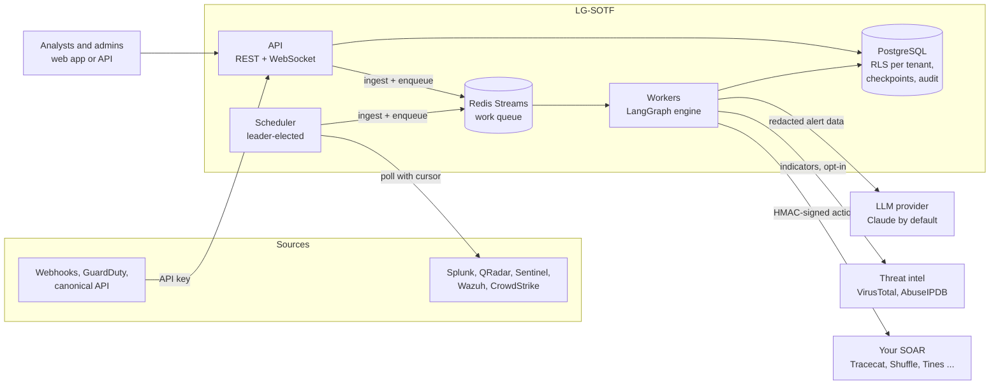
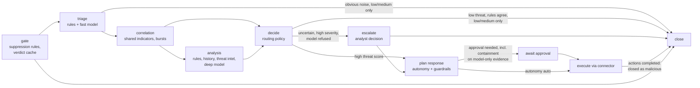
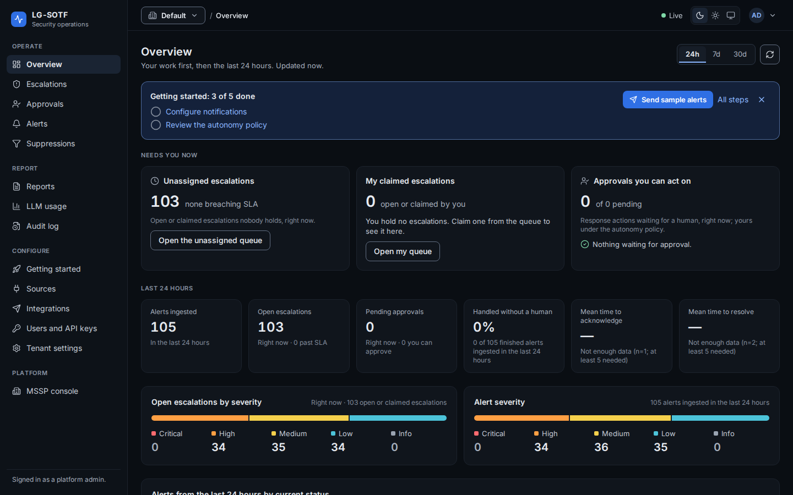
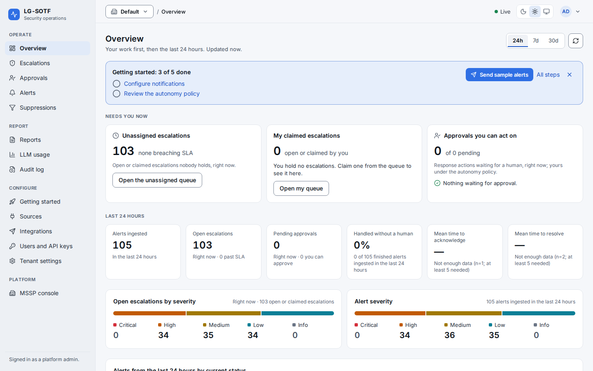
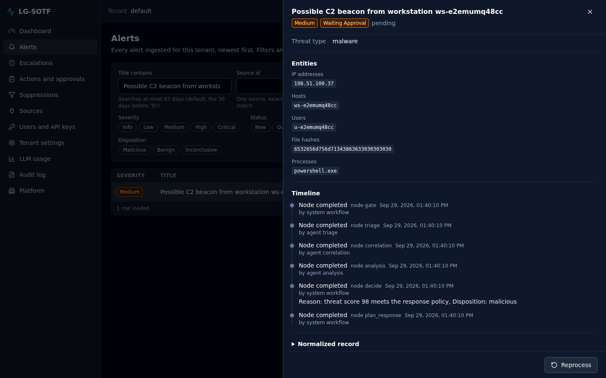
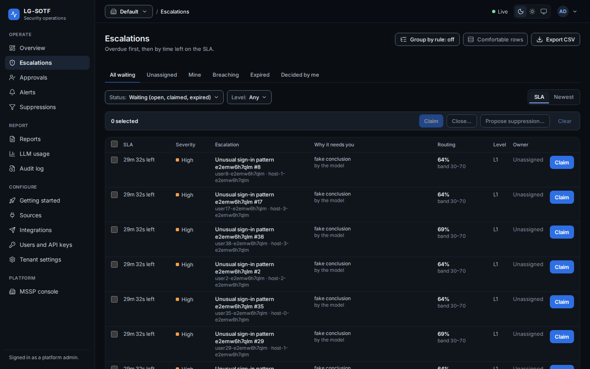
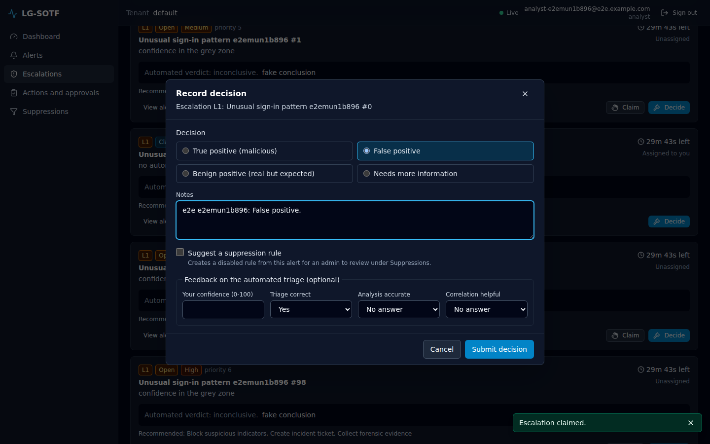
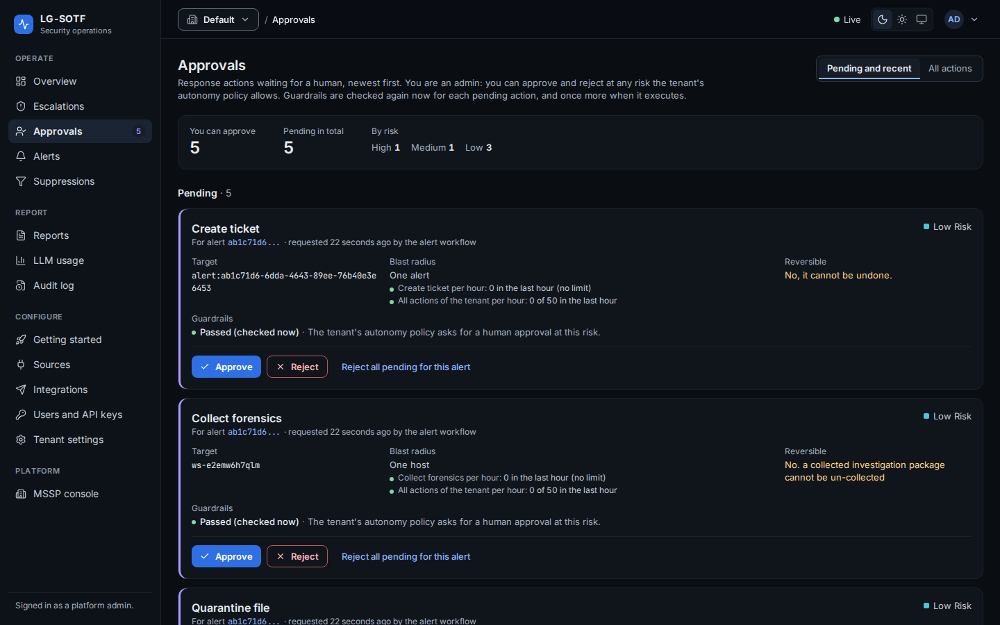

# LG-SOTF

[](https://github.com/gapilongo/SOC/actions/workflows/ci.yml)

[](LICENSE)

LG-SOTF is a multi-tenant AI triage platform for security alerts. It ingests
alerts from your SIEM, EDR and cloud detectors, investigates each one with a
LangGraph workflow of rule-based and LLM agents, closes obvious noise,
escalates everything uncertain or dangerous to your analysts with a written
assessment, and proposes response actions that run only under your policy,
guardrails and approvals.

It is built to be operated: durable queue-based workers with checkpointed
workflows, PostgreSQL row-level security per tenant, an audited decision
trail, metered LLM cost, Prometheus metrics, a Helm chart, and an evaluation
harness that measures what the platform would miss before you change a model
or a threshold.

**Your data, your model.** LG-SOTF runs entirely on your infrastructure,
including air-gapped networks, with Anthropic, OpenAI, Gemini or a model you
host yourself (Ollama, vLLM, any OpenAI-compatible server). It measures its
own accuracy against your analysts' decisions, and every case exports as a
verifiable evidence pack.

## How it works



Each alert runs through one workflow, checkpointed in PostgreSQL so a crashed
worker resumes where it stopped:



## What's new in 1.3

On `main` now. It ships first as 1.3.0 release candidates on the weekly
partner train, then as the stable 1.3.0 ([releases](docs/releases.md)).
Full list in the [changelog](CHANGELOG.md).

* **Proof-of-value install**: `scripts/pov.sh --siem-host HOST` starts a
  stack that can only read. Every response action is blocked or recorded as
  dry run whatever a tenant admin sets, mailbox sources that write back are
  refused, and outbound connections go only to the SIEM and the model
  endpoint. A test forces an approved action through a loosened tenant and
  checks nothing runs ([docs](docs/pov.md)).
* **First-run setup wizard**: five steps from a fresh install to the first
  triaged sample alert: account, organisation and first tenant, a
  language-model profile (EU-hosted or local, tested), sample alerts. CI
  times the whole path against a 30-minute budget
  ([docs](docs/onboarding.md#first-run-setup-wizard)).
* **Signed, verifiable releases**: both images are signed with cosign
  (keyless) and carry SLSA build provenance; the deploy workflow verifies
  both before anything reaches a host. Each release attaches CycloneDX
  SBOMs, an OpenVEX document and `SHA256SUMS`
  ([verify an image](docs/security.md#verify-an-image-yourself),
  [SBOMs and VEX](docs/security.md#sboms-and-vex)).
* **Release trains**: every Thursday the head of `main` becomes a signed
  partner release candidate; a candidate is promoted to stable and LTS.
  A commit is tagged only when its CI, upgrade and install rehearsals
  passed and its images verify. Support windows, backports and patch SLAs
  are published ([releases](docs/releases.md),
  [dependency policy](docs/dependency-policy.md)).
* **Pinned builds and a CVE gate**: every Python requirement is hash-locked
  and installed with `--require-hashes`, every base image is pinned by
  digest, and Trivy fails CI on any fixable critical or high CVE in either
  image ([docs](docs/security.md#pinned-inputs-and-the-image-cve-gate)).
* **Accuracy measured on a real model**: `lg-sotf eval-scorecard` turns
  evaluation runs into a one-page scorecard, false-negative rate first. The
  current one is DeepSeek V4 (open weights) on 520 generated Wazuh alerts:
  0 of 208 malicious alerts closed without a human, and 0 of 312 benign
  alerts closed by automation either
  ([scorecard](docs/scorecards/v2/deepseek-v4/scorecard.md),
  [why](docs/scorecards/v2/deepseek-v4/RUN.md),
  [how to read it](docs/scorecards/README.md)).
* **Confidence intervals on every rate**: evaluation reports, scorecards and
  the Reports pages show each rate with its sample size and a 95% Wilson
  interval, so a rate over a handful of alerts no longer reads as a firm
  number ([docs](docs/reporting.md)).
* **Investigation trace**: every model call and every threat-intelligence or
  history lookup is stored in order, with the prompt and model (or tool),
  tokens, latency and hashes of what went in and out, and appears in the case's
  evidence pack ([docs](docs/compliance.md#investigation-trace)). Each model
  call also records the name and hash of the prompt it sent.
* **Safe upgrades**: runs waiting for an analyst or an approval survive
  upgrades that change the workflow, and CI rehearses the upgrade from the
  previous release on every change: waiting runs must resume and be decided
  on the new version ([docs](docs/deployment.md#7-upgrades-and-migrations)).
* **API stability tiers**: every operation is marked `stable`, `beta` or
  `internal`. CI fails a breaking change to a stable operation, and a stable
  operation is deprecated for at least 6 months, with `Deprecation` and
  `Sunset` headers, before it changes
  ([docs](docs/api.md#stability-and-deprecation)).
* **Threat model v2 and hardening guide**: STRIDE per component, the OWASP
  Top 10 for Agentic Applications and MITRE ATLAS, each control linked to
  the code that enforces it ([threat model](docs/threat-model.md)); numbered
  L1/L2 deployment controls with checks for Compose, Helm, PostgreSQL, Redis
  and the reverse proxy ([hardening guide](docs/hardening.md)).
* **Evidence-fact schema v1**: the published JSON Schema for the typed
  observations that verdicts will cite, with SemVer and a CI breaking-change
  check. Published now; the investigation agents start producing facts in a
  later release ([docs](docs/evidence-facts.md)).

## What's new in 1.2

* **MCP for testers and analysts**: from Claude Code, send test alerts, wait
  for triage, read verdicts, reasoning and proposed actions, and score a run;
  decisions stay in the web app or Slack ([docs](docs/mcp.md),
  [design](docs/design/mcp-architecture.md)).

## What's new in 1.1

* **Actions that really happen, and are proven**: approved actions run
  directly in Microsoft 365 (purge and restore phishing emails, notify the
  reporter), Entra ID (disable, revoke sessions, reset password, confirm
  compromised) and Defender for Endpoint (isolate, block IP/domain/URL/file,
  collect forensics). Each action is re-checked against Microsoft, can be
  rolled back under the same approvals, and is routed per action type, so the
  rest can still go to your SOAR ([docs](docs/microsoft.md)).
* **SOAR templates**: a reference receiver and an n8n workflow for the
  signed webhook ([docs](docs/soar-playbooks.md)).

## What's new in 1.0

* **Phishing triage**: user-reported emails from a Microsoft 365 reporting
  mailbox, any IMAP mailbox (Google Workspace included) or
  `POST /api/v1/ingest/email`; authentication results, lookalike domains,
  display-name impersonation, deceptive links and risky attachments; purge
  message, block sender and notify reporter actions ([docs](docs/phishing.md)).
* **Integrations**: Slack, Microsoft Teams, email and signed-webhook
  notifications; approve or reject actions from Slack; one Jira or
  ServiceNow ticket per escalation, kept in sync ([docs](docs/integrations.md)).
* **Self-hosted models and air-gapped installs**: Ollama/vLLM providers with
  schema-constrained output and repair, zero-cost metering, a "Test model"
  button, an Ollama compose overlay and verified offline bundles
  ([local LLMs](docs/local-llm.md), [air-gapped](docs/air-gapped.md)).
* **Proof of value**: reports for alerts handled without a human, analyst
  hours saved, time to verdict, AI-versus-analyst accuracy (false-negative
  rate first), noisy detection rules, a printable monthly report, and
  `lg-sotf eval --from-history` to try a model on your own decided alerts
  ([docs](docs/reporting.md)).
* **MSSP console**: every tenant's activity, SLA risk and quota usage;
  suspend and reactivate; daily alert, source and user quotas; monthly usage
  export for invoicing; tenant profiles; a tenant switcher
  ([docs](docs/mssp.md)).
* **Identity**: TOTP MFA with recovery codes (required for platform admins
  in staging and production, optional per tenant), OIDC group-to-role
  mapping and just-in-time provisioning ([docs](docs/identity.md)).
* **Compliance**: signed case evidence packs with the human-oversight trail
  and audit-chain proof, NIS2 incident report drafts, GDPR tenant export and
  erasure ([docs](docs/compliance.md)).
* **MCP server**: `lg-sotf mcp` lets analysts work with LG-SOTF from Claude
  or any MCP client ([docs](docs/mcp.md)).
* **Quick start**: `make quickstart` goes from clone to triaged demo alerts
  and prints the measured time to first verdict ([docs](docs/quickstart.md));
  new tenants get a getting-started checklist and one-click sample alerts
  ([docs](docs/onboarding.md)).

## Features

**Ingestion**
* Pull connectors for Splunk (search jobs), IBM QRadar (offenses), Microsoft
  Sentinel (Log Analytics), Wazuh indexer and CrowdStrike Falcon (Alerts
  API v2), with persisted cursors, overlap windows, retries and an outbound
  destination policy (no SSRF into your network).
* Push ingestion: canonical alerts (`POST /api/v1/ingest/alerts`) and
  vendor-native webhooks (Splunk, CrowdStrike, Sentinel, Wazuh, GuardDuty via
  EventBridge, QRadar, or any JSON with a field map).
* Deterministic normalisation to one canonical alert model (a subset of OCSF
  Detection Finding) with entities and MITRE ATT&CK; secret redaction before
  anything is stored or sent to a model; deduplication by source alert id.

**Triage and investigation**
* Triage, correlation and analysis agents combining deterministic rules with
  a fast and a deep model tier (Anthropic Claude by default; OpenAI and
  Google Gemini as optional extras; a deterministic offline model for tests
  and demos).
* Correlation across the tenant's alerts by HMAC-hashed indicators; tenant
  alert history and optional threat-intelligence lookups (VirusTotal,
  AbuseIPDB) as evidence.
* Safety policy in code: automation never closes a high or critical alert
  as benign (only an analyst decision, an admin-enabled suppression rule or
  an analyst-confirmed verdict can); a low/medium benign close needs rule
  corroboration, not just the model; containment on model-only evidence
  always waits for approval; model refusals and suspected prompt injection
  go to a human. A response the policy started closes the alert as
  malicious once its actions complete (for example a ticket created under
  autonomy `auto`), whatever the severity.

**Human review**
* Escalations with levels, SLAs, escalation of overdue cases, grouping of
  related alerts into one case, claim/decide with optimistic locking, and
  decisions `true_positive`, `false_positive`, `benign_positive`,
  `needs_more_info` that resume the waiting workflows.
* Analyst feedback capture, suppression rules (analyst proposals enabled by
  admins) and suggestions from false-positive decisions.

**Response**
* A catalogue of containment and notification actions (block IP, domain or
  URL, isolate host, terminate process, quarantine file, disable user, reset
  password, revoke sessions, collect forensics, create ticket, notify),
  planned into an idempotent action ledger.
* Per-tenant autonomy per risk level, protected assets, allowed actions,
  hourly caps and blast-radius limits, re-checked right before execution.
* Dry-run by default; HMAC-signed webhooks to your SOAR for real execution.
  Direct Microsoft 365, Entra ID and Defender for Endpoint execution with
  verification and rollback; other vendors through your SOAR.

**Platform**
* Multi-tenant: PostgreSQL row-level security with a separate non-owner
  runtime role, tenant-scoped Redis keys and checkpoints, platform-admin
  cross-tenant access that is audited.
* Authentication: local accounts (argon2id, lockout, rotating refresh
  tokens), OIDC single sign-on, scoped API keys; roles viewer, analyst,
  admin.
* Append-only, hash-chained audit log per tenant with an API to verify it.
* LLM usage and cost metering per tenant, model and agent; per-tenant daily
  token budgets with rule-only fallback.
* Operations: API, worker, scheduler and migrate roles in one image;
  Redis Streams queue with dead-letter queue and CLI; crash recovery via
  leases and checkpoints; retention and partition maintenance; Prometheus
  metrics, JSON logs; Docker Compose and a Helm chart
  (HPA, KEDA, PDBs, NetworkPolicies, ServiceMonitors).
* Evaluation harness (`lg-sotf eval`) with a synthetic labelled dataset,
  adversarial prompt-injection cases, metrics with 95% intervals, a CI
  regression gate and one-page scorecards (`lg-sotf eval-scorecard`).
* Model provenance: every model call records the provider, model and the
  name and hash of the prompt it sent; an investigation trace of every step
  goes into the case's evidence pack.
* Upgrades: waiting runs finish on the workflow graph they started on, and
  CI rehearses the upgrade from the previous release on every change. The
  public API is split into `stable`, `beta` and `internal` operations, with
  a CI gate on breaking changes and a deprecation window for stable ones.
* Analyst web application (`src/lg_front`, React and TypeScript, a client
  of the public API only): a live Overview that puts the analyst's own work
  first, an alert queue with filters and a side panel per alert, an
  escalation queue with a decision page per escalation, approvals,
  suppressions, reports and tenant administration, in a dark (default),
  light or system theme. Served by a non-root nginx container under a
  strict Content-Security-Policy. Access tokens are kept in memory only.
  Shipped in the compose stack (`PROFILES=frontend`) and the Helm chart
  (`frontend.enabled`).

### Not in this release

No direct response integrations beyond Microsoft (other vendors go through
your SOAR; tickets and notifications are native), no native SAML
(use an OIDC broker such as Keycloak or Entra ID), no WebAuthn/passkeys, no
billing or self-service sign-up, no model fine-tuning or automatic threshold
learning, and no published accuracy figures on real customer data: the
accuracy report and `lg-sotf eval --from-history` measure it on yours.

## Product tour

A 75-second walkthrough. Captions explain each step: sign-in, the Overview
(your work first, then the window's figures), sending sample alerts, the
Alerts queue and one alert in its side panel, the Escalations queue and a
decision page, Approvals, integrations, tenant settings and the audit log. It
ends on the Overview in the light theme.


[Download the full-quality video (MP4, 1.6 MB)](docs/media/tour.mp4?raw=true). GitHub
plays the GIF above inline but only offers the MP4 as a download. The tour runs against the
same demo stack as the screenshots below: synthetic alerts and the offline
stand-in model. To record it again after a UI change, run
`scripts/record_tour.mjs`, then `scripts/make_tour_media.sh`. Both scripts
explain their usage at the top.

## Screenshots

Taken by the browser end-to-end suite (`scripts/e2e_ui_stack.sh`) against
the compose stack running the offline demo model: the alerts are the suite's
synthetic test alerts, and texts such as "fake conclusion" come from the
deterministic stand-in model, not from Claude.

| | |
|---|---|
|  |  |
| Overview: what needs you now, then the last 24 hours; updated live over the WebSocket | The same page in the light theme (dark, light or system, switched in the header) |
|  |  |
| Alerts queue with one alert open in the side panel: entities and workflow timeline | Escalation queue in SLA order, to claim one by one or in bulk |
|  |  |
| Decision page: the investigation next to the analyst's decision form | Approvals: response actions waiting for a human, with guardrails and blast radius |

More pages (sign-in, the alert queue, decided escalations, the actions
ledger, suppressions, sources, users and API keys, tenant settings, LLM usage
and the audit log) are in [docs/screenshots](docs/screenshots).

## Quickstart (Docker Compose)

The fastest path is one command: `make quickstart` (or
`scripts/quickstart.sh`) builds and starts the stack with the offline model,
seeds 16 demo alerts and prints the web UI address and the measured time to
the first verdict; `make quickstart OLLAMA=<model>` uses a local model. See
[docs/quickstart.md](docs/quickstart.md). The manual steps follow.

Requirements: Docker with Compose v2, GNU make, Python 3 (for the secret
generator), `curl`.

### 1. Offline demo with the fake model (no API key)

```sh
git clone https://github.com/gapilongo/SOC.git && cd SOC
make env                     # .env from .env.example plus fresh random secrets
echo 'LG_SOTF_AUTH__BOOTSTRAP_ADMIN_EMAIL=admin@example.com' >> .env
make up                      # builds the image; starts postgres, redis, migrate, api, worker, scheduler
curl -s localhost:8000/readyz
grep '^LG_SOTF_AUTH__BOOTSTRAP_ADMIN_PASSWORD=' .env   # the generated admin password
```

The default `LG_SOTF_LLM__PROVIDER=fake` is a deterministic keyword
heuristic that runs offline. It exercises the whole pipeline but is not a
detection model; staging and production refuse it.

Send an alert and review it through the API:

```sh
API=http://localhost:8000/api/v1
TOKEN=$(curl -s -X POST $API/auth/login -H 'Content-Type: application/json' \
  -d '{"email":"admin@example.com","password":"<password from .env>"}' | python3 -c 'import sys,json;print(json.load(sys.stdin)["access_token"])')

# An API key for senders (shown once)
KEY=$(curl -s -X POST $API/api-keys -H "Authorization: Bearer $TOKEN" -H 'Content-Type: application/json' \
  -d '{"name":"quickstart","scopes":["ingest"]}' | python3 -c 'import sys,json;print(json.load(sys.stdin)["key"])')

# Ingest a canonical alert
curl -s -X POST $API/ingest/alerts -H "X-API-Key: $KEY" -H 'Content-Type: application/json' \
  -d '[{"source_alert_id":"demo-1","title":"Mimikatz credential dumping on dc-01","severity":"high",
        "occurred_at":"2026-01-15T10:00:00Z","entities":{"hosts":["dc-01"],"users":["tadmin"]}}]'

# A few seconds later: the alert waits for an analyst, with an escalation
curl -s "$API/alerts?limit=5" -H "Authorization: Bearer $TOKEN"
curl -s "$API/escalations?status=open" -H "Authorization: Bearer $TOKEN"
# Claim (version from the escalation), decide, then approve proposed actions:
#   POST $API/escalations/<id>/claim     {"version": <v>}
#   POST $API/escalations/<id>/decision  {"version": <v+1>, "decision": "true_positive", "notes": "..."}
#   GET  $API/actions?status=awaiting_approval
#   POST $API/actions/<id>/approve       {"reject_remaining": true}
```

With the default `response.dry_run=true`, approved actions are recorded as
`dry_run` and nothing leaves the platform. Interactive API docs are at
`http://localhost:8000/docs`.

The analyst web app runs as a separate container (nginx serving the static
app and proxying `/api` to the api service). Start it with the rest of the
stack and sign in as `admin@example.com`:

```sh
make up PROFILES=frontend    # also builds and starts the web UI
```

Open **http://localhost:3000** (use `localhost`, not `127.0.0.1`: live
updates are accepted only from origins listed in `api.cors_origins`, and the
development configuration lists `http://localhost:3000`). The UI opens on
the Overview (your unassigned and overdue escalations, what you hold, the
approvals you can act on, then the window's figures); the sidebar leads to
the alert queue, escalations to claim and decide, approvals, suppressions
and reports. Admins also see Getting started, Sources, Integrations, Users
and API keys, Tenant settings, LLM usage and the Audit log. The header's
theme switch picks dark, light or the system setting.

Stop with `make down` (keeps data) or `make clean-volumes` (deletes it).
If you started the UI, pass the profile again (`make down PROFILES=frontend`):
without it the UI container keeps running and the stack's network cannot be
removed.

### 2. Real triage with Claude

Add your Anthropic API key to `.env` and restart:

```sh
cat >> .env <<'EOF'
LG_SOTF_LLM__PROVIDER=anthropic
ANTHROPIC_API_KEY=<your key>
EOF
make up
```

The fast tier (triage, correlation) defaults to `claude-haiku-4-5` and the
deep tier (analysis) to `claude-opus-5-5`; change them with
`LG_SOTF_LLM__FAST__MODEL` / `LG_SOTF_LLM__DEEP__MODEL` (set the tier's other
keys too, see docs/configuration.md). Every call is metered: see
`GET /api/v1/usage/llm` and set `LG_SOTF_LLM__DAILY_TOKEN_BUDGET_PER_TENANT` to
cap spend.

### Proof of value on your own alerts (read-only)

```sh
scripts/pov.sh --siem-host siem.example.internal    # or: make pov SIEM=siem.example.internal
```

One command starts a stack that can only read: response actions are blocked
or recorded as dry run whatever a tenant admin sets, mailbox sources that
mark or move messages are refused, and outbound connections go only to the
SIEM host(s) and the model endpoint (a local Ollama model by default).
Connect a source with read-only credentials; once analysts' decisions are in
the history, `scripts/pov.sh --backtest 90` compares the model with them. Helm users layer
`deploy/helm/lg-sotf/values-pov.yaml`. See [docs/pov.md](docs/pov.md).

### Production

Use the production compose override (two database roles, mandatory secrets)
or the Helm chart in `deploy/helm/lg-sotf`, with TLS in front of the API,
OIDC for analysts, and secrets from your secret store. Follow
[docs/deployment.md](docs/deployment.md). Before promoting an image, run
`make smoke`: it builds the image, starts its own throwaway stack, exercises
ingestion, triage and the API end to end, and tears the stack down. To check
a running deployment instead, run `scripts/smoke_stack.py --base-url ...
flow` with an admin's credentials (docs/deployment.md). For hosted dev and
uat environments (GitHub Actions to a free Oracle Cloud VM, HTTPS by Caddy,
automatic rollback) follow [docs/cicd.md](docs/cicd.md). Processes refuse to
start in `staging`/`production` with missing or placeholder secrets, the fake
model, wildcard CORS or insecure cookies.

## Configuration

All settings come from `LG_SOTF_<SECTION>__<KEY>` environment variables, an
optional `.env`, and an optional YAML file named by `LG_SOTF_CONFIG_FILE`.
Standard `DATABASE_URL`, `REDIS_URL` and `ANTHROPIC_API_KEY` are honoured.
The main groups:

| Section | What it controls |
|---|---|
| `database`, `redis` | Connections, pool sizes, TLS, the runtime and owner database roles |
| `llm` | Provider, fast and deep tier models, timeouts, concurrency, prompt size limits, budgets, prices |
| `auth` | JWT, session lifetimes, lockout, OIDC, bootstrap tenant and admin |
| `api` | Bind address, CORS, body limits, rate limits, metrics token, trusted proxies |
| `worker`, `scheduler` | Concurrency, timeouts, retries, dead-lettering, sweep intervals, leader lease |
| `response` | Dry-run switch, default autonomy, install-wide action cap and SOAR webhook |
| `retention` | Days to keep alerts, events, audit log, indicators, usage, checkpoints |
| `security` | Fernet encryption keys and the indicator HMAC key |
| `routing`, `ingestion`, `agents`, `tools` | Policy thresholds, ingestion limits, escalation defaults, enrichment providers |

Every setting, its environment variable and default is listed in
[docs/configuration.md](docs/configuration.md) (generated from the code).
Tenant policy (autonomy, protected assets, connector, review SLAs,
enrichment keys, token budget) is set per tenant through
`/api/v1/tenant/settings`.

## Security model in brief

* **Tenant isolation** in the database (row-level security, non-owner
  runtime role, `SECURITY DEFINER` credential lookups), in Redis keys, in
  workflow checkpoints and in caches.
* **Least authority for automation**: the model's opinion alone never closes
  a high or critical alert as benign and never triggers containment without
  approval; response actions
  pass autonomy policy and guardrails twice and default to dry run.
* **Prompt-injection defences**: alert data is redacted, size-capped,
  escaped and delimited as untrusted data; output is schema-validated;
  steering text is detected and treated as evidence of malice; an
  adversarial evaluation split is gated in CI.
* **Secrets** only from the environment, encrypted at rest where stored,
  write-only through the API; startup refuses unsafe production
  configuration.
* **Accountability**: every decision, approval and administrative change is
  in a hash-chained, append-only audit log.
* **Supply chain**: hash-locked Python dependencies, base images pinned by
  digest, a Trivy gate on both images, keyless cosign signatures and SLSA
  build provenance on every published image, verified by the deploy
  workflow before anything reaches a host; SBOMs and VEX on every release.

Personal data in alerts (names, addresses, hosts) is not pseudonymised and is
sent to the configured model provider when the LLM is enabled. Read
[docs/security.md](docs/security.md) for the controls and data handling,
[docs/threat-model.md](docs/threat-model.md) for the threat model (STRIDE,
OWASP Agentic Top 10, MITRE ATLAS), [docs/hardening.md](docs/hardening.md)
to harden a deployment, and [SECURITY.md](SECURITY.md) to report a
vulnerability.

### Verify a release

Images are signed from 1.3.0 on (and on every `main` build since signing
shipped). Verify the image digest you will run, not a tag. The signer must
be the release workflow on `main`:

```sh
SIGNER=https://github.com/gapilongo/SOC/.github/workflows/release-images.yml@refs/heads/main
ISSUER=https://token.actions.githubusercontent.com
IMAGE=ghcr.io/gapilongo/lg-sotf@sha256:<digest>
cosign verify --certificate-identity "$SIGNER" --certificate-oidc-issuer "$ISSUER" "$IMAGE"
gh attestation verify "oci://$IMAGE" --repo gapilongo/SOC \
    --cert-identity "$SIGNER" --cert-oidc-issuer "$ISSUER" --deny-self-hosted-runners
```

Do the same for `ghcr.io/gapilongo/lg-sotf-frontend`. Releases from 1.3.0
on also attach SBOMs, a VEX document and `SHA256SUMS`; how to fetch,
check and scan with them is in
[docs/security.md](docs/security.md#sboms-and-vex).

## Measuring quality

```sh
lg-sotf eval --dataset tests/fixtures/eval/synthetic_v1.jsonl --report ~/lg-sotf-eval/smoke.json \
             --thresholds tests/fixtures/eval/smoke_thresholds.yaml
```

The harness runs labelled alerts through the real ingestion and workflow in
fresh tenants (one per split, so split metrics are independent), never
invents analyst decisions, and reports the malicious
false-negative rate (threats closed without a human), benign auto-close rate,
escalation and inconclusive rates, per-class precision/recall/F1, Cohen's
kappa, cost and latency, with a regression gate for CI. The shipped dataset
is synthetic and the CI run uses the fake model, so those numbers check
plumbing and policy, not detection quality; export your analysts' decisions
to evaluate a real model ([docs/evaluation.md](docs/evaluation.md)).
Every rate comes with its sample size and a 95% Wilson interval.

`lg-sotf eval-scorecard` turns the reports of one model configuration into
a one-page scorecard.
[Scorecard v2](docs/scorecards/v2/deepseek-v4/scorecard.md) runs DeepSeek V4
(open weights under MIT, measured through the hosted API) on the 520 generated
Wazuh alerts of the attack-emulation corpus.
* **No misses.** It closed none of the 208 malicious alerts without a human,
  which bounds the miss rate below 1.8% (95%).
* **No benign closes either.** It also closed none of the 312 benign alerts.
  Every one went to an analyst or to an approval request, so on this corpus
  automation saves no analyst time yet.
* **Why.** [RUN.md](docs/scorecards/v2/deepseek-v4/RUN.md) traces it to the
  routing gates and to the replay, not to the model.

The earlier v1 baseline, a local `qwen2.5:7b` on the small hand-written sets,
is [kept for history](docs/scorecards/v1/qwen2.5-7b/scorecard.md). Read
[how to read a scorecard](docs/scorecards/README.md). Both are measured on
synthetic data, not on customer alerts.

## Development

```sh
python3.11 -m venv .venv && . .venv/bin/activate
make dev                     # hash-locked dependencies + editable install (re-lock: make lock)
make lint                    # ruff + mypy
make test                    # unit tests; integration tests need the variables below
export LG_SOTF_TEST_DATABASE_URL=postgresql://soc:<password>@127.0.0.1:5432/soc_test
export LG_SOTF_TEST_REDIS_URL=redis://127.0.0.1:6379/5
make test
```

Integration tests reset the database named in `LG_SOTF_TEST_DATABASE_URL`
(its name must contain `test`). LLM paths are tested with the fake provider;
no test needs network access. See [CONTRIBUTING.md](CONTRIBUTING.md).

The web app has its own unit tests (`npm run test:ci` in `src/lg_front`).
The browser end-to-end suite drives the real UI in Chromium against the
production-like compose stack (build, start, test, tear down):

```sh
(cd src/lg_front && npm ci && npx playwright install chromium)
scripts/e2e_ui_stack.sh      # --no-build to reuse images, --keep to leave the stack up
```

It signs in, provisions an analyst, a viewer and an ingest API key through
the UI, checks that the Overview updates live when alerts arrive, filters
and pages the alert list, opens a timeline, claims and decides an escalation,
approves a response until the alert closes, checks role gating, signs out,
and asserts that no token is kept in browser storage or written to the
container logs and that no page violates the Content-Security-Policy.

## Documentation

| | |
|---|---|
| [User guide](docs/user-guide.md) | Analyst and admin workflows |
| [Architecture](docs/architecture.md) | The system contract |
| [API](docs/api.md) | Authentication, roles, endpoints, events, stability tiers and deprecation |
| [Configuration](docs/configuration.md) | Every setting |
| [Deployment](docs/deployment.md) | Image, Compose, Helm, PostgreSQL roles, TLS, sizing, upgrades, backups |
| [CI/CD](docs/cicd.md) | Multi-arch images on GHCR, dev and uat on an Oracle Cloud Always Free VM, promotion, rollback, backups |
| [Self-hosting on a PC](docs/self-hosting-pc.md) | Dev and uat on your own Windows PC (WSL2, Tailscale Funnel), no cloud account |
| [Operations](docs/operations.md) | Runbooks, key rotation, incidents, dashboards and alerts |
| [Security](docs/security.md) | Controls, data handling, supply chain and how to verify images |
| [Threat model](docs/threat-model.md) | STRIDE per component, OWASP Agentic Top 10, MITRE ATLAS |
| [Hardening guide](docs/hardening.md) | Numbered L1/L2 deployment controls with checks |
| [Releases](docs/releases.md) | Release channels (partner, stable, LTS), support windows, backports |
| [Dependency policy](docs/dependency-policy.md) | Admission checklist for dependencies, patch SLAs |
| [Evaluation](docs/evaluation.md) | The evaluation harness |
| [Scorecards](docs/scorecards/README.md) | Accuracy scorecards per model configuration |
| [Evidence facts](docs/evidence-facts.md) | The evidence-fact schema v1 |
| [Quickstart](docs/quickstart.md) | One-command demo with measured time to first verdict |
| [Proof of value](docs/pov.md) | Read-only install on your own alerts, then the backtest |
| [Performance](docs/performance.md) | Load-test results and sizing |
| [Phishing](docs/phishing.md) | Reported-email triage, mailbox sources |
| [Integrations](docs/integrations.md) | Slack, Teams, email, webhooks, Jira, ServiceNow |
| [Reporting](docs/reporting.md) | Value, accuracy and detection reports, backtest |
| [MSSP operations](docs/mssp.md) | Console, suspension, quotas, usage metering |
| [Onboarding](docs/onboarding.md) | First-run setup wizard, getting-started checklist, sample alerts |
| [Identity](docs/identity.md) | MFA, OIDC role mapping and provisioning |
| [Compliance](docs/compliance.md) | Evidence packs, NIS2 drafts, tenant export and erasure |
| [Local LLMs](docs/local-llm.md) / [Air-gapped](docs/air-gapped.md) | Self-hosted models and offline installs |
| [MCP server](docs/mcp.md) | Using LG-SOTF from Claude or another MCP client |
| [Roadmap](docs/roadmap/README.md) | Engineering milestones and scheduled work, with what is done |
| [All documentation](docs/index.md) | Every document, by audience |
| [Changelog](CHANGELOG.md) | Release notes |

## License

Released under the [MIT License](LICENSE). Contributions are accepted under
the same license ([CONTRIBUTING.md](CONTRIBUTING.md)).
