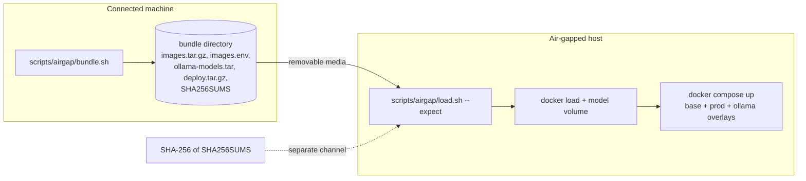

# Air-gapped installation

LG-SOTF runs with no internet access at all when the model is local
(docs/local-llm.md): the containers, the database, the queue and the model
all live on the host. This page moves everything the host needs across the
air gap and verifies it on arrival.



## 1. On a connected machine: build the bundle

You need the repository at the release you install, Docker with compose v2,
and the images: build them (`make image`, and the frontend with
`docker build -t lg-sotf-frontend:dev src/lg_front`) or pull the published
ones and name them with `APP_IMAGE` / `FRONTEND_IMAGE`.

```sh
# Models first: pull them into the ollama-models volume (only needed with --models)
echo "OLLAMA_MODEL=qwen3:8b" >> .env
docker compose -f docker/docker-compose.yml -f docker/docker-compose.ollama.yml \
    --profile ollama-pull run --rm ollama-pull

# The bundle: app, frontend, postgres, redis, ollama images + the models
scripts/airgap/bundle.sh --ollama --models --output /media/usb/lg-sotf-airgap
```

Options: `--ollama` adds the Ollama image (pinned by tag and digest in
`docker/docker-compose.ollama.yml`), `--models` archives the
`lg-sotf_ollama-models` volume (`OLLAMA_VOLUME` for another name),
`--models-dir ~/.ollama` archives an Ollama data directory instead, and
`--no-pull` refuses to download a missing image. Image references come from
`APP_IMAGE`, `FRONTEND_IMAGE`, `POSTGRES_IMAGE`, `REDIS_IMAGE` and
`OLLAMA_IMAGE`.

The bundle directory holds:

| File | Content |
|---|---|
| `images.tar.gz` | `docker save` of every image, gzip-compressed |
| `images.env` | the image references (`APP_IMAGE=...`), for the target's `.env` |
| `ollama-models.tar` | the Ollama model store (with `--models` / `--models-dir`) |
| `deploy.tar.gz` | compose files, configs, `.env.example`, `Makefile`, the secret generator, the quickstart, the demo alerts, these scripts and docs |
| `SHA256SUMS` | SHA-256 of every file above |

`bundle.sh` prints the SHA-256 of `SHA256SUMS` itself. **Send that value to
the target over a separate channel** (a ticket, a phone call, a signed
message): the manifest checks integrity, and the separately carried hash
makes sure nobody replaced the files and the manifest together.

A reference pinned by digest is saved under its tag (`ollama/ollama:0.35.0`),
because `docker load` does not restore registry digests; the digest was
verified when the image was pulled.

### Verify the published images before you bundle them

The published images are signed and carry build provenance
([security.md](security.md#verify-an-image-yourself)). Check them on the
connected machine, which still has access to Sigstore and GitHub. Then bundle
them by that digest, and take the signed copies and the Sigstore trust root
across with the bundle. You need cosign 3.0.6 or later and `gh`.

```sh
SIGNER=https://github.com/gapilongo/SOC/.github/workflows/release-images.yml@refs/heads/main
ISSUER=https://token.actions.githubusercontent.com
APP=ghcr.io/gapilongo/lg-sotf:v1.3.0@sha256:<digest>          # docs/security.md shows how to get it
FRONTEND=ghcr.io/gapilongo/lg-sotf-frontend:v1.3.0@sha256:<digest>

cosign initialize                                              # current Sigstore trust root (TUF)
SIGNED=/media/usb/lg-sotf-signed                               # next to the bundle, not inside it
mkdir -p "$SIGNED"
for ref in "$APP" "$FRONTEND"; do
  cosign verify --certificate-identity "$SIGNER" --certificate-oidc-issuer "$ISSUER" "$ref"
  gh attestation verify "oci://$ref" --repo gapilongo/SOC --cert-identity "$SIGNER" --deny-self-hosted-runners
  name="${ref##*/}"; name="${name%%:*}"
  cosign save --dir "$SIGNED/$name" "$ref"                     # image + signature + attestations
  (cd "$SIGNED" && gh attestation download "oci://$ref" --repo gapilongo/SOC)   # provenance, as evidence
done
cp ~/.sigstore/root/tuf-repo-cdn.sigstore.dev/targets/trusted_root.json "$SIGNED/"

APP_IMAGE="$APP" FRONTEND_IMAGE="$FRONTEND" scripts/airgap/bundle.sh --ollama --models --output /media/usb/lg-sotf-airgap
```

`bundle.sh` pulls a `name:tag@sha256:` reference by its digest, so the bundle
holds the bytes you just verified. Keep `lg-sotf-signed/` outside the bundle
directory, because `load.sh` refuses files that its manifest does not list.

## 2. On the air-gapped host: verify and load

```sh
mkdir -p /opt/lg-sotf && tar -xzf /media/usb/lg-sotf-airgap/deploy.tar.gz -C /opt/lg-sotf
cd /opt/lg-sotf
scripts/airgap/load.sh --expect <sha256 from step 1> /media/usb/lg-sotf-airgap
```

`load.sh` refuses the bundle, before loading anything, when the manifest's
hash differs from `--expect`, a listed file does not match, the manifest names
a path outside the bundle, or the bundle holds a file the manifest does not
list. Without `--expect` it checks the files against the manifest and warns
that the manifest itself is unauthenticated. Then it runs `docker load`,
restores the models into the `lg-sotf_ollama-models` volume (refusing a
volume that already has content unless `--force-models`; `--skip-models`
loads images only) and prints the image references. Helper containers run
with `--network none`.

Check `deploy.tar.gz` too before you extract it: it is covered by the manifest,
so run `load.sh` from a previously installed copy of the scripts, or compare
`sha256sum deploy.tar.gz` with its line in `SHA256SUMS` first.

To check the image signatures again on the air-gapped side, with no network
access, use the signed copies:

```sh
SIGNER=https://github.com/gapilongo/SOC/.github/workflows/release-images.yml@refs/heads/main
ISSUER=https://token.actions.githubusercontent.com
for dir in /media/usb/lg-sotf-signed/lg-sotf /media/usb/lg-sotf-signed/lg-sotf-frontend; do
  cosign verify --trusted-root /media/usb/lg-sotf-signed/trusted_root.json \
      --certificate-identity "$SIGNER" --certificate-oidc-issuer "$ISSUER" --local-image "$dir"
done
```

With an internal registry, push the signed copies instead of using
`docker load`: run `cosign load --dir /media/usb/lg-sotf-signed/lg-sotf
registry.internal/lg-sotf`, and the same for the frontend. Then run the images
from that registry by digest. The same `cosign verify
--trusted-root ...` command, given `registry.internal/lg-sotf@sha256:<digest>`,
checks the exact image you run, and an admission controller can enforce it.
The `sha256:<digest>.jsonl` files are the provenance attestations, kept as
evidence; they were verified on the connected machine.

## 3. Configure and start

```sh
install -m 600 .env.example .env
python3 scripts/generate_secrets.py --append .env      # secrets never leave the host
cat /media/usb/lg-sotf-airgap/images.env >> .env       # the loaded image references
cat >> .env <<'EOF'
OLLAMA_MODEL=qwen3:8b
LG_SOTF_AUTH__BOOTSTRAP_ADMIN_EMAIL=admin@corp.example
EOF

C="docker compose -f docker/docker-compose.yml -f docker/docker-compose.prod.yml -f docker/docker-compose.ollama.yml --env-file .env"
$C --profile frontend up -d --no-build --wait
```

`--no-build` matters: without it compose would try to build the images from
source. Nothing in this stack pulls from a registry once the images are
loaded; `docker compose ... config --images` lists what it expects.

Then:

* **Test the model**: Settings → Language model → Test model (or
  `POST /api/v1/tenant/llm/test`). Both tiers must answer.
* **First alerts**: `scripts/quickstart.sh --no-build --ollama qwen3:8b` does
  all of the above with a demo tenant and the demo alert set, or post
  `scripts/demo/alerts.json` yourself (docs/quickstart.md).
* **TLS**: put a reverse proxy with your internal CA in front of the UI; the
  production overlay sets `auth.cookie_secure=true` (docs/deployment.md).

## What stays offline

* The `ollama` service is attached only to the compose network `llm`, which is
  `internal: true`: no published port and no route out, even on a host that
  has one. Only the api and worker can reach it.
* The fake model, rules, enrichment caches and the web UI need no network.
  Enrichment providers (VirusTotal, AbuseIPDB) and response webhooks are off
  unless you configure them; on an air-gapped host leave them off or point
  them at internal services (the destination policy refuses metadata and, by
  default, private addresses for tenant-configured URLs).
* The frontend image serves static files only; it loads no fonts, scripts or
  telemetry from the internet.

## Updating

Build a new bundle for the new release (same steps), carry it over, run
`load.sh`, replace the deployment files from its `deploy.tar.gz`, update the
image references in `.env` and run `$C up -d --no-build --wait` again (the
one-shot `migrate` service upgrades the schema). To add or change a model,
bundle only the models: `scripts/airgap/bundle.sh --ollama --models` still
includes the images (they are small next to the models) and `load.sh
--force-models` restores the model store over the existing one.
