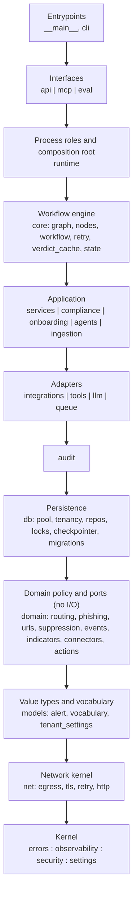

# Refactor roadmap

Status: plan of record. Baseline: `7f3d6de` (release 1.2.3). Owner: whoever merges the next step.
Scope: `src/lg_sotf` (about 70k lines of Python), `src/lg_front` (about 17k lines of TS/TSX), and the tests, CI and docs around them.
Behaviour is preserved unless a step says **Behaviour change**. Each behaviour change ships as its own PR and gets a CHANGELOG entry.

How to use this document:
- Each step is one PR, or a short series of PRs that each ship on their own.
- Start the PR title with the step id, for example `[C3] Move indicators to lg_sotf.domain`.
- In the same PR, delete the import-linter ignore lines and budget allowlist entries that the step makes unnecessary.
- Mark the step `(done in #NN)` here when it merges.

---

## 1. Target architecture

### 1.1 Backend layers



**Dependency rule.** An import may point only down this diagram.
- Siblings separated by `|` are independent: neither may import the other.
- Siblings separated by `:` (the kernel) may import each other.
- No package cycles.
- No function-local import whose only purpose is to dodge a cycle.
- Only entrypoints and `runtime` / `api/app.py` (the composition roots) build concrete adapters and read `get_settings()`.
- Every exception to the rule is written down in ADR-0001 and listed as one exact `ignore_imports` pair.

Extra contracts on top of the layers:

| Contract | Rule |
|---|---|
| api-no-workflow | `lg_sotf.api` never imports `core.{workflow,nodes,graph}`, `agents` or `langgraph`. The API never runs a workflow. |
| mcp-thin-client | `lg_sotf.mcp` never imports `db`, `queue`, `services`, `core`, `agents`, `llm`, `integrations`, `api`, `asyncpg` or `redis`. |
| infra-drivers | Application, adapter and domain packages never import `asyncpg`, `psycopg`, `psycopg_pool` or `langgraph`. Only `db`, `core` and `runtime` may. |
| integrations-are-adapters | `lg_sotf.integrations` never imports `services`, `core` or `agents`. |
| domain-pure | `lg_sotf.domain` and `lg_sotf.models` never import I/O libraries (`asyncpg`, `psycopg`, `redis`, `httpx`, `langgraph`, `langchain_core`, `fastapi`) or higher `lg_sotf` packages. |
| net-is-leaf | `lg_sotf.net` imports only `errors`, `observability`, `security`, `settings` and `httpx`. |
| routers-independent | `lg_sotf.api.routers.*` do not import each other. Shared code lives in `api/deps.py` or `api/common.py`. |

### 1.2 Who owns what

| Package | Owns | Must not contain |
|---|---|---|
| `cli`, `__main__` | Command-line wiring | Business rules |
| `api` | HTTP: routers (thin), auth, schemas, error mapping, `ApiContext` | SQL, transactions, workflow execution |
| `mcp` | MCP server; a thin REST client of `api` | Any direct DB or queue access |
| `eval` | Backtests and the eval harness | Its own copy of production state building |
| `runtime` | Worker, leader-elected scheduler, health, shutdown, ops; process wiring | Domain decisions |
| `core` | LangGraph engine: graph, nodes, workflow, retry, `core/state.py` TypedDicts | Pure policy that lower layers need |
| `services` | Use cases. Each use case owns its transaction and its audit write. Response, review, escalation, rollback, tenancy, reporting | SQL text, HTTP mechanics |
| `agents` | Triage, correlation and analysis agents | Persistence |
| `ingestion` | Pull and push sources, normalizers, ingest pipeline | Platform-wide egress or TLS code |
| `compliance`, `onboarding` | Evidence packs, GDPR, NIS2, onboarding flows | — |
| `integrations` | Outbound adapters: Microsoft, ticketing, channels, outbox delivery | Imports of `services` |
| `tools` | Enrichment providers | — |
| `llm` | Model clients, structured invocation, budgets | — |
| `queue` | Redis Streams producer, consumer, DLQ, event bus adapter | — |
| `audit` | `AuditLogger`, the only writer of audit rows | — |
| `db` | Pool, `tenant_tx`/`system_tx`, repositories (all SQL), locks registry, RLS, checkpointer, migrations | Reads of global settings |
| `domain` | Pure policy (routing, phishing, suppression), ports (`Connector`, `Verifier`, `EventPublisher`), action catalog | I/O |
| `models` | Value types and the domain vocabulary (`Literal` plus derived tuples) | Imports of other `lg_sotf` packages |
| `net` | SSRF egress policy, TLS verify and context cache, Retry-After and backoff, guarded client builder, capped reads | Domain imports |
| `errors` | Root exception classes (stdlib only) | — |
| `observability`, `security`, `settings` | Logging and tracing; crypto, redaction, signing, safe regex; typed configuration | — |

### 1.3 Frontend layers (`src/lg_front/src`)

`app/` (shell, routes, query client) → `pages/<feature>/` → `components/` (presentational only) → `lib/`, `api/`, `auth/`, `live/` (shared kernel).

The shared kernel never imports `pages` or `app`. `components/` never imports `api/endpoints` or `@tanstack/react-query`.

Three paths must not move: `src/main.tsx`, `src/auth/store.ts` and `src/auth/oidc.ts`. Python tests pin them.

---

## 2. Principles

1. **Dependency rule (Clean / Hexagonal Architecture).** Dependencies point inward and downward only. Enforced by import-linter.
2. **Acyclic and Stable Dependencies Principles (Martin).** No package cycles. Depend on small, stable leaf modules.
3. **Ports and adapters.** The inner layer owns the port (`domain/connectors.py`). Adapters import the port, never the service that uses it.
4. **Service layer, repository and unit of work (Architecture Patterns with Python).** Services own transactions. Repositories hold all SQL. `tenant_tx` is the unit of work.
5. **Functional core, imperative shell.** Security decisions (disposition, guardrails, routing) are pure functions with table-driven tests.
6. **Common Closure Principle.** Code that changes together lives together. Egress, TLS and Retry-After are one network concern.
7. **Single source of truth.** Each vocabulary, catalog, policy and HTTP primitive is declared once and imported everywhere else.
8. **Composition root.** Long-lived dependencies (`SecretBox`, TLS contexts, `Settings`) are built once per process and injected. No lazy service locators.
9. **12-factor config.** `lg_sotf.settings` is the only reader of the environment. Every process role validates its configuration at startup and fails fast.
10. **Executable architecture with ratchets (Building Evolutionary Architectures).** Contracts and budgets start green on today's code, and their allowlists can only shrink.
11. **Parallel change, minus the shims.** Moves are `git mv` plus a rewrite of every importer in the same PR. All consumers are in this repo, so no deprecation shims. The one exception is a re-export that serves tests or `examples/soar`.
12. **Move PRs are separate from behaviour PRs.** A pure move has no logic diff. A behaviour change is labelled and gets a CHANGELOG entry.
13. **Characterization tests first (Feathers).** Pin outputs with goldens before restructuring: error mapping, OpenAPI, evidence HTML, bundle digest.
14. **Testing pyramid.** A hermetic unit tier with no Postgres or Redis. Integration tests run on real services with RLS. Few end-to-end tests.
15. **Gradual typing to strict (mypy docs, Google Python style).** One config-owned file list. New leaf packages are strict from their first commit.
16. **`Literal` over `StrEnum` for vocabulary.** The LangGraph checkpoint serde encodes `Enum` members by import path, so persisted checkpoints would depend on module names.
17. **Tolerant reader.** Response models advertise enums but accept unknown values, which keeps rolling deploys safe. Request models validate strictly.
18. **Fail closed, log safely (OWASP Logging Cheat Sheet).** Exception text never goes into logs. Logs carry the error type and a frames-only stack.
19. **ADRs (Nygard, MADR).** Every structural rule and accepted exception has a numbered record under `docs/adr/`.
20. **FastAPI project structure.** Routers are thin HTTP adapters over the service layer.
21. **Frontend: query key factory, server state in React Query, a declarative route table, WCAG 2.2 AA.**

---

## 3. Guardrails in CI (land first, Phase 0)

| Guardrail | Mechanism | Starts at | Ratchet |
|---|---|---|---|
| Layer and package contracts | import-linter in `pyproject.toml` `[tool.importlinter]`, run by `make import-lint` and the CI Lint job | Green, with about 62 **exact** `importer -> imported` ignore pairs (no `**` wildcards), each commented with the step that removes it | Unmatched ignores fail. Each step deletes its lines. |
| Lint rules | ruff: add `BLE`, `A`, `RUF100`, `TID251` (ban `os.environ`/`os.getenv`/`os.putenv` outside `settings.py`), `T20` and `DTZ` (src only), `C901` with max-complexity 20 | Generated per-def `# noqa: C901` on today's offenders. No per-file ignores. | `RUF100` fails stale noqa. Max-complexity drops to 15 at the end. |
| Module and function size | `tests/unit/architecture/test_budgets.py` (AST) | Module ≤ 800 lines, function ≤ 80 lines; allowlist pinned at today's sizes (33 functions; `services/response.py`, `mcp/tester.py`, `services/reporting.py`) | Fails when an entry grows, or when it shrinks without its number being lowered. The failure message prints the new number. |
| Data-access rules | `tests/unit/architecture/test_data_access.py` | Raw SQL outside `db/` (str, f-string or `*_SQL` first argument; `pipe.execute()` is not flagged); `.tenant_tx/.system_tx/.connection` calls under `api/**` (about 14); `AuditLogger.record` without `conn=` (34 of 54); `get_settings()` outside composition roots (21); advisory-lock class numbers declared in `db/locks.py` and unique | Shrink-only allowlists. |
| Import isolation | `tests/unit/architecture/test_import_isolation.py` | Runs `python -c "import lg_sotf.<pkg>"` in a subprocess for each package root, plus an import-budget list (module X must not load Y) | Later steps add budget entries. |
| Type checking | `[tool.mypy] files = ["src/lg_sotf", "examples/soar/receiver", "examples/soar/n8n/build_workflow.py"]`; CI and `make` run bare `mypy` | All 283 files, after deleting 3 unused ignores | Strictness flags promoted globally. New leaf packages go on the strict list from day one. |
| Characterization goldens | `tests/unit/api/error_mapping.golden.json` (exception class → status and code via MRO); committed `docs/openapi.json` with a snapshot test | Today's output | Any diff is a reviewed artifact. |
| Frontend contract | `tests/deploy/test_frontend_contracts.py`: `lib/guardrails.ts` keys ⊇ `GUARDRAIL_REASONS`; `SOURCE_TYPES`, `INTEGRATION_KINDS` and `TICKETING_KINDS` equal the backend values. Later: `schema.gen.ts` diff check and `contract.check.ts` compiled by `tsc -b` | Green after G7 | — |
| Tenant isolation | `test_every_tenant_table_has_forced_rls_and_policy` discovers tables from `information_schema`. Later: a test comparing vocabulary with DB `CHECK` constraints | All tenant tables | — |
| Test hygiene | `pytest-timeout`, warnings as errors (unit tier), a separate service-free fast job, `--cov-fail-under` on the CI command, per-package floors for `runtime`, `security` and `api/auth` | Today's totals minus 1 point | Floors only go up. |
| Ownership | `.github/CODEOWNERS` on `.github/workflows/`, `scripts/ci/`, `requirements*.txt`, `pyproject.toml` and `tests/unit/architecture/` | — | Lowering a ratchet needs owner review. |

---

## 4. Roadmap

Legend:
- **Risk:** low or medium.
- **Effort:** S is up to 1 day, M is 2 to 5 days, L is more than a week.
- **Verify:** the existing ~4,355-case suite stays green unless the step says otherwise.

### Sequencing

- **Phase 0** comes first and in full. It changes no runtime behaviour.
- After Phase 0, four tracks run in parallel:
  - **Structure:** Phase 1 → Phase 2 → Phase 4 → Phase 5.
  - **Data and correctness:** Phase 3. D1, D2 and D3 can start right after Phase 0.
  - **Contracts and types:** Phase 6, after F2 and F10.
  - **Frontend:** Phase 7, after G6 and G7.
- Phase 8 (test-suite hygiene) can run at any time.
- These steps all touch `services/response.py`. Merge them in this order: F6 → C6 → D4.2 → S1 → S2 → D7.

---

### Phase 0 — Guardrails (no runtime change) (done in #82)

#### G1 · One toolchain configuration (done in #82)
- **Why:** `.pre-commit-config.yaml` (last changed in "sprint0") runs black at 88 columns, isort, flake8-docstrings, mypy 1.5.1 and bandit. CI and the Makefile run ruff 0.16.9 at 120 columns and mypy 2.3.1. The mypy path list is copied by hand in `ci.yml:51-66` and `Makefile:55-59`. About 21k lines are never type-checked directly: `api`, `core`, `eval`, `agents`, `compliance`, `tools` and `cli.py`.
- **Change:**
  - `.pre-commit-config.yaml`: keep the generic `pre-commit-hooks` and add `astral-sh/ruff-pre-commit` pinned to ruff 0.16.9. Remove black, isort, flake8, mirrors-mypy and bandit (bandit stays in `make security-scan` and the CI security job). Run `make typecheck` as a pre-push hook.
  - `pyproject.toml`: `[tool.mypy] files = [...]` as in section 3.
  - Delete the 3 unused ignores at `core/checkpointer.py:49,85,89`. Check them against the pinned `langgraph-checkpoint-postgres`.
  - Makefile: add `typecheck`, `import-lint` (placeholder), `test-fast` (`tests/unit tests/deploy`) and `check`.
  - The CI Lint job calls `make lint typecheck`.
  - Rewrite `tests/deploy/test_ci_workflow.py:183` to assert that both CI and the Makefile run bare `mypy`. Add an assertion that the pre-commit ruff rev equals the `requirements-dev.txt` pin.
  - Update the `CONTRIBUTING.md` setup to `pre-commit install && make check`.
- **Verify:** paste the mypy before and after file counts into the PR (227 files, then 283). No runtime code changes.
- **Risk / Effort / Deps:** low · S · none.

#### G2 · import-linter baseline contracts (done in #82)
- **Why:** `docs/architecture.md` states no dependency direction. Four package cycles exist: agents↔core, core↔db, core↔services and integrations↔services. 62 import lines break the intended layering, and nothing stops a 63rd.
- **Change:**
  - Add `import-linter` to the `[dev]` extra in `pyproject.toml`. Regenerate `requirements-dev.txt` with the pip-compile command in its header; never edit the `.txt` by hand. This also pins grimp.
  - `[tool.importlinter]`: `root_package = "lg_sotf"`, `include_external_packages = true`, `exclude_type_checking_imports = true`.
  - Contracts: the layers contract from section 1.1, plus independence of `api`, `mcp` and `runtime`, plus api-no-workflow, mcp-thin-client and infra-drivers.
  - `ignore_imports` lists exact pairs generated from grimp, grouped by the step that removes them (C1–C7, F3, F7) or by ADR-0001 (accepted). Sketch:
    ```toml
    layers = ["__main__", "cli", "api | mcp | eval", "runtime", "core",
              "services | compliance | onboarding | agents | ingestion",
              "integrations | tools | llm | queue", "audit", "db", "(domain)",
              "models", "(net)", "(errors) : observability : security : settings"]
    ignore_imports = [
      # C1 — routing/phishing move to lg_sotf.domain
      "lg_sotf.agents.triage.base -> lg_sotf.core.routing",
      # ADR-0001 accepted — lazy import inside Settings.production_problems
      "lg_sotf.settings -> lg_sotf.llm.endpoint",
    ]
    ```
  - CI Lint job: run `pip install --no-deps -e .`, then `lint-imports`.
- **Verify:** all contracts are KEPT on `681eafd`. The PR description shows that a deliberately added `integrations -> services` import fails.
- **Risk / Effort / Deps:** low · S · G1.

#### G3 · ADR log and ADR-0001 (layering) (done in #82)
- **Why:** decisions live only in prose or outside the repo. `docs/adr/` does not exist.
- **Change:**
  - Add `docs/adr/README.md` (index), `template.md` (MADR) and `0000-record-architecture-decisions.md`.
  - Add `0001-layering.md` covering:
    - the layer table;
    - every accepted exception (`settings -> llm.endpoint` lazy; the `TYPE_CHECKING`-only `ResponseAction` reference);
    - the `__init__` rule: a package `__init__` may eagerly import only its own modules that stay within kernel and domain layers.
  - Replace the package tree in `docs/architecture.md` §2 with a "layer / packages / may import" table that links ADR-0001.
  - Add the routers-independent contract with 6 exact ignores:
    - suppressions → alerts
    - audit → alerts
    - integrations → review
    - reports → suppressions
    - mfa → auth
    - platform → identity
  - Reserve ADR numbers 0002 to 0013 as listed in section 6.
- **Verify:** `lint-imports` is green.
- **Risk / Effort / Deps:** low · S · G2.

#### G4 · Ruff rule ratchet (done in #82)
- **Why:** the source has 65 `# noqa: BLE001` and 4 `# noqa: A002` for rules that are not enabled. Without RUF100, none of the 103 noqa comments is checked. The CONTRIBUTING rule "configuration only in settings.py" is not enforced.
- **Change:**
  - **PR 1:** enable `RUF100`, `BLE` and `A` together. Apply `ruff check --fix --select RUF100` (138 unused noqa). Annotate the 3 BLE sites in house style without changing the handlers: `eval/history.py:327`, `eval/runner.py:162` and `:177`.
  - **PR 2:**
    - `TID251` banned-api for `os.environ`, `os.getenv` and `os.putenv`, with the message "read configuration through lg_sotf.settings". Per-file ignores for `settings.py`, `tests/**` and `scripts/**`. Zero violations today.
    - `T20` for src only, exempting `cli.py` and `eval/command.py`.
    - `DTZ` for src only, with a reasoned noqa at `services/reporting.py:169`.
  - **PR 3:** `C901` with `max-complexity = 20`. Generate a per-def `# noqa: C901` for current offenders by script (about 53).
- **Verify:** no handler logic changes. Ruff is green.
- **Risk / Effort / Deps:** low · S · G1.

#### G5 · Architecture test suite (done in #82)
- **Why:** reviewers need objective thresholds. Import-linter cannot see SQL, transaction ownership, module size or runtime import cost.
- **Change:** add `tests/unit/architecture/` with:
  - `test_budgets.py`: the size budget described in section 3.
  - `test_data_access.py`: the raw-SQL, router-transaction, audit-without-conn, `get_settings()` and advisory-lock ratchets. The baseline is one `path::qualname` per line. Include a self-test showing that `await pipe.execute()` and `handler.execute(action)` are not flagged.
  - `test_import_isolation.py`: a subprocess import for each package root, plus an empty, extensible `BUDGETS` list of `(module, must_not_load)` pairs.
- **Verify:** green on HEAD. The tests run in the unit job.
- **Risk / Effort / Deps:** low · S · G1.

#### G6 · Characterization goldens: error mapping and OpenAPI (done in #82)
- **Why:** Phases 1, 2 and 6 move exception classes and touch routers. API status codes and the published contract must not change by accident.
- **Change:**
  - `tests/unit/api/test_error_mapping.py`: for every class handled in `api/errors.py install_error_handlers`, plus every `Exception` subclass defined in `lg_sotf`, resolve the handler through the MRO as Starlette does. Snapshot class → `(status, code)` to `error_mapping.golden.json`.
  - `scripts/export_openapi.py`: calls `create_app(settings, configure_observability=False).openapi()` with sorted keys, as in `tests/unit/api/test_app.py:36`. Commit the output as `docs/openapi.json`.
  - `tests/unit/api/test_openapi_snapshot.py`: on mismatch, prints the regenerate command. The snapshot churns on FastAPI or pydantic bumps; regenerating is one command.
- **Verify:** test-only change.
- **Risk / Effort / Deps:** low · S · none.

#### G7 · Frontend contract test and guardrail text fix (done in #82)
- **Why:** `lib/guardrails.ts` is missing `invalid_email`, `invalid_message` and `internal_sender` (`services/response.py:431-433`, emitted at `:1490`), plus the reviewer codes `rejected_by_reviewer` and `rejected_with_remaining` (`response.py:1890-1892`). Analysts see raw codes.
- **Change:**
  - Add `tests/deploy/test_frontend_contracts.py`. It imports `GUARDRAIL_REASONS`, `get_args(api.schemas.SourceType)`, `integrations.config.KINDS` and `TICKETING_KINDS`, and regex-parses the TS keys and arrays. It compares keys, not wording.
  - Add the missing descriptions to `lib/guardrails.ts`.
  - Add a vitest case for `describeBlockedReason('internal_sender')`.
- **Behaviour change:** UI text only. CHANGELOG entry.
- **Risk / Effort / Deps:** low · S · none.

#### G8 · Catalog-derived RLS test (done in #82)
- **Why:** `test_migrations.py:31-51` checks a hand-written table list, and `test_rls.py:21-39` already leaves out `user_mfa` and `usage_daily`. A new tenant table that nobody adds to the list is never checked for FORCE RLS.
- **Change:**
  - Discover tenant tables with the query from `tests/integration/api/test_compliance.py:441-443`: tables with a `tenant_id` column, excluding partitions. Assert `relrowsecurity`, `relforcerowsecurity` and a `tenant_isolation` policy for each, plus `tenants`.
  - Assert that the discovered set equals `test_rls.TENANT_TABLES`.
  - Add `user_mfa` and `usage_daily` to `seed_everything`.
- **Verify:** the integration job passes.
- **Risk / Effort / Deps:** low · S · none.

#### G9 · CI test hygiene (done in #82)
- **Why:** a hung async test burns the 30-minute job. One job runs everything, although the unit tier is hermetic and takes 54 s. `tests/deploy/test_funnel_workflow.py:27,63` pins an exact tailscale action SHA, which broke Dependabot run 40450658932.
- **Change:**
  - Split CI into a fast job (`pytest tests/unit tests/deploy` with no `LG_SOTF_TEST_*` env, which proves the tier is hermetic) and an integration job. Pin the split in `tests/deploy/test_ci_workflow.py`.
  - Add `pytest-timeout` to both the `[dev]` extra and the lock file, because `--strict-config` rejects the ini key without the plugin. Set `timeout = 120` and `timeout_method = "signal"`. Mark `e2e/test_processes` and `eval/test_runner` with 300 s.
  - Warnings: set `filterwarnings = ["error", ...]` for the unit tier after fixing the 3 known `ResourceWarning`s. For integration, start with `error::RuntimeWarning` and `error::pytest.PytestUnraisableExceptionWarning`.
  - Replace the exact-SHA assertion with "pinned to a 40-hex SHA with a `# vX.Y.Z` comment" (already enforced generically at `test_ci_workflow.py:28`).
- **Verify:** both jobs are green with the same total case count.
- **Left over (done in #85):** #82 turned only `RuntimeWarning` into an error. The leaks are fixed at their source (the stub API server in `tests/deploy/test_local_llm_deploy.py` was never `server_close()`d; the IMAP limit tests never closed their `makefile()` readers or the client, so the socket pair's descriptors outlived `close()` and surfaced in later tests). `ResourceWarning` and `PytestUnraisableExceptionWarning` are now errors for the whole suite, and `tests/unit/conftest.py` makes every warning an error in the unit tier, with no ignore-list.
- **Risk / Effort / Deps:** low · S · G1.

#### G10 · Coverage floors and runtime characterization tests (done in #82)
- **Why:** `coverage.xml` is produced but never read. `runtime` is the least covered package (82.0% line, 72.0% branch) and `shutdown.py` is at 50.8%. These code paths are untested: `cancel_and_wait`, `GracefulShutdown`, `wait_or_stop`, and the deep-backlog branch at `scheduler.py:461-465`. `db/migrations` shows 0%, which skews the totals.
- **Change:**
  - Add `tests/unit/runtime/test_shutdown.py`:
    - a second `handle()` triggers `on_force` once;
    - `on_force=None` makes the second signal a no-op;
    - `install()` outside the main thread installs nothing;
    - `cancel_and_wait(recancel_s=0.01)` finishes a task that swallows `CancelledError`, with no "never retrieved" warning;
    - `wait_or_stop` returns True or False correctly.
  - Add an integration test: create the workers group, `XADD` an entry with an ID one hour old, and assert that `claim_orphaned_runs(queued_older_than_s=None)` is called and `scheduler.orphan_queued_skipped` is logged. Add a fresh-entry case.
  - Fix migration coverage (`source_pkgs` or `[tool.coverage.paths]`), or omit `*/db/migrations/*` with a comment pointing to `test_migrations.py`.
  - Put `--cov-fail-under=<total-1>` on the CI command only, so local runs without services do not fail.
  - Add `scripts/ci/coverage_floors.py` for `runtime`, `security` and `api/auth`, with 1.0 point of slack and raise-only floors.
- **Risk / Effort / Deps:** low · M · G9.

#### G11 · CODEOWNERS on ratchets and supply chain (done in #82)
- **Why:** editing `scripts/ci/bandit-baseline.json`, `gitleaks.toml` or a ratchet allowlist silently disables a guard.
- **Change:** add owners for `.github/workflows/`, `scripts/ci/`, `requirements*.txt`, `pyproject.toml`, `tests/unit/architecture/` and `src/lg_front/eslint.config.js`, placed above the MCP rules. First confirm branch protection and how PRs from the sole owner get merged.
- **Risk / Effort / Deps:** low · S · none.

---

### Phase 1 — Foundations (leaf modules)

#### F1 · Kernel error module `lg_sotf/errors.py` (done in #86)
- **Why:** `db/errors.py:12` imports `StorageError` from `core.exceptions`. That is the only top-level db→core edge. `agents/correlation/base.py:37` imports `core.exceptions`. `ingestion/sources/netpolicy.py:34` needs `SourceConfigError` from a domain package.
- **Change:**
  - `git mv core/exceptions.py errors.py`. It holds `LG_SOTFError`, `WorkflowError`, `InvalidResumePayload`, `NodeError`, `NodeTimeout`, `AgentError` and `StorageError` verbatim.
  - Add `IngestionError` and `SourceConfigError` verbatim, keeping their names and bases. `ingestion/errors.py` imports them and keeps every subclass where it is.
  - Add `OperationError` with an unchanged `Exception` base. `runtime/ops.py` imports it, so `cli.py:38,460` keeps working.
  - Rewrite the importers: `db/errors.py`, `core/{retry,nodes,workflow}.py`, `agents/correlation/base.py`, `runtime/worker.py:49` and the tests. No shim.
  - Add a forbidden contract: `lg_sotf.errors` imports no `lg_sotf` module. Add it to the mypy strict list.
- **Verify:**
  - Assert `issubclass(SourceConfigError, IngestionError)`, `SourceConfigError.__name__ == "SourceConfigError"` and `ingestion.errors.SourceConfigError is lg_sotf.errors.SourceConfigError`.
  - `type(exc).__name__` is used in logs and `sources.last_error`, so class names must not change.
  - The G6 golden is unchanged.
  - Delete the ignores `db.errors -> core.exceptions` and `agents.* -> core.exceptions`.
- **Risk / Effort / Deps:** low · S · G2, G6.

#### F2 · Domain vocabulary `lg_sotf/models/vocabulary.py` (done in #91)
- **Why:** each vocabulary is declared 6 to 14 times. Severity alone has about 12 sites. Derived subsets are copied too: `BENIGN_DECISIONS` ×4, `SEVERITY_RANK` ×2, `HIGH_SEVERITIES` ×3, and `ENDED_RUN_STATUSES` equals `TERMINAL_RUN_STATUSES`. `tests/unit/ingestion/test_push_source_types.py` exists because this duplication already caused a production bug. The audit finding on role, scope and severity is still open.
- **Change:**
  - **F2.1:** create the module (stdlib only). Each vocabulary is one declaration, `AlertStatus = Literal[...]`, with `ALERT_STATUSES = get_args(AlertStatus)`. Cross-package sets only:
    - `Role` (plus `ROLE_RANK`, `REVIEWER_ROLES`)
    - `Scope`
    - `Severity` (moved from `models/alert.py`, which re-exports it; plus `SEVERITY_RANK`, `HIGH_SEVERITIES`)
    - `AlertStatus`, `Disposition`
    - `Decision` (plus `BENIGN_DECISIONS`)
    - `ActionStatus` (plus terminal and completed subsets)
    - `RiskLevel`, `AutonomyMode`, `VerificationState`
    - `EscalationStatus`, `EscalationLevel`
    - `RunStatus` (plus terminal)
    - `SourceType` (plus `PUSH_SOURCE_TYPES`)
    - `Route`
    - the actor constants `POLICY_APPROVER`, `REQUESTED_BY`, `WORKFLOW_OWNER`, `SCHEDULER_OWNER` and `EXECUTION_OWNERS`

    Add `tests/unit/models/test_vocabulary.py`, which compares every current redeclaration by set equality (order only for `ROLE_RANK`). Add ADR-0004.
  - **F2.2:** `db/repos/*` import from the vocabulary and keep their old names as re-exports.
  - **F2.3:** `api/auth/principal.py`, `api/schemas.py:14-20`, the router-local tuples, and `mcp/{tools,tester,runs}.py`. `models` is a pure leaf, so the thin-client rule still holds.
  - **F2.4:** the remaining copies in `services`, `core`, `eval`, `compliance`, `queue`, `integrations`, `settings.py:186-187` and `cli.py:146`, including the derived subsets and the copies of `POLICY_APPROVER` at `compliance/evidence.py:52`, `db/repos/reports.py:36` and `services/review.py:92`.
  - **F2.5:** `tests/integration/db/test_vocabulary_constraints.py` reads `pg_get_constraintdef` for every `CHECK` on `alerts`, `response_actions`, `escalations`, `sources`, `users`, `integrations` and the outbox, and asserts set equality.
- **Behaviour change (own commit inside F2.2):** `users.ROLES` and `cli.py:146` order roles `admin, analyst, viewer`. Switching to the canonical order changes the `check_choice` message and the CLI help. CHANGELOG entry.
- **Verify:** pure re-binding to identical values, checked by the set-equality test.
- **Risk / Effort / Deps:** low · M · G2.

#### F3 · Extract `lg_sotf.net` (egress, TLS, Retry-After) (done in #86)
- **Why:** install-wide SSRF and TLS controls live in `ingestion`. That causes 19 import lines from `llm`, `integrations`, `services`, `tools` and `mcp`, two of them function-local at `llm/endpoint.py:56,75`. `ingestion/__init__.py` eagerly imports every pull connector, so importing a 162-line policy module loads 62 modules, `db.repos` among them. The MCP stdio client loads 73 modules.
- **Change:**
  - `git mv`:
    - `ingestion/sources/netpolicy.py` → `net/egress.py`. `DestinationRefused(SourceConfigError)` now comes from `lg_sotf.errors`.
    - `build_verify` → `net/tls.py`.
    - `parse_retry_after` and `MAX_RETRY_AFTER_S` → `net/retry.py`.
  - `net/__init__.py` is empty; its docstring states the leaf rule.
  - `SourceHttpClient` and the auth strategies stay in ingestion.
  - Rewrite every importer in the same PR:
    - `ingestion/sources/*`
    - `llm/endpoint.py` (both imports become top-level)
    - `integrations/http.py`, `integrations/microsoft/{http,auth}.py`
    - `services/connectors/{webhook,registry,microsoft}.py`
    - `tools/enrichment/http.py` and the `tools/enrichment/__init__` re-export
    - `mcp/client.py`
    - tests
  - Move `tests/unit/ingestion/test_netpolicy.py` to `tests/unit/net/`.
  - Trim `ingestion/__init__.py` to the error re-exports plus `compute_fingerprint`. No `src` code does `from lg_sotf.ingestion import <name>`.
  - Add the net-is-leaf contract and a G5 budget entry: `lg_sotf.net.egress` loads neither `lg_sotf.db` nor `lg_sotf.ingestion`. Add `lg_sotf.net` to the mypy strict list.
- **Verify:**
  - Exception classes are identical, so every `except SourceConfigError`, `describe_error` (`ingestion/service.py:247`) and the `api/errors.py:183` mapping to 422 behave as before.
  - G6 is unchanged.
  - Only `httpx` attributes are monkeypatched in tests, and those survive the move.
  - Delete the ingestion ignore lines.
- **Risk / Effort / Deps:** low · M · F1, G5.

#### F4 · One reader of `allow_private_destinations` (done in #90)
- **Why:** the rule is copied at `integrations/http.py:91-96` and `services/connectors/registry.py:113-117`, and Microsoft overrides it at `microsoft/http.py:284-286`.
- **Change:**
  - Add `settings.IngestionSection`, the field-only pydantic model. It is not wired into `Settings` validation. `ingestion/options.IngestionOptions` subclasses it and keeps `from_settings`/`for_source`.
  - Add `net.egress.egress_policy(settings, *, require_https=None) -> DestinationPolicy`. Replace both copies with it. Microsoft calls it with `require_https=True`.
  - `ingestion/sources/base.py:94-96` keeps its strict read. ADR-0007 records the lenient-vs-strict split.
- **Verify:** new tests pin that an unrelated invalid key (`batch_size: 0`) yields `allow_private=False`, that `"true"` yields `True`, and that production still requires https.
- **Risk / Effort / Deps:** low · S · F3.

#### F5 · One backoff formula (done in #90)
- **Why:** `min(max, base*2**n)*(0.5+rand/2)` is written four times: `integrations/http.py:208`, `microsoft/http.py:317`, `ingestion/sources/http.py:287-288` and `webhook.py:333-334`.
- **Change:**
  - Add `net.retry.exp_backoff(attempt, base_s, max_s, rand)` and use it in the four sites, passing each class's existing `self._rand`.
  - Leave the other variants alone: `delivery`, `verification`, `llm/structured`, `imap`, worker resume and `mcp`. They differ on purpose, and one docstring sentence in `net/retry.py` says so.
- **Verify:** the tests that inject `rand` (`tests/unit/ingestion/test_http.py`, `services/test_webhook.py`, `integrations/microsoft/test_http.py`) see identical delays.
- **Risk / Effort / Deps:** low · S · F3.

#### F6 · Advisory lock registry (done in #90)
- **Why:** `ACTION_CAP_LOCK=710_020` (`response.py:275`) and `ESCALATION_GROUP_LOCK=710_021` (`escalation.py:112`) sit outside `db/locks.py`, which is supposed to own the lock namespaces.
- **Change:**
  - Add `ACTION_CAP`, `ESCALATION_GROUP` and `async def tenant_xact_lock(conn, lock_class, key)` to `db/locks.py`. It runs the same SQL: `SELECT pg_advisory_xact_lock($1, hashtext($2))`.
  - Use it in `services/escalation.py:388,597`, `services/response.py:2258,2517` and `db/repos/audit.py:71`.
  - Enable the G5 lock-uniqueness check with an empty allowlist.
- **Verify:** same SQL text and same class numbers.
- **Risk / Effort / Deps:** low · S · G5.

#### F7 · One owner-DSN helper (done in #90)
- **Why:** `compliance/ops.py:32` imports `runtime.ops` (an application package depending on a process role). The `migration_url or url` fallback is copied at `runtime/ops.py:34`, `runtime/leader.py:54` and `runtime/scheduler.py:649`.
- **Change:**
  - Add `db.pool.owner_dsn(settings)` and `owner_database(settings, application_name)`.
  - Point `runtime/ops.py`, `runtime/leader.py`, `runtime/scheduler.py`, `compliance/ops.py`, `eval/command.py` and `eval/runner.py` at them.
  - Delete the `compliance.ops -> runtime.ops` ignore.
- **Risk / Effort / Deps:** low · S · F1.

#### F8 · No global settings in the data layer (done in #90)
- **Why:** `get_settings()` is a hidden fallback at `users.py:233,352`, `runs.py:459`, `pool.py:142` and `retention.py:121`. Every production caller already passes explicit values.
- **Change:**
  - Make these required: keyword-only `max_attempts`/`lockout_minutes` on `UsersRepo.reserve_login_attempt` and `record_login_failure`, `max_attempts` on `RunsRepo.requeue_stale_all_tenants`, `settings: DatabaseSettings` on `Database`, and `RetentionSettings` on `purge_expired`.
  - Update `test_workflow_repos.py:204,207`, `test_runtime_role.py:136,138`, `test_migrations.py:159` and `test_auth.py:119-143`.
  - Remove the `db/**` entries from the G5 `get_settings()` allowlist.
- **Verify:** mypy flags any missed caller.
- **Risk / Effort / Deps:** low · S · G5.

- **Left over:** `db/migrate.py::_ssl_params` and `libpq_url` still fall back to `get_settings()` (two G5 baseline lines). They also serve hand-run `alembic` with `db/alembic.ini`; removing them means threading `DatabaseSettings` through every migrate helper and `env.py`, so it is its own step.

#### F9 · Typed DB connection (done in #91)
- **Why:** `Connection` aliases untyped `asyncpg.Connection`, so it resolves to `Any` (`db/repos/_base.py:30`, `db/pool.py:36`). There are 15 explicit `conn: Any` parameters: `services/review.py` ×7, `services/escalation.py` ×2, `integrations/outbox.py` ×5 and `eval/history.py` ×1.
- **Change:**
  - Add `db/types.py` with a `DbConnection` Protocol covering exactly the methods the code uses: `execute`, `fetch`, `fetchrow`, `fetchval`, `transaction`, `is_in_transaction`, `terminate`, `set_type_codec`, `is_closed` and `close`. Add `DbRecord`.
  - Keep one `Connection` alias, exported as `lg_sotf.db.Connection`.
  - Replace the `conn: Any` parameters. Use psycopg's `AsyncConnection` at `core/checkpointer.py:164`.
  - Add typed helpers `fetch_int`, `fetch_bool` and `affected` in `_base.py`.
  - Protocol rather than `asyncpg-stubs`: no new dependency.
- **Verify:** no runtime change; a Protocol is structural.
- **Risk / Effort / Deps:** low · S · G1.

#### F10 · mypy strictness promotion
- **Why:** strictness currently applies only to `settings`, `llm`, `security` and `observability`. The global `ignore_missing_imports` hides untyped dependencies.
- **Change:**
  - Make `disallow_untyped_defs` and `disallow_incomplete_defs` global.
  - Limit `ignore_missing_imports` to an override for `asyncpg.*` (and `re._parser`/`re._constants` only if mypy needs them).
  - Fix the about 33 `no-any-return` sites in two PRs (db first, then the rest), using the F9 helpers. Then set `warn_return_any` globally.
  - Add `[tool.pydantic-mypy] init_forbid_extra = true`.
  - The strict list gains `net`, `errors`, `models` and, after C1, `domain`.
  - Re-measure every count in the PR.
- **Risk / Effort / Deps:** low · M · F9.

#### F11 · `load_secret_box` and forwarding the injected box (done in #90)
- **Why:** there are five lazy loaders with three different failure behaviours. `ResponseService` receives a `secret_box` but builds `ConnectorRegistry` (`response.py:1592`) and `TicketService` (`:1662`) without it. `api/app.py:97` builds `ReviewService` without the box the context already holds.
- **Change:**
  - Add `security.crypto.load_secret_box(settings) -> Optional[SecretBox]`. It returns None if and only if keys are unset, and raises on invalid keys.
  - Use it at `api/app.py:81` and `runtime/scheduler.py:662`.
  - Forward the box to the registry, the ticket service and `ReviewService`.
- **Verify:** a test asserts that the injected box is the one used for webhook and ticket secrets. Semantics are identical, since the lazy loaders read the same keys.
- **Risk / Effort / Deps:** low · S · none.

---

### Phase 2 — Break the package cycles

`core` keeps its name and becomes the workflow engine only. See "Not doing" for why it is not renamed.

#### C1 · `lg_sotf.domain`: urls, phishing, routing (done in #89)
- **Why:** `core` mixes pure policy that lower layers import (`routing.py` has 12 importers, `phishing.py` 7) with orchestration that imports those same layers (`nodes.py:23-39`, `workflow.py:30-48`). That is the agents↔core cycle.
- **Change:**
  - `git mv`: `ingestion/email/urls.py` → `domain/urls.py`, `core/phishing.py` → `domain/phishing.py`, `core/routing.py` → `domain/routing.py`.
  - Rewrite all importers in src and tests, including `ingestion/email/{html,parser}.py` and `normalizers/email.py`. No shims.
  - Add the domain-pure contract.
  - Add a budget entry: `import lg_sotf.domain.phishing` loads neither `lg_sotf.db` nor `langchain_core`.
- **Verify:** pure move. Delete the `agents -> core.{routing,phishing}` ignores.
- **Risk / Effort / Deps:** low · M · F1, G5.

#### C2 · suppression and events to `domain` (done in #89)
- **Change:**
  - `git mv core/suppression.py core/events.py domain/`. `events.py` keeps the `EventPublisher` port, `make_event` and `publish_event`. `queue.events.EventBus` stays the adapter.
  - Rewrite `services/{dispatch,escalation,review,response,reporting}.py`, `integrations/delivery.py:373` (lazy import becomes top-level), the API routers, `api/errors.py`, `eval/dataset.py` and the agents.
- **Verify:** pure move. Delete the `services -> core.*` and `integrations.delivery -> core.events` ignores.
- **Risk / Effort / Deps:** low · S · C1.

#### C3 · indicators to `domain` (done in #89)
- **Why:** `services/response.py:639` lazily imports `agents.correlation.indicators`, which drags the agents and the LLM stack into the API's import graph.
- **Change:**
  - `git mv agents/correlation/indicators.py domain/indicators.py`. `agents/correlation/__init__` imports it from `domain`.
  - Make `response.py:639` a top-level import.
  - Add a budget entry: importing `lg_sotf.services.response` does not load `lg_sotf.agents`.
- **Verify:** the api-no-workflow contract loses its ignore.
- **Risk / Effort / Deps:** low · S · C1.

#### C4 · Checkpointer to `db` (done in #89)
- **Why:** `core/checkpointer.py` is the tenant-isolation (RLS) adapter for LangGraph checkpoints. `db/migrate.py:284` lazily imports it from `core`.
- **Change:**
  - `git mv core/checkpointer.py db/checkpointer.py`, verbatim. Do not export it from `db/__init__`, so API processes do not load langgraph.
  - Point `core/workflow.py:31` at the new path.
  - `db/migrate.py` keeps a function-local import, now intra-package, so Alembic runs (revision 0009 imports `migrate`) do not load langgraph.
  - Optional follow-up: extract `db.checkpointer.open_checkpointer(settings, size)` from `WorkflowEngine.create` (`core/workflow.py:192-207`).
- **Verify:**
  - `test_rls::test_checkpoint_tables_are_tenant_isolated` and the engine integration tests pass.
  - Persisted checkpoint format is unchanged: tables and serde are untouched.
  - The db contract now has zero ignores.
- **Risk / Effort / Deps:** low · S · F1.

#### C5 · Connector port to `domain/connectors.py` (done in #89)
- **Why:** 16 integrations modules import `ConnectorResult`, `VerificationResult` and `VerifyPlan` from `services/connectors/base.py`, so adapters depend on the application package that uses them.
- **Change:**
  - `git mv services/connectors/base.py domain/connectors.py`. It is stdlib-only, with a `TYPE_CHECKING`-only `ResponseAction` reference (recorded in ADR-0001).
  - `services/connectors/__init__` keeps re-exporting the names.
  - Rewrite the 16 integrations modules, `services/connectors/*`, `services/response.py:181` and the 15 test files.
- **Verify:** pure move. Delete the `integrations.* -> services.connectors.base` ignores.
- **Risk / Effort / Deps:** low · M · C1.

#### C6 · Action catalog to `domain/actions.py`
- **Why:** `ACTION_CATALOG` lives in the 2,707-line `services/response.py`. That forces function-local imports at `connectors/microsoft.py:251`, `connectors/routing.py:249` and `integrations/microsoft/catalog.py:58,177`.
- **Change:**
  - Move `TargetKind` (l.229), `ActionSpec` (l.309), `ACTION_CATALOG` (l.327), `FORWARD_OF`, `ACTION_TARGET_KINDS`, `DEFAULT_BLAST_RADIUS`, the reason-code constants and `GUARDRAIL_REASONS` (l.398-450).
  - `response.py` imports and re-exports them, so its 41 importers and the API are unchanged.
  - Turn the four function-local imports and `tests/fixtures/microsoft.py` into top-level imports of `lg_sotf.domain.actions`.
  - Actor constants come from `models.vocabulary` (F2).
- **Verify:** `check_invariants` and `tests/unit/integrations/microsoft/defender/test_catalog.py` guard the move. G7 still passes.
- **Risk / Effort / Deps:** low · S · C5, F2.1.

#### C7 · Webhook signing to `security/signing.py` (done in #89)
- **Change:**
  - Move the `X-LGSOTF-*` header constants, `SIGNATURE_VERSION`, `DEFAULT_TOLERANCE_S`, `MIN_SECRET_BYTES`, `_secret_bytes`, `sign`, `verify_signature`, `verify_request` and `encode_body`.
  - `webhook.py` re-exports them for `examples/soar`.
  - Point `integrations/channels.py:38` at the new module.
  - Add the integrations-are-adapters contract with zero ignores.
  - Leave `response.py:1287,1659` lazy. They keep `integrations.ticketing` off the API import path; change them only if a measurement shows a reason.
- **Verify:** examples/soar tests pass. The integrations↔services cycle is gone. `lint-imports` shows 0 package cycles.
- **Risk / Effort / Deps:** low · S · C5.

---

### Phase 3 — Data access and correctness

#### D1 · Audit entries commit with their change (done in #87)
- **Why:** `AuditLogger.record` promises that an action whose audit entry cannot be written is not reported as done (`audit/logger.py:43-47`). 34 of its 54 calls pass no `conn=`, and many record a change that has already committed:
  - sources CRUD (`api/routers/sources.py:122-170`)
  - integrations CRUD
  - suppressions
  - MFA enroll, regenerate and disable (`api/auth/mfa.py:175,257,270`)
  - `platform.create_tenant`
  - `runtime/ops.py:63-67,257`
  - compliance erasure, onboarding, tenant settings

  `runtime/scheduler.py:532` bypasses `AuditLogger` entirely, so there is no redaction and no log line. This audit finding is still open.
- **Change (one PR each):**
  - **D1.1:** add `AuditLogger.record_event`, which delegates with `conn=None` and documents a non-transactional access event. Switch the access and failure events to it: `auth/service.py` login_failed and friends, `authenticate.py:330,431`, `compliance.py:91`, `platform.py:203`, `ingest.py:150`. Tighten the G5 count.
  - **D1.2:** `MfaService` enroll, regenerate and disable each run in one `tenant_tx`, with `required_for(user)` computed first. Add a failure-injection test: `repos.audit.append` raises, and MFA stays enabled.
  - **D1.3:** sources and suppressions. Each create, update or delete plus its audit moves into a service function that owns one transaction. `sources.py:123` already holds a transaction for `ensure_capacity`. This also does D5 for these routers.
  - **D1.4:** integrations CRUD, `tenant.py:449`, `onboarding.py:79`, and compliance `erasure_started`. Streaming erasure batches stay as they are, documented.
  - **D1.5:** `scheduler.py:532` uses `self._audit.record(..., conn=conn)`. Add a G5 rule: `.audit.append(` appears only in `audit/logger.py` and `db/`.
  - **D1.6:** `record(..., *, conn)` becomes keyword-required. `record_event` is the only call without a connection.
- **Behaviour change:** an audit write failure now rolls back the change (500, nothing changed) instead of leaving it committed. CHANGELOG entry. ADR-0003 records the rule.
- **Risk / Effort / Deps:** medium · M · G5.

#### D2 · Atomic tenant provisioning shared by the API and the CLI (done in #87)
- **Why:** `api/routers/platform.py:219-297` runs up to 7 separate transactions, and `TenantsRepo.provision` uses an autocommit `_lookup`. If `users.create` fails, the tenant exists without an admin and a retry returns 409. `runtime/ops.py:229-272` is a second, divergent implementation.
- **Change:**
  - **D2.1:**
    - `TenantsRepo.provision(conn=None)`: with `conn`, it runs `lgsotf_create_tenant` on that connection. That function saves and restores `app.bypass_rls` with transaction-local `set_config` (migration 0002:28-38).
    - Add a public `db.tenancy.switch_tenant(conn, tenant_id)`. `Repository._switch_tenant` delegates to it.
    - Add an integration test under the runtime role: in one transaction, run provision, `update_settings`, `users.create` and the audit for the new tenant, switch tenants, then audit for the home tenant. Hash chains verify, and an exception leaves no rows.
  - **D2.2:** add `services/tenancy.provision_tenant(...)` with today's exact audit actions and details. Validation and argon2 hashing happen before the transaction, and cache invalidation after commit. Switch `platform.create_tenant` to it. Add failure-injection tests and a concurrent same-id test, which yields 409.
  - **D2.3:** `runtime/ops.create_tenant` uses `provision_tenant` on the owner database, keeping `'via': 'cli'` in the details.
  - **D2.4:** document atomic provisioning in `docs/mssp.md`. Add a G5 rule: `TenantsRepo.provision/create` is called only from `services/tenancy.py`, `db/` and migrate/bootstrap.
- **Behaviour change:** a failure leaves nothing behind, and a retry succeeds. CHANGELOG entry. A unified CLI password policy is a separate change, made only if it does not tighten what the CLI accepts today.
- **Risk / Effort / Deps:** medium · M · D1.1.

#### D3 · Cached TLS contexts (done in #86)
- **Why:** `IntegrationHttp._client` (`integrations/http.py:136-145`) and `WebhookConnector._client` (`webhook.py:321-330`) build a new transport, and with it a new `SSLContext` that loads the CA bundle synchronously on the event loop, on every call.
- **Change:**
  - Add `net/tls.py` `TlsContexts`: a process default (`httpx.create_ssl_context()`, as `microsoft/http.py:322` already does) and a 256-entry LRU of custom-CA contexts keyed by `sha256(pem)`.
  - Both classes use it.
- **Verify:** a test counts SSL context creations across two requests and expects 1.
- **Behaviour change:** performance only.
- **Risk / Effort / Deps:** low · S · F3.

#### D4 · All tenant SQL in repositories
- **Why:** there are about 35 domain queries outside `db/`. Three of them duplicate repository methods and differ in behaviour. `tests/unit/services/fakes.py:146-150` answers queries by string-matching SQL.
- **Change (one PR each; each deletes its G5 baseline lines):**
  - **D4.1:** add `allowed_from` to `EscalationsRepo.decide` (default `ACTIVE_ESCALATION_STATUSES`). `review.decide` passes `("expired",)` when the decision is late. Delete `_DECIDE_EXPIRED_SQL` and `_decide_expired` (`review.py:94-102,393-421`). This is equivalent because `now` is always passed, so `COALESCE($9, now())` equals `$8`. Covered by `test_review.py`.
  - **D4.2:** add `ActionsRepo.executed_counts(tenant_id, since=None, *, conn) -> (int, Dict[str,int])`, with the SQL moved verbatim from `response.py:277` (database clock). It replaces the test-only `count_executed_since`. Add `find_orphaned_executing` / `..._all_tenants`. `FakeActions` implements it, and `FakeConnection.fetch` stops sniffing SQL.
  - **D4.3:** split `db/repos/integrations.py` (662 lines, three aggregates) into `IntegrationsRepo`, `OutboxRepo` and `TicketsRepo`, exposed as `repos.outbox` and `repos.tickets`. Rewrite callers in the same PR.
  - **D4.4:** add connection-level query functions `alerts.event_summaries(conn, tenant_id, ids, exclude_source_id)`, which merges `outbox._ALERTS_SQL` and `ticketing._ALERT_SQL`, plus `outbox.matching_enabled(conn, ...)` and `enqueue_on(conn, ...)`. `IntegrationsRepo.enqueue` delegates. The `enqueue_event` signature and its 7 callers are unchanged. `ENQUEUE_SQL` becomes private.
  - **D4.5:** move the escalation grouping SQL (`_DETACHED_SQL`, `_ATTACHED_TO_SQL`, `_FIND_PARENT_SQL`, `_ATTACH_SQL`, `escalation.py:106-140`) into `EscalationsRepo` methods. The SQL is identical; `ACTIVE_ESCALATION_STATUSES` replaces the equal literal. Covered by `test_escalation_grouping.py`, including its spy.
  - **D4.6:** runtime sweeps (`runtime/orphans.py`, `runtime/resumes.py`) become `*_all_tenants` methods on `RunsRepo`, `AlertsRepo`, `EscalationsRepo` and `ActionsRepo`. The public functions and dataclasses stay as thin wrappers, and `scheduler.py` is untouched.
  - **D4.7:** `services/tenancy.ensure_capacity` uses `SourcesRepo.count` and `UsersRepo.count_active`. `db/errors` exports the transient-error tuple, and `core/retry.py` stops importing asyncpg.
- **Stays in the baseline, with a one-line justification each:** `compliance/tenant_data.py` (schema-wide streaming GDPR export with its own completeness test), `compliance/evidence.py:109`, the `eval/runner.py:314` schema probe, and `runtime/leader.py` (a session lock on a dedicated connection).
- **Caveat:** moving SQL behind `Repository._tenant` changes which errors surface (`_translated` maps them to `Conflict`, `ReferenceNotFound` and `InvalidValue`). Each moved method keeps the error types its callers catch.
- **Risk / Effort / Deps:** medium · M · F6, F9.

#### D5 · Routers own no transactions
- **Why:** 14 router call sites open transactions (in `alerts.py`, `identity.py`, `sources.py`, `platform.py`, `tenant.py`, `dashboard.py`, `compliance.py` and `auth/authenticate.py`), and there are 9 router-local `_audit` helpers.
- **Change:**
  - One router per PR. Each `async with ctx.db.tenant_tx(...)` block and its audit call move into a service function that takes the repos and the audit logger. For `authenticate`, the function goes in `api/auth`.
  - Add an `Actor(type, id)` value object and `Principal.actor` once the second router needs it.
  - The G5 router-transaction count drops to 0. Add ADR-0003: services own transactions.
- **Verify:** API integration tests pass unchanged.
- **Risk / Effort / Deps:** low · M · D1.3.

#### D6 · Pagination fixes
- **Change:**
  - **D6.1:** `db/pagination` exports `API_MAX_LIMIT = 200`. Replace the `MAX_LIMIT` copies (`alerts.py:29`, `audit.py:27`, `review.py:63`) and the `le=200` literals (`platform.py:448`, `integrations.py:712`). Use `check_limit` where limits are hand-checked (`runs.py:152`, `users.py:137`, `indicators.py:92`).
  - **D6.2:** add `SuppressionsRepo.find_reusable(tenant_id, match, now, *, conn)`, newest first with disabled rules included. Use it instead of the full scan at `review.py:567-570`.
  - **D6.3 (behaviour change):** `UsersRepo.list` becomes keyset over `(email, id)`. `identity.list_users` drains the pages, so the response body is unchanged and no longer truncates at 1,000 (`identity.py:97`). CHANGELOG entry.
  - **D6.4:** add a unit test: every public `list*` repository method returns `Page[...]` or appears in a documented `BOUNDED_LISTS` set (sources, users, integrations, api_keys, `list_all_tenants`).
- **Risk / Effort / Deps:** low · S · none.

#### D7 · SecretBox injected everywhere; fail fast in every role
- **Change:**
  - **D7.1:** thread `secret_box` through `WorkflowEngine.create` → `ResponseService`/`ReviewService`, `scheduler.py:382,586` and `EnrichmentService`. The worker root wraps `load_secret_box` in `try/except SecurityConfigError`, logs `worker.secret_box_unavailable` and passes None, which preserves today's behaviour. The lazy loaders log `security.secret_box_lazy_load` at warning level.
  - **D7.2 (behaviour change, ADR-0006):** remove the worker-root catch, so worker and scheduler refuse to start on invalid keys, as the API already does. CHANGELOG entry.
  - **D7.3:** delete the five lazy loaders: `delivery.py:147-152`, `ticketing.py:434-440`, `enrichment/service.py:273-281`, `response.py:1648-1656` and `registry.py:159-165`. Each class keeps its documented None-or-raise contract. Add a G5 rule: `SecretBox.from_settings` and `load_secret_box` are called only from `security/crypto.py`, `api/app.py`, `runtime/*.py` and `cli.py`.
- **Risk / Effort / Deps:** medium · S · F11.

#### D8 · Optional: one guarded state-transition helper
- **Why:** `EscalationsRepo._guarded_update`, `ActionsRepo.transition` (94 lines), `AlertsRepo.update_status` and `RunsRepo._finish` repeat the same sequence: a guarded UPDATE with a version check, a re-read, then classification into NotFound, Conflict or InvalidTransition. Their same-status policy differs.
- **Change:** add `_base.guarded_update(..., same_status=Policy.IDEMPOTENT|RAISE)` that keeps every SQL statement byte-identical. Adopt it one repo per commit.
- **Verify:** the repo integration tests.
- **Risk / Effort / Deps:** medium · M · D4.1. Do it only if a repo is being changed anyway.

---

### Phase 4 — Split the large modules

#### S1 · Pure approval disposition
- **Why:** `ResponseService.plan` (`response.py:1706-1808`, CC ≈ 30) decides when containment runs without a human. Right now that rule is reachable only through Postgres.
- **Change:**
  - **S1.1:** add a frozen `Disposition(status, explanation, approved_by=None, approval_reason=None)`, `AutoBudget(total, per_type)` with `can_auto`/`consume`, and a pure `dispose(cand, spec, ctx, policy, block, budget)` in `response.py`. Add a table-driven test of every branch:
    - guardrail block
    - pre-approval within and above the analyst's authority
    - llm_only containment
    - uncorroborated target
    - hourly cap
    - blast radius
    - auto
    - approval

    It asserts the exact explanation and approval_reason strings, and that the budget is consumed only on auto, including when `propose` returns an existing row.
  - **S1.2:** `plan()` uses `dispose()`. The sequence propose → record_transition → publish → `_approve_proposed`/`_settle_proposed` is unchanged. `plan()` leaves the budget allowlist and loses its noqa.
  - **S1.3:** add `guardrail_result(code, **detail)` for `block_approved`, `_block_approved` and `rollback.request`, producing byte-identical dicts.
  - **S1.4 (optional):** add a pure `dispose_rollback(...)` for `rollback.request`. The three in-transaction branches stay explicit.
- **Risk / Effort / Deps:** medium · M · C6.

#### S2 · `services/response` package
- **Why:** one 2,707-line file has at least seven reasons to change.
- **Change:**
  - **S2.1:** `git mv services/response.py services/response/__init__.py` with no content change. Add `tests/unit/services/test_response_api.py`, asserting that every pre-split `__all__` name and every name src or tests import still resolves.
  - **S2.2:** `targets.py` (target and IP library, stdlib only). Private helpers may lose their underscores. No aliases, because nothing outside the module uses them.
  - **S2.3:** `protected.py`, `policy.py` and `guardrails.py`. Put `_is_preapproved` in the planner so imports point one way. Retarget the `log` monkeypatch at `test_guardrails.py:241`.
  - **S2.4:** `planner.py` (playbooks, candidates, `dispose`). Add contracts: `integrations` and `services.connectors` must not import `services.response`, plus an intra-package layers contract derived from the actual imports, with `targets` at the bottom.
  - **S2.5:** `ledger.py` `ActionLedger`, as a pure move. `ResponseService` keeps one-line delegates for `record_transition`, `audit_action`, `publish_action` and `record_verification_outcome`.
  - **S2.6:** `execution.py` `ActionExecutor`, as a pure move.
    - `_verification_write` becomes pure, replacing the `__new__` hack in `test_verification_backoff.py:243`.
    - Retarget the `datetime` patch at `test_response_durability.py:78`.
    - Keep the `_run_connector` delegate for `test_response_halted.py:146,155`.
- **Verify:** each PR lands alone and is gated by the integration suites. Each submodule is ≤ 600 lines.
- **Risk / Effort / Deps:** medium · L · S1, D4.2, F6.

#### S3 · `ReviewService.decide` as named phases
- **Change:**
  - Add pure `_parse_decision`, `_authorise_approvals` and `_resume_requests`, with unit tests.
  - Add `_record_decision(conn, ...)` inside the same single `tenant_tx`.
  - `decide` (164 lines, CC ≈ 29) drops to about 45 lines and leaves the allowlist.
- **Risk / Effort / Deps:** medium · M · D4.1.

#### S4 · Escalation placement
- **Change:**
  - Add a pure `_place(policy, severity, threat_score, confidence, n_correlations, reason_code, now) -> _Placement`.
  - Add `_announce_created(conn, escalation, audit_action, details, alert_overrides)`.
  - The two `open_*` methods keep their own idempotency lookups and audit payloads, which differ on purpose.
- **Risk / Effort / Deps:** medium · S · D4.5.

#### S5 · LLM call pipeline
- **Change:**
  - **S5.1:** add `_CallMeter`, which replaces the four duplicated recorder and tally pairs in `ainvoke_structured` (`llm/structured.py:360-502`, CC ≈ 39). It records to the recorder first, then the tally. The `CancelledError` path still skips the error metric and the `llm.call_failed` log.
  - **S5.2:** extract `_plan_invoke` and `_invoke_with_transient_retry`, with the same jitter and the same log events.
  - **S5.3 (behaviour fix, own PR):** add a `_reserved` context manager that settles the reservation in `finally`. That covers cancellation (tokens used so far) and post-call exceptions (`_classify`, `extract_usage`, `record_samples`), which leak the reservation today. Tests for both. CHANGELOG entry.
  - **S5.4:** `AnalysisAgent`: extract a pure `_assemble_result` with tests for its three branches, then `_prompt_block` and `_reason`.
- **Verify:** `tests/unit/llm/test_structured.py`, including the `asyncio.sleep` patch.
- **Risk / Effort / Deps:** low · M · F10.

#### S6 · Evidence pack
- **Change:**
  - **S6.1:** add a golden HTML test and a `bundle_sha256` golden for a fixed pack. Move `render_evidence_html` and `_step_rows` to `compliance/evidence_html.py` and re-export them from `evidence.py`. Add a contract: `evidence_html` must not import `lg_sotf.db`.
  - **S6.2:** split `human_oversight` (CC ≈ 39) into `_audit_steps`, `_event_steps`, `_escalation_steps`, `_action_steps` and `_feedback_overrides`. Keep the pre-sort append order and the stable sort key, so the digest golden stays identical.
- **Risk / Effort / Deps:** low · S · F2.4.

#### S7 · Safe regex engine to `security/safe_regex.py`
- **Why:** `domain/suppression.py` (787 lines) holds a Thompson-NFA ReDoS-safe engine that depends on CPython-private `re._parser` and `re._constants`, next to the rule language.
- **Change:**
  - Move the engine (limits, `WorkBudget`, `validate_regex`, `SafePattern`, `compile_pattern`) verbatim, raising `InvalidPattern(ValueError)`.
  - Translate to `InvalidRule(str(exc)) from exc` at a few named sites: the exported wrappers, and the regex branches of `_evaluate` and `validate_rule_match`. Messages stay byte-identical because they reach API clients.
  - Move the engine tests to `tests/unit/security/`.
  - Add a Python-version guard test that fails loudly if `re._parser` or `re._constants` change shape.
  - Contract: `safe_regex` imports only the stdlib and `observability`.
- **Risk / Effort / Deps:** low · S · C2.

#### S8 · Ingestion batch helpers
- **Change:**
  - Extract a pure `_dedupe_batch` and `_assemble_result` from `IngestionService._ingest` (`ingestion/service.py:668-781`), with unit tests.
  - Optionally extract `_persist` by moving the whole single `tenant_tx` block (insert, usage, duplicate lookup, `queue_alerts`, `set_cursor`).
- **Risk / Effort / Deps:** low · S · G5.

#### S9 · Thin routers
- **Why:** there are six cross-router imports, and the API identity check and `runtime/ops.check_password` are two divergent password policies.
- **Change:**
  - Move the pure helpers into `api/common.py`: `reject_catch_all`, `aware`, and the mfa→auth rate-limit helpers.
  - Move `enqueue_resumes` into `services/review.py`.
  - Add a single password policy in `security/passwords.py`, used by `identity` and `runtime/ops`. If it tightens what the CLI accepts, that is a separate change with a CHANGELOG entry.
  - Slack stays in the API layer, because `slack_approver_refusal` uses `api.auth.mfa`. Only the outcome-message table and helpers move to `api/routers/_slack.py`.
  - The routers-independent contract reaches zero ignores.
- **Risk / Effort / Deps:** low · M · D5.

---

### Phase 5 — Cross-cutting consolidation

#### X1 · Failure logging and safe error text
- **Why:** there are 80 broad handlers. 58 of them log, and only 1 of those includes a traceback (`scheduler.py:240` logs `error=KeyError`). Error text is sanitised four ways, and two of them truncate before redacting, which can hide JWTs and API keys from the redaction patterns.
- **Change:**
  - **X1.1:** add `security.redaction.safe_text(text, limit)` (redact, collapse whitespace, then truncate) and `safe_error_text(exc, limit=300)`. Add `observability.logging.log_failure(logger, event, exc, *, level="error", **fields)`. It emits:
    - `error=type(exc).__name__`, the unchanged field value;
    - `stack`, the last 15 frames as `module:lineno in func` with no source text;
    - `cause_types`;
    - never the message.

    Tests feed in an exception whose message carries a JWT and alert text, and assert that neither appears in the output.
  - **X1.2:** migrate the `runtime/` handlers, keeping event names and keys.
  - **X1.3:** migrate `services`, `integrations`, `mcp` and `eval` the same way.
  - **X1.4 (behaviour change):** `sanitize_error`, `delivery.safe_error` (limit 1000), `http.error_snippet` and `mcp._safe_text` become wrappers. Redaction now runs before truncation, and `mcp` now redacts. CHANGELOG entry.
  - **X1.5 (behaviour change, ADR-0005):** `api/errors.py:161` and `api/middleware.py:120` switch from `exc_info=exc` to `log_failure`.
- **Risk / Effort / Deps:** low · M · G4.

#### X2 · Shared guarded-HTTP building blocks
- **Why:** seven outbound stacks each copy the client builder and the capped streaming read. `api/auth/oidc.py:186-193` reads the whole body before checking `MAX_JWKS_BYTES`. `IntegrationHttp` has no unit tests.
- **Change:**
  - **X2.1:** characterization tests with `httpx.MockTransport` in `tests/unit/integrations/test_http.py`:
    - retries
    - `idempotent=False` on read timeout and 5xx
    - Retry-After above 15 s
    - response cap
    - redirects not followed
    - refused destination
    - `invalid_ca`

    Add matching gap tests for `mcp/client.py` and `tools/enrichment/http.py`.
  - **X2.2:** add `net/http.py` with `read_capped(response, max_bytes)` (raises `ResponseTooLarge`) and `guarded_client(*, policy, verify, user_agent, timeout, base_url=None, transport=None, resolver=None, pin)`. Swap one stack per commit. Each stack maps `ResponseTooLarge` to its existing exception, then the private `_TooLarge`/`_ResponseTooLarge` classes are deleted. Move the D3 cache into `net/tls.py`.
  - **X2.3 (hardening):** `oidc._get_json` uses `client.stream` plus `read_capped`. Test that an oversized JWKS is refused before it is fully buffered.
  - **X2.4:** document the per-stack table of retry, idempotency, Retry-After and connection lifetime in `docs/architecture.md` §12. Add a ruff `TID251` ban on `httpx.AsyncHTTPTransport` outside `lg_sotf/net/**`.
- **Risk / Effort / Deps:** medium · M · F3, D3.

#### X3 · MCP Retry-After parsing (behaviour fix)
- **Change:** `mcp/client.py:260` uses `net.retry.parse_retry_after(value, cap=10.0)`. It now accepts HTTP-dates and fractional values, and the 10 s ceiling stays. CHANGELOG entry.
- **Risk / Effort / Deps:** low · S · F3.

#### X4 · No settings service locator
- **Why:** there are 21 `settings or get_settings()` fallbacks, for example `security/crypto.py:53`, `queue/producer.py:30`, `llm/budget.py:63`, `llm/prompting.py:379,446`, `observability/tracing.py:44` and `queue/{consumer,dlq,events}.py`.
- **Change:**
  - One module per PR: make `settings` a required parameter and pass it from the roots.
  - The G5 allowlist shrinks to `cli.py`, `api/app.py`, the `runtime/*` entrypoints and `settings.py`.
- **Risk / Effort / Deps:** low · M · F8.

#### X5 · Tracing decision (ADR-0008)
- **Why:** `observability/tracing.py` builds an OTLP provider, but `get_tracer` has zero callers. An operator who sets `observability.otlp_endpoint` gets nothing.
- **Change:** decide with the operator who would consume traces.
  - **Default if nobody commits to consuming them:** delete `tracing.py`, its four call sites and the three OTel dependencies. Keep accepting `otlp_endpoint` with a deprecation warning (Settings uses `extra="ignore"`).
  - **Otherwise:**
    - a `span()` helper that is a no-op without an endpoint;
    - a structlog `trace_id` processor;
    - API middleware spans (route template only) and `worker.process` spans;
    - an optional `traceparent` stream field (`parse_message` ignores unknown fields, so rolling deploys are safe);
    - node and LLM spans;
    - outbound spans only through an httpx event hook in `net.guarded_client` that records host, method and status, never the path or query. Slack and Teams webhook URLs are credentials.
- **Risk / Effort / Deps:** low · S (remove) or M (instrument) · X2.

---

### Phase 6 — Types and the API contract

#### T1 · Typed security edge
- **Change:**
  - Type `role_at_least(role: Optional[str], minimum: Role)`, `Access.role: Optional[Role]`, `Access.scope: Optional[Scope]`, `Principal.role: Optional[Role]` and `Principal.scopes: FrozenSet[Scope]`.
  - At the 4 construction sites in `authenticate.py` (205, 268, 303, 400), narrow with `cast`. No new runtime rejection.
- **Verify:** mypy now checks `deps.py:86-93`, `mfa.py:51`, `suppressions.py:85` and `ws.py:68,92`.
- **Risk / Effort / Deps:** low · S · F2.3, F10.

#### T2 · Vocabulary enums in OpenAPI (tolerant reader)
- **Change:**
  - In `api/schemas.py`, define module-level aliases, e.g. `AlertStatusStr = Annotated[str, WithJsonSchema({"type": "string", "enum": list(ALERT_STATUSES)})]`. Use aliases, not a function call inside the annotation.
  - Apply them to the 30 Out fields, one router group per commit, with tests that assert the enums.
  - Document the 4 untyped 200 responses with `responses={200: {"model": X}}`, not `response_model`, so runtime serialization of the export and evidence payloads does not change.
  - Regenerate `docs/openapi.json`; the diff is the review artifact. Add ADR-0009.
- **Risk / Effort / Deps:** low · M · G6, F2.3.

#### T3 · Typed workflow state
- **Change:**
  - **T3.1:** add `core/state.py`, which imports only `typing` and `models.vocabulary`. It holds `total=False` TypedDicts: `GateDigest`, `TriageDigest`, `CorrelationDigest`, `AnalysisDigest`, `DecisionDigest`, `PlanDigest`, `AnalystInput` and `ApprovalInput`. Annotate the 4 `digest()` methods via `cast`. Unit tests assert `set(result.digest()) <= Digest.__annotations__`.
  - **T3.2:** the `WorkflowState` fields in `core/graph.py` use them, imported at runtime because LangGraph resolves the state schema with `get_type_hints`. Add a test that builds the compiled graph. Fix mypy findings in `domain/routing.py` and `core/nodes.py`. Any real key mismatch changes a verdict, so it is a separate behaviour-fix commit with a regression test and a CHANGELOG entry.
  - **T3.3:** add an `AlertSummary` TypedDict. Type the writers in `core/nodes.py`, the `summary` parameter of `AlertsRepo.update`, and the readers in `compliance/{evidence,nis2}.py`. Do not touch `mcp/*`, which reads JSON over REST.
  - **T3.4:** advertise the summary schema with `Annotated[Dict[str, Any], WithJsonSchema(...)]`. No runtime validation.
- **Verify:** TypedDicts are erased at runtime, so checkpoints and JSONB are unchanged.
- **Risk / Effort / Deps:** low · M · F10, F2.

#### T4 · One initial-state factory
- **Why:** `eval/history.py:187 initial_state()` hand-copies how `WorkflowEngine` builds the initial state, and it has already drifted: `eval/history.py:220` accepts bools for the token budget, while `core/workflow.py:399` rejects them. Backtests can disagree with production.
- **Change:**
  - First, a characterization test that compares both outputs on fixture alerts.
  - Then add a single `core` function returning `WorkflowState`, used by both the engine and the backtest.
- **Behaviour change (backtest only):** the bool budget is now rejected in backtests too. CHANGELOG entry.
- **Risk / Effort / Deps:** low · S · T3.2.

#### T5 · Typed tenant-settings document
- **Why:** the allowed-key lists are declared twice (`tenant.py:83`, `tenancy.py:61`). `llm_daily_token_budget` is coerced in four readers (`core/workflow.py:375,399`, `compliance.py:157`, `ingestion/service.py:637`, `eval/history.py:220`), and the PATCH validator at `tenant.py:359-363` is a fifth copy of the rule.
- **Change:**
  - Add `models/tenant_settings.py` with `TenantSettingsDoc` (TypedDict, `total=False`), the key constants, and typed accessors such as `token_budget(doc) -> Optional[int]`, used by every reader and by the validator.
  - The section models (`PhishingSettings`, `ResponsePolicySettings`) keep their own fail-closed parsing.
- **Risk / Effort / Deps:** low · S · T4.

---

### Phase 7 — Frontend (`src/lg_front`)

#### FE1 · Coverage ratchet and characterization tests
- **Change:**
  - Add a pinned `@vitest/coverage-v8` with thresholds just below today's measured values, plus per-glob floors for `src/api`, `src/auth`, `src/live` and `src/lib`. Run it in `test:ci`.
  - New tests:
    - `createInvalidator`: fake timers; several events inside the 2 s window cause one invalidation per prefix; `cancel()` drops pending work.
    - `OidcCallback` single-flight: StrictMode double effect redeems once; the URL is cleared first.
    - `UsersPage`: the API-key secret is shown once and is gone after close.
    - `SourcesPage`: create, edit, remove credentials.
    - `SuppressionsPage` CRUD.
    - a `Dashboard` smoke test.
- **Risk / Effort / Deps:** low · M · none.

#### FE2 · One owner of session cache clearing
- **Why:** `Login.tsx:278` and `OidcCallback.tsx:41` call `queryClient.clear()`. `auth/cacheBinding.ts:37-40` documents that `clear()` alone is not enough, because a mounted observer keeps rendering another identity's data.
- **Change:**
  - Add a `cacheBinding` test: logging in after another identity's session renders no stale rows.
  - Route both call sites through `forgetCachedData`.
  - Ban `QueryClient.clear` outside `auth/cacheBinding.ts` with `no-restricted-syntax`.
- **Risk / Effort / Deps:** low · S · FE1.

#### FE3 · Guarded success-body parsing
- **Change:**
  - In `client.ts:221-224`, raise `ApiError({status, code: "invalid_response", requestId})` when the Content-Type is not JSON or `JSON.parse` throws.
  - Keep the existing handling of empty bodies, 204, blob and text.
  - Add tests for a 200 with an HTML body, an empty body and invalid JSON.
- **Behaviour change:** a misrouted `index.html` now shows an error card instead of a raw `SyntaxError`.
- **Risk / Effort / Deps:** low · S · none.

#### FE4 · Query-key factory and invalidation policies
- **Why:** there are 82 literal `queryKey`s. `PLATFORM_TENANTS_KEY` is queried four times with different options (`PlatformPage.tsx:167,308,526`, `TenantSwitcher.tsx:77`). `TenantSettingsPage.tsx:51` retypes `['onboarding-status']`.
- **Change:**
  - **FE4.1:** add `src/api/queryKeys.ts` (`qk.*`, `as const`, values identical to today's literals) with a prefix-invariant test: every list and detail key starts with its `.all` key. Migrate alerts, escalations, actions and tickets. `keysForEvent` keeps returning `string[]` (derived from `qk.*.all[0]`), so `createInvalidator`'s `Set<string>` deduplication still works.
  - **FE4.2:** migrate the remaining keys. Move `PLATFORM_TENANTS_KEY`, `ONBOARDING_KEY` and `STATUS_KEY` into `qk`. Add `usePlatformTenants({refetchInterval?, staleTime?, enabled?})` and pass each site's current options explicitly.
  - **FE4.3:** add `src/api/invalidate.ts` with named policies (`afterAlertChange`, `afterEscalationChange`, `afterActionChange`, …) that keep today's semantics. Add ESLint rules: no array-literal `queryKey`, and no `invalidateQueries` outside `api/invalidate.ts`, `lib/pagination.ts` and `auth/cacheBinding.ts`. Tests and `src/test/**` are exempt.
- **Risk / Effort / Deps:** low · M · FE1.

#### FE5 · Harden `useKeysetList` (audit finding, open)
- **Change:**
  - Keep `itemKey` in a latest-value ref.
  - Memoize the flattened list and `reload` on `hashKey(queryKey)`, which is already computed at `pagination.ts:127`.
  - Add a render-count test.
- **Verify:** no behaviour change.
- **Risk / Effort / Deps:** low · S · FE4.1.

#### FE6 · Bounded ticket lookup (audit finding, open)
- **Why:** `EscalationsPage.tsx:193-198` sends up to 200 UUIDs as query parameters, about 10 KB. That exceeds nginx's 8 KB `large_client_header_buffers`, so the request fails with a silent 414.
- **Change:**
  - Split the ids into chunks of at most 50, each fetched through `useQueries` with `qk.tickets.forEscalations(chunk)`.
  - Add a test: 200 escalations produce requests of at most about 4 KB each.
- **Behaviour change:** ticket links appear on full pages. CHANGELOG entry.
- **Risk / Effort / Deps:** low · S · FE4.1.

#### FE7 · Shared helpers
- **Change:**
  - Add `lib/json.ts` with `isJsonObject`, `asObject` (returns `{}`), `asObjectOrNull` and `parseJsonObject(text, what)`, which raises the exact `"<what> must be a JSON object."`. Add table tests. Replace the 7 `obj()` copies and the 3 textarea parses (`SourcesPage.tsx:162,206`, `IntegrationsPage.tsx:213`). Single-use siblings stay.
  - `downloadCsv`, `reports.downloadText` and `Mfa.downloadText` become wrappers over the existing `downloadBlob` (same BOM and MIME rules). Add a `download.test.ts`. Ban `URL.createObjectURL` outside `lib/download.ts`.
  - `UsagePage` uses `isoDay`/`defaultRange` from `lib/reports`.
  - **Behaviour change (own PR):** `UsagePage` calls `rangeError`, so the 366-day limit is reported before the request.
- **Risk / Effort / Deps:** low · S · FE1.

#### FE8 · Route registry and per-route error boundary
- **Why:** `NAV_ITEMS` (`Layout.tsx:42-59`) and the routes (`App.tsx:74-90`) have diverged: `/account` has no route gate. The only `ErrorBoundary` wraps the whole app.
- **Change:**
  - **FE8.1:** add `can.account` to `auth/roles.ts` and use it in `NAV_ITEMS`.
  - **FE8.2:** add `src/routes.tsx` `APP_ROUTES {path, Page, allowed, nav?}`. `App.tsx` maps it, and `NAV_ITEMS` is derived from it. Public routes (login, OIDC callback, printable report) stay inline. Add an `App.test.tsx` loop: for viewer, analyst, admin and the platform override, nav visibility equals the route gate.
  - **FE8.3 (behaviour fix):** gate `/account` with `can.account`.
  - **FE8.4:** `ErrorBoundary` gains `resetKey`/`fallback` props and wraps the `Outlet` in `Layout.tsx:232-236`, so the shell and sign-out survive a page crash. Chunk-load errors show "A new version is available, reload". Detection covers the Chrome, Firefox and Safari messages and `vite:preloadError`.
- **Risk / Effort / Deps:** low · S · FE1.

#### FE9 · Frontend structure and boundaries
- **Change:**
  - **FE9.1:** add a frontend section to `docs/architecture.md` and ADR-0010. Add ESLint `no-restricted-imports`: `src/{api,auth,live,lib,components}/**` may not import `pages/**` or `app/**`, and `src/{api,auth,live,lib}/**` may not import `components/**`. Both pass today.
  - **FE9.2:** `git mv` `App.tsx`, `routes.tsx`, `Layout.tsx` and `queryClient.ts` to `src/app/`. `main.tsx`, `auth/store.ts` and `auth/oidc.ts` stay, because Python tests pin them. Update `README.md:145-155`.
  - **FE9.3:** move data-fetching components next to their features: `TenantSwitcher` → `pages/platform/`, `Onboarding` → `pages/onboarding/`, `LlmTestCard` → `pages/settings/`, `components/actions/*` and `lib/guardrails.ts` → `pages/actions/`. Then enable "components may not import `api/endpoints` or `@tanstack/react-query`".
  - **FE9.4–6:** pure-move splits of `TenantSettingsPage` (633 lines) into `pages/settings/` sections, `PlatformPage` (650) into tabs, and `IntegrationsPage` (684) into `specs.ts`, `IntegrationForm.tsx`, `DeliveryLog.tsx` and the page. Split `pages/helpers.test.ts` into tests next to the modules they cover.
- **Risk / Effort / Deps:** low · M · FE4, FE8.

#### FE10 · Contract-checked API types
- **Change:**
  - Add a pinned `openapi-typescript` devDependency. `npm run gen:api` turns `docs/openapi.json` into `src/api/schema.gen.ts`. The CI frontend job runs `gen:api && git diff --exit-code`.
  - Add `src/api/contract.check.ts`, compiled by `tsc -b`. For responses, `Schemas['X']` must be assignable to the hand-written `X`. For requests, the hand-written `XIn` must be assignable to `Schemas['XIn']`. Fix the mismatches it finds.
  - Ban imports of `schema.gen` outside `src/api/`.
  - Type the vocabulary fields in `types.ts` with unions (taken from the schema once T2 lands) and the `Badge.tsx` tone maps as `Record<Union, Tone>`, keeping the runtime fallback for unknown values. `auth/roles.ts` and `UsersPage.tsx:16` use `Role`.
- **Verify:** types are erased, so there is no runtime change.
- **Risk / Effort / Deps:** low · M · G6, T2.

#### FE11 · Accessibility
- **Change:**
  - Extract `useFocusTrap(panelRef, open, {restoreFocus})` from `Dialog.tsx`'s `Modal`. `Dialog.test.tsx` passes unchanged.
  - Use the hook in the mobile nav (`Layout.tsx:100-114,180-185`), keeping Layout's own focus-to-`<main>` rule. Test that Tab and Shift+Tab stay inside the open menu.
  - Add a pinned `@axe-core/playwright` to the "main pages render under the CSP" scenario (`triage.spec.ts:461`), failing on serious or critical violations. Fix what it finds in the same PR.
  - Optional: an MFA enrollment and recovery-code e2e test, with the TOTP computed via `node:crypto`.
- **Behaviour change:** focus trapping in the mobile nav (WCAG 2.2 AA).
- **Risk / Effort / Deps:** low · M · FE1.

#### FE12 · Bounded refetch after mutations (needs product sign-off)
- **Why:** mutations invalidate list prefixes directly, so a 20-page list refetches all 20 pages one after another.
- **Change:**
  - Inside `invalidate.ts`, patch the changed row from the mutation response (`setQueriesData`), then call `invalidateBounded`.
  - Add a test: a 3-page escalations list issues at most one request, and the decided row shows its new status without a reload.
- **Behaviour change:** UX. CHANGELOG entry.
- **Risk / Effort / Deps:** medium · S · FE4.3.

---

### Phase 8 — Test-suite hygiene

#### Q1 · Controllable clock in the API harness
- **Change:**
  - `ApiHarness` gets a clock, and sets `api.ctx.limiter = RateLimiter(redis, prefix, clock=clock)` after startup.
  - Replace the 8 `fresh_rate_window` calls, which sleep up to 15.1 s, and freeze the clock in `test_auth.py:328`, which flakes when a test straddles a minute boundary. Delete `fresh_rate_window`.
- **Verify:** test-only change.
- **Risk / Effort / Deps:** low · S · none.

#### Q2 · Fixture and helper consolidation
- **Change:**
  - Move the real-Redis case from `tests/unit/llm/test_budget.py` to `tests/integration/llm/`. Delete the root `redis_url`/`redis_client` (which shadow the flushing ones) and the unused `requires_*` markers. Move `integration/db/test_helpers_unit.py` to `tests/unit/db/`.
  - Add a collection check: a `tests/unit` item that requests `db`, `repos`, `redis_client` or `migrated_database_url` fails.
  - Move `ApiHarness`, `PASSWORD`, `password_hash` and the `TENANT_*` constants into `tests/integration/api/_support.py` (25 importers). Do the same for `MicrosoftEnv`. Replace the `F401` fixture re-export.
  - Move helpers that tests import from other test modules (`runtime/test_worker.py`, `db/test_rls.py`, `ingestion/test_poll.py`, `deploy/test_compose.py`, `unit/agents/test_triage.py`) into the nearest `_support.py`. Add a grep test that bans `from tests.*conftest import` and `from tests.*.test_` imports.
  - Merge the duplicated session checkpointer fixture into `tests/integration/conftest.py`. Assert that every public non-partition table except `alembic_version` is in `ALL_TABLES` or `CHECKPOINT_TABLES`.
- **Risk / Effort / Deps:** low · M · G9.

#### Q3 · Injectable clock in runtime timing paths
- **Change:**
  - Add a defaulted `clock: Callable[[], float] = time.time` to `oldest_undelivered_age_s` (`runtime/orphans.py:129`) and to the worker and scheduler constructors, wherever the time is read in Python. Redis-side idle times stay real.
  - Replace the fixed 1.1–1.6 s sleeps that depend on Python-side time in `runtime/test_worker.py`, `e2e/test_recovery.py` and `runtime/test_scheduler.py`.
- **Verify:** production defaults are unchanged.
- **Risk / Effort / Deps:** low · S · G10.

#### Q4 · Parallel integration tier
- **Change:**
  - `database_url` becomes `<name>_gw<N>` (`CREATE DATABASE` if missing; the `test` name guard stays). The Redis DB index becomes base + N, refusing above 15.
  - Add a guard that fails any harness built without `unique_prefix`, because pub/sub ignores DB indexes.
  - Run `-n 4 --dist loadfile` in a non-blocking job for about 10 green runs, comparing junit totals with the serial run, then make it blocking. Keep `make test-serial`.
  - Add a nightly `-p randomly` job with a pinned `pytest-randomly`.
- **Risk / Effort / Deps:** medium · M · Q2.

#### Q5 · One-command onboarding and testing docs
- **Change:**
  - Extract `scripts/ci/create_test_role.sql` (NOSUPERUSER NOBYPASSRLS CREATEDB) from `ci.yml:115-122`.
  - Add `docker/docker-compose.test.yml` (postgres:16 and redis:7, non-default ports, tmpfs), plus `make test-services`, `test-integration` and `test-services-down`. Add a deploy test that CI and the compose file use the same SQL file.
  - Write `docs/testing.md`: tiers, `_support.py` helpers, the fake LLM, running one test, timeouts, isolation rules, the flaky-test policy. `docs/architecture.md` §14 becomes a pointer to it.
  - Backfill ADR-0011 (RLS per tenant and the non-BYPASSRLS runtime role), ADR-0012 (Redis Streams queue with DLQ) and ADR-0013 (configuration only through `lg_sotf.settings`).
- **Risk / Effort / Deps:** low · S · G3.

---

## 5. Not doing (and why)

| Item | Reason |
|---|---|
| Move the outbound connector adapters (`services/connectors/webhook.py`, `microsoft.py`) into `integrations` | After C5–C7 this breaks no cycle. It would churn 1,148 lines in the response-execution path mainly for naming. X2 is the change that makes outbound I/O easier to reason about. |
| Generic `TTLCache` and `TokenBucket` | The clear-all eviction triggers only above 10,000 tenants. The two buckets differ on purpose (reserve and refund versus try-acquire), and merging them puts Defender rate limiting at risk for no user-visible gain. |
| Replace the hand-written TS interfaces with aliases of generated types | 61 import sites, and the edits are not mechanical (pydantic output marks defaulted fields as required). FE10's assignability check catches drift without the churn. Alias a type only when its domain is next edited. |
| A Python→TS vocabulary generator | It would be a second codegen pipeline. Vocabulary comes from OpenAPI enums (T2 → FE10), and guardrail keys are covered by G7. |
| One spec-driven form engine for Sources and Integrations | The two ~30-line engines differ by product semantics; sharing them is the wrong abstraction for forms that write credentials. The duplicated parse goes into FE7, and the page split into FE9. |
| A `GuardedHttp` / `RetryPolicy` engine for all seven stacks | Their idempotency rules differ on purpose (Graph 409, per-attempt connections, Retry-After ceilings). A framework is harder to review than explicit loops, and a wrong flag duplicates a containment action. Revisit only if one fix again has to be made by hand in more than three loops. |
| Package named `lg_sotf.platform` | "Platform" already means the platform-admin domain, and `platform` is also a stdlib module name. The package is `lg_sotf.net`. |
| Global `LgSotfError` / `ConfigurationError` roots with multiple inheritance, an MRO-everywhere test, a `ConfigurationError → 422` handler | Nothing would catch the root. The router translations are deliberate. F1 breaks the only db→core edge with a verbatim move. |
| Deprecation-warning shims, PEP 562 re-export layers, "release N+1" deletions | Every importer is in this repo, and import-linter plus `test_imports.py` catch a missed one. The only re-exports kept serve tests or `examples/soar`. |
| Lazy `__getattr__` facades for `services/connectors` and `llm` | No measured cost. They would hide types from readers and IDEs. The ingestion facade is simply trimmed (F3). |
| Split `Settings.production_problems` into a `runtime.startup` module | That would create two half-gates in a fail-closed production check. The `settings -> llm.endpoint` edge is an accepted exception in ADR-0001. |
| Rename `core` to `lg_sotf.workflow` | After Phase 2, `core` is already the workflow engine only. A rename churns every runtime and eval import for a name. |
| `StrEnum` vocabulary | The LangGraph checkpoint serde would persist import paths (`jsonplus.py:494`). |
| Unit of work with buffered audit, an in-process tenant tracker, generic `after_commit` | Buffering would move every audit `ts` (`clock_timestamp()`) to commit time. RLS already makes tenant mismatches fail closed. Post-commit publishing is already best effort. D5 achieves service-owned transactions without new infrastructure. |
| Unified `ActionLedger.settle_proposed` and a 9-parameter `_create_in_tx` for escalations | The audit details and error handling of these paths differ in ways the compliance trail shows. A shared helper would hide that. |
| `SlackApprovals` moved into `services`; retention `_Purger` | The Slack refusal uses `api.auth.mfa`, so moving it would invert the dependency rule. `_Purger` saves about 2 lines per block and moves SQL further from review. |
| Remove `Page.__iter__`; cap `SuppressionsRepo.list`; `X-Next-Cursor` headers | Tuple unpacking is documented. A cap would silently create duplicate suggestions (D6.2 fixes the real problem). A hidden header nobody reads. |
| Ruff `PLR0915`/`PLR0912`, `PT011`/`PT018` (2,363 hits), `ANN401`; an AST "equal member set" scanner; `utcnow` ban | Duplicate metrics, large rewrites with low payoff, or false positives. `DTZ003` already covers `utcnow`. |
| An import-linter contract over `tests/`; ADR format linter; 7 backfilled ADRs at once; CODEOWNERS over all of `api/auth`, `security` and `db` | The cheaper mechanisms are Q2's grep test and ADRs written when needed. With a single owner, broad CODEOWNERS would block every PR. |
| `ALL_TABLES` derived from `pg_tables`; timeouts on 59 tests; xdist on the unit tier | Respectively: it changes truncation of partitions and checkpoints; the slowest test is 8.8 s; the separate fast job already gives the feedback. |
| Unify jitter in `delivery`, `verification`, `llm/structured`, `imap` and worker resume | They differ on purpose. Changing them alters retry spread and breaks tests that patch `random.uniform`. |
| Framework changes (ORM, React state library, a new web framework, microservices) | Not justified by the evidence. The seams above solve the measured problems. |
| Anything removed in 1.2.3 (ConfigManager, the tool orchestrator, the legacy registry) | Already done. |

---

## 6. ADR register

| No. | Title | Step |
|---|---|---|
| 0000 | Record architecture decisions (MADR template) | G3 |
| 0001 | Layering, the dependency rule and accepted exceptions | G3 |
| 0002 | Module boundaries, size and complexity budgets, move PRs separate from behaviour PRs | G5 |
| 0003 | Data access: SQL only in repositories, services own transactions, audit in the same transaction | D1, D5 |
| 0004 | Domain vocabulary: `Literal` over `StrEnum`, frozen migrations | F2 |
| 0005 | Exception text is never logged | X1 |
| 0006 | Encryption keys are validated at startup in every role | D7 |
| 0007 | Egress policy lives in `lg_sotf.net`; lenient `allow_private` fallback outside ingestion | F4 |
| 0008 | Tracing: instrument at choke points, or remove | X5 |
| 0009 | API contract: committed OpenAPI snapshot, tolerant reader | T2 |
| 0010 | Frontend structure and boundaries | FE9 |
| 0011 | Postgres RLS per tenant and the non-BYPASSRLS runtime role | Q5 |
| 0012 | Redis Streams work queue with DLQ | Q5 |
| 0013 | Configuration only through `lg_sotf.settings` | Q5 |

The MCP decision (read, safe writes and proposals over MCP; decisions are human-only) stays in `docs/design/mcp-architecture.md` and is linked from the ADR index.

---

## 7. Definition of done

**Architecture**
- [ ] `lint-imports`: every contract in section 1.1 is KEPT. `ignore_imports` contains only the exceptions listed in ADR-0001 (`settings -> llm.endpoint`). There are zero package cycles, and no function-local import exists only to dodge a cycle.
- [ ] `docs/architecture.md` §2 is the layer table, and `docs/adr/` holds ADRs 0000–0013.
- [ ] Import budgets hold: `lg_sotf.net.egress`, `lg_sotf.domain.phishing` and `lg_sotf.integrations.microsoft.catalog` load none of `lg_sotf.db.repos`, `langchain_core` or `asyncpg`. `lg_sotf.services.response` does not load `lg_sotf.agents`.

**Data**
- [ ] The raw-SQL baseline contains only the four justified entries (`compliance/tenant_data`, `compliance/evidence`, the eval schema probe, `runtime/leader`).
- [ ] The router-transaction count is 0.
- [ ] `AuditLogger.record` requires `conn`.
- [ ] `get_settings()` is called only in the composition roots.
- [ ] Every advisory-lock class is declared in `db/locks.py`.
- [ ] Tenant provisioning is atomic in the API and the CLI.
- [ ] The vocabulary-vs-`CHECK` and RLS catalog tests pass.

**Code quality**
- [ ] No module over 800 lines, and every `services/response/*` module ≤ 600 lines.
- [ ] The function budget allowlist holds only entries justified as cohesive (for example `integrations/microsoft/http._send`, `core/phishing.assess`, `db/repos/actions.transition`).
- [ ] Ruff max-complexity is 15.
- [ ] `BLE`, `RUF100` and `TID251` are enabled with no stale noqa.

**Types**
- [ ] Bare `mypy` over `src/lg_sotf` passes with `disallow_untyped_defs`, `warn_return_any` and `init_forbid_extra`.
- [ ] `net`, `domain`, `errors` and `models` are strict.
- [ ] No `conn: Any`.
- [ ] `WorkflowState` uses TypedDicts.
- [ ] OpenAPI advertises every vocabulary enum.

**Cross-cutting**
- [ ] One egress policy reader, one `parse_retry_after`, one capped reader and client builder, cached TLS contexts.
- [ ] `SecretBox` is built only in the composition roots, and every role fails fast on invalid keys.
- [ ] Failure logs carry `stack` and never the message text.
- [ ] Tracing is either removed or emits spans, as ADR-0008 decided.

**Frontend**
- [ ] No literal `queryKey` and no stray `invalidateQueries`.
- [ ] One route table drives routes, nav and gates; per-route error boundary in place.
- [ ] `schema.gen.ts` is checked in CI and `contract.check.ts` compiles.
- [ ] Axe runs in e2e.
- [ ] The mobile nav traps focus.
- [ ] Coverage thresholds are met.
- [ ] The boundary lint rules are on.

**Tests and CI**
- [ ] At least as many test cases as the 4,355 baseline, all green, in both the serial and the `-n 4` runs.
- [ ] Unit tier hermetic and warnings-as-errors.
- [ ] Every test has a timeout; there are no wall-clock sleeps for rate windows.
- [ ] The coverage floors for `runtime`, `security` and `api/auth` are at least the baseline and recorded in `scripts/ci/coverage_floors.py`.
- [ ] `make check` and CI run identical commands.

**Process**
- [ ] Every behaviour change listed above has its own PR and a CHANGELOG entry.
- [ ] Every step in this document is marked `(done in #NN)` or moved to "Not doing" with a reason.