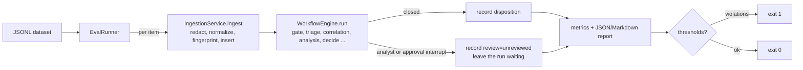

# Evaluation harness

`lg-sotf eval` runs a labelled set of alerts through the real pipeline and
reports how the platform handled them: which malicious alerts it would have
closed without a human, how much benign noise it closed on its own, how often
it asked an analyst, what it cost and how long it took. A thresholds file
turns the report into a regression gate with a non-zero exit code.

Use it to:

* compare models, prompts, routing thresholds or tenant policies before a
  change reaches production;
* check a release against a fixed dataset in CI (with the fake model: plumbing
  and safety policy only);
* measure a deployment on its own analysts' decisions (the `analyst_feedback`
  export below).

## How a run works



Before the first item the CLI checks that the report paths are writable and
that PostgreSQL, the migrated schema and Redis answer; any failure exits with
code 2 before a tenant is created or a token is spent.

* **Real components.** Each item goes through
  `lg_sotf.ingestion.service.IngestionService` and
  `lg_sotf.core.workflow.WorkflowEngine`: the same normalizers, redaction,
  graph, Postgres checkpointer, agents, routing policy, escalation grouping,
  response planner and guardrails a worker uses. Only the Redis queue is
  bypassed (the runner calls the engine directly).
* **Fresh tenants, one per split.** By default (`--isolate splits`) the CLI
  creates one tenant per split, `<base>-<n>-<split>` where `<base>` is
  `eval-<timestamp>-<random>` (or `--tenant <id>`), so results never mix with
  earlier runs or real data, and correlation, tenant history and escalation
  grouping from one split never shape another. Split metrics are therefore
  independent, and `--split adversarial` gives the same per-item outcomes as
  the adversarial split of a full run. `--isolate none` runs every item in the
  single tenant `<base>`; split metrics from such a run are not independent.
  The report records the mode and the tenants (`run.isolation`,
  `run.tenants`). Canonical items are ingested through the reserved
  `api` source; vendor items through a push source of their format
  (`config.format`), generic webhook items through a source with the item's
  field map.
* **No invented decisions.** When a run stops at an analyst interrupt
  (escalation) or an approval interrupt (response actions), the harness
  records `review: "unreviewed"`, appends an `eval.review_not_performed`
  event to the alert's timeline and leaves the run waiting. It never resumes
  a run with a made-up analyst decision, and it never approves an action.
* **Order.** Items run one at a time in file order by default (split by
  split with `--isolate splits`, results reported in file order). Within a
  tenant, correlation reads earlier alerts and escalation grouping attaches
  related alerts, so a fixed order keeps runs reproducible. `--concurrency N` is
  faster but correlation-dependent outcomes may vary between runs.
* **Where data goes.** The run writes alerts, runs, escalations, actions and
  checkpoints to the configured database. Use a **dedicated evaluation
  database** (and Redis database or key prefix); `environment=production` is
  refused.

## Running it

```sh
# 1. A dedicated database and Redis DB, migrated once
createdb -h 127.0.0.1 -U soc soc_eval
export LG_SOTF_DATABASE__URL=postgresql://soc:<password>@127.0.0.1:5432/soc_eval
export LG_SOTF_REDIS__URL=redis://127.0.0.1:6379/7
export LG_SOTF_SECURITY__ENCRYPTION_KEYS=... LG_SOTF_SECURITY__INDICATOR_HMAC_KEY=...   # scripts/generate_secrets.py
lg-sotf migrate

# 2a. Plumbing run with the offline fake model (free, deterministic)
LG_SOTF_LLM__PROVIDER=fake lg-sotf eval \
    --dataset tests/fixtures/eval/synthetic_v1.jsonl \
    --report ~/lg-sotf-eval/smoke.json \
    --thresholds tests/fixtures/eval/smoke_thresholds.yaml

# 2b. Model run (spends tokens; see "Cost" below)
LG_SOTF_LLM__PROVIDER=anthropic ANTHROPIC_API_KEY=... lg-sotf eval \
    --dataset ~/lg-sotf-eval/my-labelled.jsonl --report ~/lg-sotf-eval/claude.json \
    --thresholds ~/lg-sotf-eval/my-thresholds.yaml --baseline ~/lg-sotf-eval/previous.json
```

Keep labelled customer data and its reports outside the repository (the
examples use `~/lg-sotf-eval/`). When the dataset is not marked synthetic
and the dataset or the report lies inside a git work tree, the CLI prints a
warning.

Options: `--split` and `--tag` (repeatable) select items, `--limit N` takes
the first N, `--markdown PATH` (default: the report path with `.md`),
`--tenant ID` (base tenant id), `--isolate splits|none` (default `splits`),
`--concurrency N` (1-32), `--baseline REPORT` with
`--allow-baseline-mismatch`, `--validate-only` (check dataset, thresholds and
baseline without running anything).

Progress lines and the summary go to standard output; logs go to standard
error at `WARNING` unless `LG_SOTF_OBSERVABILITY__LOG_LEVEL` is set.

Exit codes: `0` finished and every threshold held (or none were given), `1` a
threshold or regression check failed, `2` the evaluation could not run or
produced nothing to judge: invalid dataset, thresholds or baseline; a
baseline from a different dataset, selection or report schema; a report path
that cannot be written; database unreachable or not migrated; Redis
unreachable; tenant exists; unsafe environment; or every item errored (the
report is still written so the errors can be read).

### With Docker Compose

Run the eval as a one-off container of the stack's image against a separate,
migrated database. The container runs as uid 10001 with a read-only root
filesystem, so run it as your own user (`--user`) and mount a directory you
own for the reports:

```sh
C="docker compose -f docker/docker-compose.yml"
EVAL_DB="postgresql://soc:${POSTGRES_PASSWORD:-soc_dev_password}@postgres:5432/soc_eval"
$C up -d --wait postgres redis                                  # the eval needs both
$C exec -T postgres createdb -U soc soc_eval                    # once
$C run --rm --no-deps -e LG_SOTF_DATABASE__URL="$EVAL_DB" migrate   # migrate the eval database
mkdir -p ~/lg-sotf-eval
$C run --rm --no-deps --user "$(id -u):$(id -g)" \
    -e LG_SOTF_DATABASE__URL="$EVAL_DB" -e LG_SOTF_REDIS__URL=redis://redis:6379/7 \
    -e LG_SOTF_OBSERVABILITY__LOG_LEVEL=WARNING \
    -v "$PWD/tests/fixtures/eval:/data:ro" -v "$HOME/lg-sotf-eval:/eval" \
    migrate eval --dataset /data/synthetic_v1.jsonl --report /eval/report.json \
                 --thresholds /data/smoke_thresholds.yaml
```

If the report directory is not writable the command stops with exit code 2
before evaluating anything. The compose stack loads
`configs/development.yaml`, which logs at `INFO`; the
`LG_SOTF_OBSERVABILITY__LOG_LEVEL=WARNING` override keeps the per-node JSON
log lines out of the terminal so only the progress lines and the summary are
printed.

## Dataset format

JSON Lines, one item per line. The optional first line
`{"_meta": {"synthetic": true, "description": "...", "version": 1}}` describes
the file; reports built from a synthetic dataset carry a notice.

```json
{"id": "syn-007",
 "source_type": "sentinel",
 "alert": {"SystemAlertId": "...", "DisplayName": "...", "AlertSeverity": "High", "...": "..."},
 "expected": {"disposition": "malicious", "route": "escalate", "escalation": true},
 "labels": [{"annotator": "a1", "disposition": "malicious"}, {"annotator": "a2", "disposition": "inconclusive"}],
 "split": "standard",
 "tags": ["identity", "mfa-fatigue"],
 "notes": "free text"}
```

| Field | Required | Meaning |
|---|---|---|
| `id` | yes | Unique id (letters, digits, `.`, `_`, `:`, `-`) |
| `source_type` | yes | `canonical`, `splunk`, `crowdstrike`, `sentinel`, `wazuh`, `guardduty`, `qradar`, `webhook` or `email` |
| `alert` | yes | The event exactly as that source sends it (canonical schema: `lg_sotf.ingestion.normalizers.canonical`); for `email`, `{"mime": "<raw RFC 5322 message>", "reporter": "<optional address>"}`, ingested like `POST /ingest/email` |
| `source_config` | `webhook` only | The generic webhook source config (`field_map`, `severity_map`, ...) |
| `expected.disposition` | yes | Ground truth: `malicious`, `benign` or `inconclusive` (a human must look) |
| `expected.route` | no | Expected policy route: `close`, `escalate` or `plan_response` |
| `expected.escalation` | no | Should a human be involved (analyst review or action approval)? |
| `labels` | no | Individual annotators' dispositions, for inter-annotator agreement |
| `split` | no | Default `standard`; the shipped set also has `adversarial` |
| `tags`, `notes` | no | Free-form; `--tag` filters on tags |

Loading is strict: an invalid or duplicate line stops the run with its line
number (exit code 2), so a typo can never silently shrink a gated dataset.

`_meta.tenant_settings` (optional) is merged into every evaluation tenant
before the first item: `tools.internal_domains` and the `phishing` section
(see `docs/phishing.md`). The shipped phishing set,
`tests/fixtures/eval/phishing_v1.jsonl` (39 synthetic reported emails, with
`phishing_smoke_thresholds.yaml`), uses it:

```sh
LG_SOTF_LLM__PROVIDER=fake lg-sotf eval --dataset tests/fixtures/eval/phishing_v1.jsonl \
    --report ~/lg-sotf-eval/phishing.json --thresholds tests/fixtures/eval/phishing_smoke_thresholds.yaml
```

### From the tenant's history (backtest)

`lg-sotf eval --from-history --tenant T --days N [--limit M]` needs no
dataset file: it replays the alerts analysts decided in tenant T in the last
N days through the current pipeline and model, read-only and without any
side effect, and reports with the same metrics, thresholds and baselines.
See docs/reporting.md ("Backtest").

## Metrics

Rates are fractions; a rate with an empty denominator is reported as `null`
("n/a"), never as 0. Items whose ingestion or run failed count in
`error_rate` and are excluded from every other rate.

| Metric | Definition |
|---|---|
| `malicious_false_negative_rate` (headline) | Expected-malicious items the platform **closed on its own as benign**, over scored expected-malicious items. An escalated malicious alert is not a false negative: a human sees it. |
| `benign_auto_close_rate` | Expected-benign items closed as benign without a human: the analyst work saved. |
| `benign_auto_response_rate` | Expected-benign items the policy routed to a response plan. |
| `high_severity_auto_closed_benign` | High/critical items automation closed with any disposition other than `malicious`. The routing policy never closes a high or critical alert as benign on its own (only a suppression rule or an analyst-confirmed verdict can, and an evaluation tenant has neither), so this is a safety property: gate it at 0. |
| `high_severity_auto_closed_malicious` | High/critical items closed as `malicious` after a policy response whose actions completed (for example autonomy `auto` for a non-containment action such as `create_ticket`). Correct behaviour; watch it, do not gate it at 0. |
| `escalation_rate` | Items for which analyst review was requested. |
| `approval_request_rate` | Items waiting for response-action approval. |
| `inconclusive_rate` | Items whose predicted disposition is `inconclusive`. |
| `model_refusal_rate` | Items where a model refused (the alert is escalated). |
| `per_class` | Precision, recall, F1, support per disposition, with `macro_f1` and `accuracy`. |
| `confusion_matrix` | Rows expected, columns predicted. |
| `kappa_vs_expected` | Cohen's kappa of predicted vs expected. |
| `inter_annotator_kappa` | Cohen's kappa per annotator pair sharing at least two items (from `labels`), and the mean. |
| `route_accuracy`, `escalation_accuracy` | Over items that carry `expected.route` / `expected.escalation`; a pending approval counts as human involvement. |
| `cost_per_alert_usd`, `tokens_per_alert`, `llm_calls_per_alert` | Means over scored items, from each alert's `summary.llm_usage` (the same metering as `/usage/llm`). |
| `total_cost_usd`, `total_tokens`, `errored_cost_usd` | Totals over every item, including items that errored after model calls (read back from the alert when the run failed): what the run cost. `errored_cost_usd` is the errored items' share. |
| `latency_s` | Mean, p50, p95, max seconds from ingestion to the run's stop (close or interrupt). |

**Predicted disposition** is what the platform concluded on its own: the
closing disposition of a closed alert; `malicious` for a run waiting on
response approval (the policy decided to respond); for a run handed to an
analyst, the analysis agent's verdict (`inconclusive` when there was none).

Every metric is also reported per split (`splits.<name>`), and the report
lists every item with its status, route, decision code, close reason, token
usage, cost and latency.

## Reports

* JSON (`--report`): `schema_version`, `dataset` (path, sha256, item count,
  synthetic flag, splits), `run` (isolation, tenants, provider, models,
  concurrency, duration, `selection`: splits, tags, limit, isolation),
  `notes`, `metrics`, `splits`, `items` and, with thresholds, `gate`. Keep it
  as the next run's `--baseline`.
* Markdown (`--markdown`, default next to the JSON): notices, run facts,
  gate result, headline table per split, per-class scores, confusion matrix,
  inter-annotator agreement and the item table with missed malicious items
  marked `MISSED`.

## Regression gate

```yaml
version: 1
min_items: 200                       # fewer scored items fails the gate
metrics:                             # absolute bounds on report paths
  error_rate: {max: 0.01}
  malicious_false_negative_rate: {max: 0.0}
  splits.adversarial.malicious_false_negative_rate: {max: 0.0}
  benign_auto_response_rate: {max: 0.0}
  high_severity_auto_closed_benign: {max: 0}
  benign_auto_close_rate: {min: 0.30}
  per_class.malicious.recall: {min: 0.85}
  cost_per_alert_usd: {max: 0.05}
  latency_s.p95: {max: 240}
regressions:                         # only with --baseline <previous report>
  malicious_false_negative_rate: {max_increase: 0}
  benign_auto_close_rate: {max_decrease: 0.03}
  escalation_rate: {max_increase: 0.05}
```

Paths are dotted paths into `metrics` (`per_class.malicious.recall`,
`latency_s.p95`) or `splits.<name>.<metric>`. A metric that is missing or
undefined fails its bound unless the bound sets `allow_missing: true`, so a
dataset change cannot silently switch a gate off. The numbers above are an
example shape, not recommended values: derive yours from a baseline run of
your own labelled data.

A baseline is only compared when it describes the same experiment: the same
report schema version, the same dataset file (sha256) and item count, and the
same selection (`--split`, `--tag`, `--limit`, `--isolate`). Otherwise the
command exits with code 2; `--allow-baseline-mismatch` compares anyway and
prints a warning.

## CI smoke evaluation (fake model)

`tests/integration/eval/test_runner.py::test_smoke_evaluation_of_the_synthetic_dataset_passes_the_ci_gate`
runs all of `tests/fixtures/eval/synthetic_v1.jsonl` with `llm.provider=fake`
against the CI PostgreSQL and Redis services and applies
`tests/fixtures/eval/smoke_thresholds.yaml`. It runs in the normal `pytest`
job (about 10 seconds).

**The fake model is a keyword heuristic, not a detection model.** Its
metrics measure plumbing and policy: every item ingests and runs to a
decision point, no malicious item is closed without a human, no benign item
is routed to containment, no high/critical alert is closed as anything but
malicious, the automatic close path still works. They say nothing about how
well a real model triages.

A recorded run of the fake-model command in "Running it" (2026-09-29,
synthetic dataset, default `--isolate splits`, no `--baseline`; a baseline
adds the three regression checks, making 12):

```text
items 64 (scored 64, errors 0)
malicious false-negative rate 0.0% (0 of 35)
benign auto-close rate 28.6%; escalation rate 89.1%; inconclusive rate 40.6%
macro F1 0.616; kappa vs expected 0.467
cost per alert $0.000000; latency p95 0.155 s
split adversarial: 16 items, malicious FNR 0.0%, escalation 100.0%
split standard: 48 items, malicious FNR 0.0%, escalation 85.4%
gate PASSED (9 checks)
```

## The shipped synthetic dataset

`tests/fixtures/eval/synthetic_v1.jsonl` has 64 hand-written items across all
eight source formats: 35 malicious, 21 benign, 8 inconclusive; 16 of them in
the `adversarial` split (prompt injection in descriptions, command lines,
entity names, cloud tags and log lines; `</alert_data>` tag forgery;
zero-width-space obfuscation; size padding; malicious activity named like
maintenance; a benign newsletter full of threat words; response steering
toward a domain controller; claimed authorisation). Addresses are
documentation ranges and RFC 1918, names are `example.com`-style, labels were
assigned when writing each scenario. See `tests/fixtures/eval/README.md`.
It is a test fixture, not evidence of detection quality.

## Evaluating on your own labelled data

The best dataset is your own analysts' decisions. Every escalation decision
is stored in `analyst_feedback`; `docs/tools/export_feedback.sql` turns one
tenant's decisions into an eval dataset:

```sh
mkdir -p -m 700 ~/lg-sotf-eval          # outside the repository
psql "$OWNER_DSN" -v tenant=acme -v days=90 -v out="$HOME/lg-sotf-eval/acme-feedback.jsonl" \
     -f docs/tools/export_feedback.sql
lg-sotf eval --dataset ~/lg-sotf-eval/acme-feedback.jsonl --report ~/lg-sotf-eval/acme-feedback.json
```

The output path (`-v out=...`, no spaces) is required; without it the script
prints its usage and writes nothing. Never write the export or its reports
inside the repository: they contain customer telemetry. (The CLI warns when a
non-synthetic dataset or its report is inside a git work tree.)

Mapping: `true_positive` becomes `malicious`, `false_positive` and
`benign_positive` become `benign`, `needs_more_info` becomes `inconclusive`;
the deciding analyst is recorded as a pseudonymous annotator. The export has
**one item per alert**: an alert that was re-escalated after a
`needs_more_info` decision has several decisions, and its label is the
latest decision other than `needs_more_info` (or `needs_more_info` when that
is all there is). Items are ordered by that decision's time. The stored
(redacted) raw event is replayed through a source of the same format; alerts
whose raw event was truncated at ingestion are skipped.

Know the biases before you trust the numbers:

* **Selection bias.** Only escalated alerts have analyst decisions, so the
  export never contains alerts the platform closed on its own. To measure
  missed threats, have analysts label a random sample of automatically
  closed alerts as well (add them to the JSONL by hand or from your case
  system) and keep that sample as its own split.
* **Label noise.** Decisions made under time pressure are imperfect. For a
  gold set, have two analysts label the same items independently (two
  `labels` entries) and check `inter_annotator_kappa`; resolve disagreements
  before using `expected`.
* **Sensitive data.** The export contains customer telemetry (secrets are
  redacted at ingestion; names, addresses and hosts are not). Keep it out of
  git, restrict access, and delete it when done. A model run sends it to your
  LLM provider under your agreement with that provider, exactly as
  production does.

## Public benchmarks

Public datasets are useful for comparison but are not committed to this
repository (size and licence terms). Download them yourself, read their
licences, and convert them to the JSONL format above with a script kept
outside the repository or in a private fork.

* **Microsoft GUIDE** (the "Microsoft Security Incident Prediction" dataset
  released with the GUIDE paper; distributed through Kaggle). Evidence rows
  carry an incident grade (`TruePositive`, `BenignPositive`,
  `FalsePositive`). A reasonable mapping groups rows by `AlertId` (or
  `IncidentId`), builds a canonical alert (`title` from the alert title,
  `category`, `mitre.techniques` from `MitreTechniques`, entities from the
  evidence columns, severity from your own mapping) and sets
  `TruePositive` to `malicious` and both other grades to `benign`. Most
  identifiers in GUIDE are anonymised numbers, so it exercises routing on
  structure and categories far more than language understanding; do not
  compare its numbers with results on readable telemetry.
* **ExCyTIn-Bench** (Microsoft) evaluates LLM agents answering investigation
  questions over a database of Sentinel-style logs. It measures
  investigation, not triage disposition, and the harness does not replay its
  log database. Use its incidents' alerts as canonical items with dispositions
  you assign, or run the benchmark with its own tooling to judge a candidate
  deep-tier model before configuring it here.

Record which benchmark version you used, the conversion script's commit and
the resulting dataset's sha256 (in every report) next to the numbers.

## Cost of a model run

Every item makes one or more real model calls. Estimate before running:
`items x tokens_per_alert x price`. The fake run's `tokens_per_alert`
(prompt sizes are realistic, about 1,700 tokens per alert on the synthetic
set) gives a lower bound for the fast tier; alerts that reach the analysis
agent use the deep tier and, with a thinking model, many more output tokens.
Set `LG_SOTF_LLM__DAILY_TOKEN_BUDGET_PER_TENANT` as a safety net: when the
evaluation tenant's budget is exhausted, agents fall back to rules and the
report's later items no longer reflect the model.

## Limitations

* Enrichment providers (VirusTotal, AbuseIPDB) run only if configured for the
  evaluation install; results then depend on live third-party data.
* Escalation grouping and correlation make items of the same split (the same
  tenant) interact; this mirrors production but means an item's outcome can
  depend on the items before it in its split. Keep dataset order stable
  between runs you compare. With `--isolate none`, items of different splits
  interact too and split metrics are not independent.
* The harness evaluates the automated decision up to the first human
  interrupt. What happens after an analyst decision (response planning on a
  `true_positive`, suppression suggestions) is covered by the test suite, not
  by these metrics.
