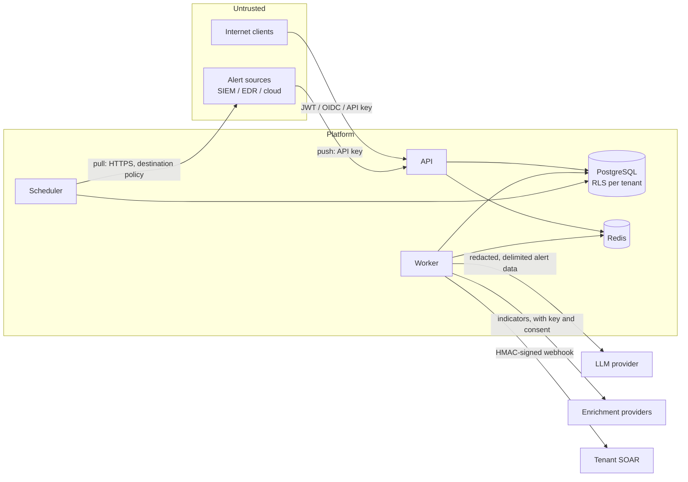

# Security model

This document describes how LG-SOTF protects the data it processes and the
environments it can act on: the threat model, tenant isolation,
authentication, secrets, defences against prompt injection, response
guardrails, data handling and audit. The system contract is
`docs/architecture.md`; operating procedures (key rotation, incident
checklist) are in `docs/operations.md`. To report a vulnerability, see
`SECURITY.md` in the repository root.

## 1. Threat model

### What we protect

| Asset | Why it matters |
|---|---|
| Alert data of each tenant | Security telemetry: host and user names, addresses, command lines, sometimes personal data |
| The integrity of triage decisions | A wrong automatic close hides an intrusion; a wrong response disrupts the business |
| The ability to act (response connectors) | Containment actions (block an address, isolate a host, disable an account) go to the tenant's SOAR |
| Credentials held by the platform | Source (SIEM/EDR/cloud) credentials, SOAR webhook secrets, enrichment API keys, LLM provider keys |
| Accounts and sessions | Analysts approve containment; admins configure sources and policy |
| The audit trail | Evidence of who decided and approved what |

### Who we defend against

| Actor | Capability | Main controls |
|---|---|---|
| External attacker whose activity produces alerts | Controls much of the alert text: process names, command lines, file names, user agents, cloud resource tags, email subjects | Untrusted-data prompt boundary, injection detection, rule corroboration, severity policy, guardrails, analyst review (sections 5, 6) |
| Attacker with a stolen API key | Can push alerts (`ingest` scope) or read (`read`) within one tenant | Scoped keys, hashed at rest, revocable, rate limits, no admin or decision rights for keys (section 3) |
| Malicious or compromised tenant user | Acts within their role in their tenant | RBAC, per-action approval rights by risk, audit log, other tenants unreachable (sections 2, 3, 8) |
| Tenant admin configuring a hostile source URL | Could aim pull connectors at internal services (SSRF) | Outbound destination policy (section 4) |
| A misbehaving or manipulated model | Returns a wrong verdict or a harmful recommendation | Schema-validated output, model output never alone sufficient to close high/critical alerts or to contain (sections 5, 6) |
| Operator with infrastructure access | Database, Redis, secrets | Out of scope for application controls; mitigated by two database roles, encrypted secrets, append-only audit log, and your own infrastructure access control |

Out of scope: compromise of the host, container runtime, database server or
Kubernetes control plane; the security of the SOAR platform that receives
response webhooks; the LLM provider's own handling of prompts (governed by
your agreement with the provider).

### Trust boundaries



## 2. Tenant isolation

Every tenant-owned table has a `tenant_id` column and a PostgreSQL row-level
security policy with `FORCE ROW LEVEL SECURITY`: a row is visible and
writable only when `tenant_id` equals the transaction's `app.tenant_id`
setting. Application code reaches tenant data only inside
`Database.tenant_tx(tenant_id)` (which sets it with `SET LOCAL`), and
repositories additionally filter by `tenant_id` explicitly (defence in
depth).

Cross-tenant work (partition maintenance, retention, SLA and stale-run sweeps,
tenant creation from the CLI) uses `system_tx()`, which bypasses the policy
only when `app.bypass_rls = 'on'` **and** the session user belongs to the
schema-owner role. In production the API and workers connect as a separate
runtime role (`database.runtime_role`) that owns nothing and has no
`BYPASSRLS`; `lg-sotf migrate` refuses to grant privileges to a role that is
a superuser, has `BYPASSRLS` or is a member of the owner role. Credential
lookups that must happen before the tenant is known (user by email, refresh
token by hash, API key by id) go through narrow `SECURITY DEFINER`
functions. The isolation is tested against a real database with the runtime
role (`tests/integration/db/test_rls.py`, `tests/integration/api/test_isolation.py`).

Beyond the database:

* Redis keys, streams and pub/sub channels carry the tenant id
  (`{prefix}:t:{tenant_id}:...`, `{prefix}:events:{tenant_id}`); WebSocket
  connections subscribe only to their principal's tenant channel.
* LangGraph checkpoint threads are `{tenant_id}:{alert_id}`, and the
  checkpoint tables (`checkpoints`, `checkpoint_blobs`, `checkpoint_writes`)
  are under the same `FORCE ROW LEVEL SECURITY` policy, keyed on the thread
  id's tenant prefix (`lg-sotf migrate` applies it after LangGraph's
  `setup()`); the worker's checkpointer sets `app.tenant_id` from the thread
  id before every statement.
* Live-event WebSockets re-check the token, the account and the tenant every
  `api.ws_revalidate_s` (15 s): logout, deactivation, deletion and tenant
  suspension close an open socket within that interval. Concurrent sockets
  are capped per principal (`api.ws_max_per_principal`) and per tenant
  (`api.ws_max_per_tenant`), so one tenant cannot use up a process's
  subscriber slots.
* Caches (verdict cache, enrichment cache) are keyed per tenant; enrichment
  results are never shared between tenants.
* Indicator correlation uses per-tenant rows of HMAC-hashed values.
* A platform admin may act on another tenant with `X-Tenant-ID`; every such
  request is written to that tenant's audit log, and decisions (claims,
  escalation decisions, approvals) stay with the tenant's own members.

## 3. Authentication and authorisation

* **Local accounts**: argon2id password hashes; minimum length
  `auth.password_min_length` (12); identical responses and work for unknown
  users, wrong passwords and locked accounts; lockout after
  `auth.max_login_attempts` failures for `auth.lockout_minutes`.
* **Sessions**: short-lived HS256 access tokens (`auth.access_token_ttl_s`,
  15 minutes by default) carrying `jti`; opaque refresh tokens stored as
  SHA-256 hashes, in an `HttpOnly; Secure; SameSite=Strict` cookie scoped to
  `/api/v1/auth`, rotated on every refresh; refresh and logout also refuse
  browser requests from any other origin (a sibling subdomain is same-site). Reuse of a rotated refresh token
  revokes all of the user's sessions and is audited. Logout revokes the
  refresh token and blocks the presented access token until it expires. The
  user row is re-read on every request, so deactivation and role changes
  apply immediately (open WebSockets within `api.ws_revalidate_s`). Login
  attempts are counted before the password is checked, so concurrent
  requests cannot exceed the lockout budget.
* **Single sign-on (OIDC)**: tokens from `auth.oidc_issuer` are verified
  against its JWKS (RS256/ES256 only, `aud` required); tenant and role come
  from configured claims; linking to a local account requires a verified
  email; OIDC never grants platform-admin rights.
* **API keys**: `lgk_<id>_<secret>`, stored as SHA-256 hashes and shown once;
  scopes `ingest`, `read`, `write`; keys can never use administrative
  endpoints, decide escalations or approve actions.
* **Roles**: `viewer` (read), `analyst` (notes, suppression proposals,
  claim/decide escalations, approve low and medium risk actions), `admin`
  (users, keys, sources, settings, suppression management, high and critical
  approvals). The approver's role always comes from the authenticated
  principal, never from a request body.
* **Hardening**: request size limits enforced while streaming, Redis rate
  limits (stricter on login and ingest; failing credentials are throttled per
  client address), CORS allowlist, security headers (CSP
  `frame-ancestors 'none'`, `nosniff`, `no-referrer`, `no-store`, HSTS over
  HTTPS), uniform error envelope without stack traces. Trust
  `X-Forwarded-For` only from the proxies named in `api.forwarded_allow_ips`.

Details and the endpoint/role matrix: `docs/api.md`.

## 4. Secrets and outbound connections

* **Where secrets live**: only in environment variables fed from your secret
  store (Kubernetes Secrets, a secret manager). `settings.py` is the only
  reader. The Helm chart's values schema rejects secret-bearing keys under
  `settings`, so they cannot land in a ConfigMap or in release history. The
  production compose override passes each container only the secrets it
  needs (docs/deployment.md).
* **Startup checks**: in `staging` and `production`, processes refuse to
  start without a JWT secret of at least 32 bytes, encryption keys and an
  indicator HMAC key, with a fake model, wildcard CORS, insecure cookies, the
  development database password, or any secret value published in this
  repository (placeholders in `configs/development.yaml` and `.env.example`).
* **Secrets at rest**: source credentials, tenant webhook secrets and tenant
  enrichment API keys are encrypted with Fernet (`security.encryption_keys`,
  rotation by key list), bound to their tenant and purpose, write-only
  through the API (responses show only `has_secret` / `<name>_configured`).
  Configuration keys that look like credentials are refused in plain
  `config`.
* **Hashes**: passwords (argon2id), API keys and refresh tokens (SHA-256),
  indicator values (HMAC-SHA256 with `security.indicator_hmac_key`).
* **Pull connectors**: source URLs are tenant-controlled, so every request is
  checked before it is sent: HTTPS only in staging/production; every address
  the host resolves to must be allowed; loopback, link-local (including cloud
  metadata endpoints), multicast, unspecified and reserved addresses are
  always refused; private ranges only when the install sets
  `ingestion.allow_private_destinations`; the connection is pinned to the
  checked address (no DNS rebinding) while TLS still verifies the host name.
  Integrations, response webhooks and Microsoft Graph use the same policy
  (`lg_sotf.net.egress.egress_policy`; Graph is HTTPS in every environment).
  If the `ingestion` section is invalid, pull sources refuse to run and the
  others refuse private ranges (ADR-0007).
* **Response webhooks**: HMAC-SHA256 signed (`X-LGSOTF-Signature` over
  timestamp and body), with an idempotency key per action; receivers must
  verify the signature and reject stale timestamps.
* **Logs**: structured JSON with a redaction pass over every record; a
  caught failure is logged with its error type, a frames-only stack and its
  cause types, never the exception message or a traceback (ADR-0005); no
  request bodies, query strings or credentials in access logs; no raw alert
  bodies at INFO. Error text that is stored or shown is redacted before it
  is truncated.

## 5. Prompt-injection defences

Alert content is attacker-influenced. The design assumes a model **will**
sometimes be fooled and makes sure that being fooled cannot, on its own,
close a dangerous alert or trigger containment.

1. **Hard boundary between instructions and data**
   (`lg_sotf.llm.prompting`). Instructions live in the system message; alert
   data is redacted, size-capped, serialised as compact JSON with `<` and `>`
   escaped (a closing `</alert_data>` cannot be forged from inside the data)
   and wrapped in `<alert_data>`; investigation results go in a separate
   `<tool_data>` block. Both blocks are explicitly labelled as untrusted data,
   never instructions.
2. **Structured output only.** Every model call must return a
   schema-validated object; invalid or truncated output is an error, a
   refusal is recorded as a refusal. Free text from the model never selects a
   code path.
3. **Injection detection as evidence.** Triage scans every alert field
   (NFKC-normalised, zero-width and bidi characters removed, bounded scan) for
   model-steering text: "ignore previous instructions", "classify this as
   benign", fake `<system>` tags, verdict forgeries and similar. When found,
   false-positive signals taken from alert text are voided, a
   `prompt_injection_suspected` true-positive signal is added, and the rule
   score cannot corroborate an automatic response.
4. **Rules decide what text cannot.** False-positive keywords count only from
   the detection title and rule name, not from descriptions or command lines.
   A low/medium benign close needs rule corroboration in addition to the
   model. The routing policy chooses to plan a response from the threat
   score; what then runs automatically is decided per action: automatic
   *containment* needs rule evidence that does not come from text an
   attacker writes (threat-intelligence verdicts, analyst-confirmed history,
   behavioural observations), and containment on model-only evidence always
   waits for approval. Non-containment actions (create a ticket, notify,
   collect forensics) run automatically wherever the tenant set autonomy
   `auto` for their risk level.
5. **Severity policy.** Automation never closes a high or critical alert as
   benign; only an analyst decision, an admin-enabled suppression rule or an
   analyst-confirmed verdict (not for critical) does. A cached
   analyst-confirmed verdict applies only up to the severity the analyst
   decided (a benign medium never closes a high repeat), is dropped when an
   analyst decides `true_positive` on that detection or a response is
   planned for it, and admins can clear a tenant's cache
   (`DELETE /tenant/verdict-cache`). Suppression rules suggested from
   false-positive decisions are bounded to the decided severity and below.
   Alerts mapped by the optional LLM-fallback normalizer
   (`llm_normalized`) have no trusted text, never use the verdict cache
   and are never closed automatically. A response the policy
   started closes the alert as **malicious** once its actions complete
   (connector success or the tenant's dry run), at any severity; if an
   action fails or none completes, the alert is escalated instead. The
   evaluation metric `high_severity_auto_closed_benign` measures the first
   rule and is gated at 0 in CI.
6. **Refusals escalate.** A refusal by any agent sends the alert to an
   analyst with reason `model_refused`; no actions are planned from a refused
   analysis.
7. **Measured.** The evaluation harness has an `adversarial` split (injection
   in descriptions, command lines, entity names, cloud tags and logs, tag
   forgery, zero-width obfuscation, padding, camouflage, response steering)
   and the CI gate requires a 0% malicious false-negative rate on it
   (docs/evaluation.md). With the fake model this checks policy, not model
   robustness; run it with your production model before changing models or
   prompts.

## 6. Response guardrails

LG-SOTF proposes containment and, only where a tenant allows it, executes it
through the tenant's SOAR webhook or, for Microsoft 365, Entra ID and
Defender for Endpoint, directly with the tenant's own app registration
(fixed Microsoft hosts, write-only credentials, the same guardrails;
docs/microsoft.md). It calls no other vendor API directly.

* **Autonomy per risk level** (tenant policy, default: `approval` for low,
  medium and high, `disabled` for critical). Containment on model-only
  evidence is never automatic; an analyst's pre-approval covers only low and
  medium risk; high and critical actions need an admin.
* **Guardrails before planning and again right before execution**: the
  tenant policy must be well formed (malformed policy blocks everything); the
  action type must be known and allowed; the target must match the action's
  kind and be syntactically valid; IP blocks never target loopback,
  link-local, multicast, unspecified or reserved addresses (including
  IPv4-mapped and similar IPv6 forms), and private ranges only when the tenant
  allows it; protected hosts, users, domains, CIDRs, processes and file
  hashes are never acted on, whatever the spelling (IP literal forms, DN and
  `DOMAIN\user` forms, Unicode normalisation, URL hosts as browsers resolve
  them: full-width digits, ideographic dots, `\` as a path separator,
  percent-encoding, NAT64 prefixes); critical operating-system and
  security-agent processes (`lsass.exe`, `csrss.exe`, `services.exe`,
  `svchost.exe`, `explorer.exe`, `systemd`, EDR agents ...) are never
  terminated.
* **Targets**: parent/grandparent processes and their hashes are never
  response targets; `terminate_process` and `quarantine_file` carry the
  alert's hosts (`params.scope.hosts`) in the signed webhook body. With
  rule evidence, automatic containment applies only to the targets that
  evidence is about (the indicator with a malicious threat-intel or history
  verdict, the executable and host a behavioural rule observed, the C2
  destination); other entities of the same alert wait for approval
  (`target_not_corroborated`).
* **Rate limits**: a per-tenant hourly cap (bounded by the install's
  `response.max_actions_per_hour_per_tenant`) and per-action blast-radius
  limits, enforced atomically at execution.
* **Dry run by default**: `response.dry_run=true` (the default) records what
  would happen without sending anything. A dry-run execution is reported as
  such on the alert.
* **Ledger**: every action is a row with an idempotency key, its status
  history, who approved it and the connector's result; every transition is
  audited.

## 7. Data handling

* **What is stored**: the original event (`alerts.raw`, capped at
  `ingestion.max_raw_bytes`), the normalised canonical alert, summaries of
  each agent's reasoning, the timeline, escalations, analyst decisions and
  feedback, the action ledger, daily LLM usage, and the audit log.
* **Redaction**: secrets are removed from every event **before** it is
  stored or shown to a model: private keys, cloud and API keys, JWTs,
  authorisation headers, credentials in connection strings and command lines
  (long flags, and the short or slash password flags of common admin and
  lateral-movement tools: PsExec/PAExec, evil-winrm, CrackMapExec/NetExec,
  Hydra, `net use`/`net user`, `schtasks /rp`, `xfreerdp /p:`, `cmdkey
  /pass:`, sqlcmd/bcp `-P`, plink/pscp `-pw`, ldapsearch `-w`, 7-Zip/RAR/zip,
  Impacket `domain/user:password@host`, mimikatz `/ntlm:`, Winlogon
  `DefaultPassword`), signed-URL signatures (Azure SAS `sig=`), incoming
  webhook URLs (Slack, Teams, Discord), vendor tokens (GitLab, npm,
  SendGrid, Slack), values under secret-labelled keys. Hashes, GUIDs and other indicators stay
  intact because analysts need them.
* **Personal data is not redacted.** User names, email addresses, host
  names, IP addresses and command lines are the substance of triage; they are
  stored and, when the LLM is enabled, sent to the configured model provider.
  Customers must cover this in their data-processing terms with you and with
  the provider. Options to limit exposure: disable the LLM (`llm.enabled=false`,
  rules only), use a provider and region that meet your requirements, and
  keep enrichment providers opt-in per tenant.
* **Enrichment**: indicators go to third-party threat-intelligence providers
  only when a key is configured and the tenant consents (install key shared
  explicitly, or the tenant's own key). Private addresses and the tenant's
  internal domains are never sent.
* **Retention** (scheduler maintenance job, defaults): alerts 90 days, alert
  events 90, audit log 365, indicator sightings 30, LLM usage 400, workflow
  checkpoints of completed runs 30. Configure with `retention.*`. A tenant may
  have shorter or longer `alerts_days` and `indicators_days` in
  `tenants.settings.retention` (set by an operator in the database;
  `/tenant/settings` does not edit them); the partitioned timeline and audit
  tables follow the install setting. Expired monthly
  partitions are dropped whole.
* **Deletion on request**: there is no self-service tenant data export or
  erasure endpoint in this release; operators handle such requests in the
  database (see the gaps list in the README).
* **Backups** contain everything above; the encryption and HMAC keys are
  part of the backup set but must be stored separately (docs/deployment.md).

## 8. Audit

Security-relevant events are written to `audit_log`, a partitioned,
append-only table: a per-tenant SHA-256 hash chain (`prev_hash`, `hash`), and
a database trigger that blocks `UPDATE`, `DELETE` and `TRUNCATE` except for
the retention job. Entries cover logins and session events, refresh-token
reuse, user and API-key changes, source and settings changes, suppression
rules, claims, decisions, approvals and response execution, escalation
creation, and platform-admin cross-tenant access. Accounts created outside
the API (`lg-sotf migrate`'s bootstrap admin, `create-admin`, the first admin
of `create-tenant`) are audited as `user.created` (actor `migrate`/`cli`),
plus `platform.admin_granted` for platform admins; `lg-sotf enqueue` and
`dlq requeue` record `alert.reprocess_requested`. Entries never contain
secrets or raw alert bodies (they are redacted again before logging).
Admins read them with `GET /api/v1/audit` and verify the chain with
`GET /api/v1/audit/verify`. Export the audit log for the period of an
incident before retention removes it.

## 9. Supply chain and build

* Every dependency is pinned and hash-locked, and every base image is
  pinned by digest (see "Pinned inputs and the image CVE gate" below).
  `pip-audit` and Bandit run in CI, Gitleaks on every change and in a weekly
  full-history scan, and Dependabot keeps GitHub Actions, base-image digests,
  and Python and npm dependencies current.
* Both images are scanned with Trivy on every change: a fixable critical or
  high CVE fails CI.
* Every release carries CycloneDX SBOMs and an OpenVEX document, each with
  a build-provenance attestation (see "SBOMs and VEX" below).
* The container image runs as a non-root user (uid 10001) with a read-only
  root filesystem, no build tools, no pip/setuptools and no setuid binaries; `dumb-init` as PID 1. Kubernetes
  manifests drop all capabilities and use the `RuntimeDefault` seccomp
  profile.
* Every published image (`ghcr.io/gapilongo/lg-sotf` and
  `ghcr.io/gapilongo/lg-sotf-frontend`, amd64 and arm64) is signed with
  cosign and carries a SLSA build-provenance attestation. Both are keyless:
  the certificate is issued by Sigstore for the GitHub OIDC identity of the
  `Release images` workflow on `main`, and both are recorded in the public
  Rekor transparency log. The signature covers the multi-arch image digest,
  not a tag. A release tag `vX.Y.Z` points at the same digest that `main`
  built and signed, so it is covered too.
* Signing runs in its own job. That job checks out no code and runs no build
  step; it only signs the digests that the build job pushed. It is the only
  job in the release path that can request an OIDC token. The images are
  built on GitHub-hosted runners in fresh VMs. A compromised build step
  therefore cannot sign or attest anything (SLSA Build L3: the build cannot
  forge its own provenance).
* The deploy workflow (`.github/workflows/deploy.yml`) runs `cosign verify`
  and `gh attestation verify` on both digests before anything reaches a host.
  It requires this exact signer identity and issuer, and stops the deploy if
  either check fails. Images published before signing existed
  are refused too.

### Verify an image yourself

You need [cosign](https://docs.sigstore.dev/cosign/system_config/installation/)
3.0.6 or later and, for the provenance, the GitHub CLI (`gh`). Always
verify the digest you will run, not a tag:

```sh
SIGNER=https://github.com/gapilongo/SOC/.github/workflows/release-images.yml@refs/heads/main
ISSUER=https://token.actions.githubusercontent.com

# Resolve the release tag to its digest once, then use only the digest.
docker buildx imagetools inspect ghcr.io/gapilongo/lg-sotf:v1.3.0 --format '{{json .Manifest}}' | jq -r .digest
IMAGE=ghcr.io/gapilongo/lg-sotf@sha256:<digest>

# 1. Signature: made by the release workflow on main, logged in Rekor.
cosign verify --certificate-identity "$SIGNER" --certificate-oidc-issuer "$ISSUER" "$IMAGE"

# 2. Build provenance (SLSA v1): which repository, commit and workflow built it.
gh attestation verify "oci://$IMAGE" --repo gapilongo/SOC \
    --cert-identity "$SIGNER" --cert-oidc-issuer "$ISSUER" --deny-self-hosted-runners
```

Do the same for `ghcr.io/gapilongo/lg-sotf-frontend`. Never accept a looser
identity, such as `--certificate-identity-regexp '.*'` or only the
repository owner. Any other workflow in the repository can also get a
GitHub OIDC token, and only the release workflow on `main` publishes
images. In Kubernetes, an admission controller (the Sigstore
policy-controller or Kyverno `verifyImages`) can enforce the same identity
and issuer. For air-gapped hosts, see
[air-gapped.md](air-gapped.md#verify-the-published-images-before-you-bundle-them).

### Pinned inputs and the image CVE gate

* **Python packages.** `requirements.txt` (what the image installs),
  `requirements-dev.txt` (CI and development: the same versions plus the
  test tools), `docker/requirements-build.txt` (pip, setuptools and
  dumb-init for the image build) and the CI tool locks in `scripts/ci/` pin
  every package and carry the SHA-256 of each of its wheels and sdists, for
  every platform (the amd64 and arm64 images, and macOS for development).
  The Dockerfile, CI and `make dev` install them with
  `pip install --require-hashes`, so a file that changed on the index, or a
  package missing from the lock, fails the install. The files are generated:
  re-lock with `make lock` (or `make lock ARGS="--upgrade-package fastapi"`)
  and never edit them by hand. `pip-audit` checks all of them in CI.
* **Base images.** Every `FROM` in `docker/Dockerfile` and
  `src/lg_front/Dockerfile`, and the `# syntax=` frontend, is pinned as
  `name:tag@sha256:digest`; Dependabot bumps the digest weekly. The
  PostgreSQL, Redis and Caddy defaults in the compose files are pinned the
  same way. To build from a registry mirror, set `PYTHON_BASE_IMAGE`,
  `NODE_IMAGE` or `NGINX_IMAGE`, preferably with the same digest.
* **Image CVE gate.** CI scans the backend and frontend images it builds
  with Trivy (OS packages and language libraries) and fails on any critical
  or high finding that has a fix. The fix is a base-image digest bump or a
  re-lock. An exception goes in `.trivyignore`, reviewed in a pull request:
  each entry names the reviewer's reasoning, expires within 90 days (Trivy
  then reports it again), and, if the finding does not affect the product,
  has a matching `not_affected` statement in `security/vex.json`.
  `tests/deploy/test_supply_chain.py` enforces all three. Scan an image
  locally the same way:

  ```sh
  trivy image --scanners vuln --severity CRITICAL,HIGH --ignore-unfixed \
      --ignorefile .trivyignore --exit-code 1 lg-sotf:dev
  ```

### SBOMs and VEX

Each GitHub release `vX.Y.Z` has these assets:

| Asset | What it lists |
|---|---|
| `lg-sotf-vX.Y.Z-python.cdx.json` | Every Python package of `requirements.txt` (the backend image's lock), with versions, package URLs and the SHA-256 hashes the build verifies. Packages behind a platform marker (Windows-only, for example) are listed too. |
| `lg-sotf-vX.Y.Z-frontend-npm.cdx.json` | The web app's production npm packages, from `package-lock.json`. |
| `lg-sotf-vX.Y.Z-image-linux-amd64.cdx.json`, `...-linux-arm64.cdx.json` | Everything installed in the backend image at the release digest: Debian packages and Python packages. |
| `lg-sotf-frontend-vX.Y.Z-image-linux-amd64.cdx.json`, `...-linux-arm64.cdx.json` | The same for the frontend image (Alpine packages). |
| `lg-sotf-vX.Y.Z.openvex.json` | OpenVEX 0.2.0: CVEs that scanners report in these images but that do not affect LG-SOTF, each with its justification (`security/vex.json` at the tagged commit). |
| `SHA256SUMS` | SHA-256 of every file above. |

The SBOMs are CycloneDX JSON (1.6 for Python, 1.5 for npm, 1.7 for the
images). The release workflow validates every file against its schema
before it publishes it (CycloneDX's strict JSON schemas and the OpenVEX
JSON schema in `security/schemas/`), and CI does the same on every change.
The image SBOMs are made from the exact digests the release tag points at.

Fetch and verify them:

```sh
TAG=v1.3.0
gh release download "$TAG" --repo gapilongo/SOC --dir lg-sotf-$TAG \
    --pattern '*.cdx.json' --pattern '*.openvex.json' --pattern SHA256SUMS
cd lg-sotf-$TAG && sha256sum --check SHA256SUMS

# Provenance: built by the release workflow for this tag, from this repository.
for f in *.json; do
  gh attestation verify "$f" --repo gapilongo/SOC --deny-self-hosted-runners \
      --cert-identity "https://github.com/gapilongo/SOC/.github/workflows/release-images.yml@refs/tags/$TAG" \
      --cert-oidc-issuer https://token.actions.githubusercontent.com
done
```

Then use the VEX document with your scanner, scanning the release digest:

```sh
grype "ghcr.io/gapilongo/lg-sotf@sha256:<digest>" --vex "lg-sotf-$TAG.openvex.json"
trivy image --vex "lg-sotf-$TAG.openvex.json" "ghcr.io/gapilongo/lg-sotf@sha256:<digest>"
```

A VEX statement names the image (`pkg:oci/lg-sotf` or
`pkg:oci/lg-sotf-frontend`) and the package inside it, and says why the CVE
does not apply (for example, `vulnerable_code_not_in_execute_path`, with
an impact statement naming the code that is never called). Trivy 0.76
applies these image-scoped statements to Alpine packages (the frontend)
but not to Debian packages (the backend); compare the backend's findings
with the document by CVE ID. Statements are added in a reviewed pull
request, together with the matching `.trivyignore` entry, and removed once
a base-image update ships the fix.

## 10. Known limitations

* HS256 access tokens use one shared secret; rotating it invalidates access
  tokens (refresh tokens survive). There is no asymmetric signing or key id
  rotation window yet.
* Local accounts support TOTP MFA only (no WebAuthn/passkeys yet), and SAML
  needs an OIDC broker; see [identity.md](identity.md).
* Personal data in alerts is not pseudonymised before it reaches the model
  provider (section 7).
* Rate limits fail open when Redis is unavailable (account lockout still
  applies).
* No third-party penetration test or certification (SOC 2, ISO 27001) has
  been performed on this release.
