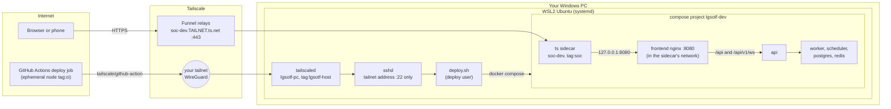

# Self-hosting dev and uat on your Windows PC

This guide runs LG-SOTF's two hosted environments, **dev** and **uat**, on
your own Windows 11 PC instead of a cloud VM, with no credit card and no
monthly cost:

* the stacks run in Docker inside WSL2 (Ubuntu 26.04);
* the public HTTPS addresses come from **Tailscale Funnel**:
  `https://soc-dev.<your tailnet>.ts.net` and `https://soc-uat.<your tailnet>.ts.net`,
  with real certificates, no open port on your router and no public IP;
* GitHub Actions still builds and deploys everything (the same pipeline as
  [cicd.md](cicd.md)): the deploy job joins your tailnet for a few minutes and
  deploys over SSH, which listens only on the PC's tailnet address;
* a Windows scheduled task keeps WSL running while nobody is signed in, and
  after every reboot.

It is written for someone doing this for the first time. Budget about an hour
and a half, most of it waiting for installs and the first image build.

Read [cicd.md](cicd.md) sections "How it works", 10 (promote), 11 (roll back)
and 12 (backups) too: the pipeline is the same, only the host differs.

## How it works



uat is a second, identical compose project (`lgsotf-uat`) with its own
sidecar `soc-uat`. Each environment has its own Tailscale machine, so its own
hostname and certificate; browsers keep their cookies apart by hostname.

What each piece does:

| Piece | Where | Job |
|---|---|---|
| `ts` sidecar (`tailscale/tailscale`, userspace mode) | one per environment | Joins the tailnet as `soc-<env>` (tag `tag:soc`) and publishes `https://soc-<env>.<tailnet>.ts.net` with Funnel. It needs no extra privileges. Its identity lives in the Docker volume `lgsotf-<env>-tailscale`, which deploys never delete |
| frontend (nginx) | shares the sidecar's network | Receives Funnel's traffic on 127.0.0.1:8080, serves the web app, sends `/api` and the `/api/v1/ws` WebSocket to the api |
| `tailscaled` on the PC | WSL, machine `lgsotf-pc`, tag `tag:lgsotf-host` | The PC's own tailnet address (100.x.y.z); used only for deploys |
| `sshd` | WSL | Listens only on that tailnet address, only for the `deploy` user, only with the GitHub deploy key |
| deploy job | GitHub-hosted runner | Joins the tailnet as a short-lived `tag:ci` machine that may only reach `tag:lgsotf-host` on port 22, then runs the usual pinned-host-key SSH deploy |
| `LG-SOTF WSL keepalive` | Windows Task Scheduler | Starts WSL one minute after boot and checks every 5 minutes, signed in or not |

The deploy runs on GitHub's machines, never on yours: a self-hosted runner on
a public repository would let anyone's pull request run code on your PC.

## What it costs

**$0**: GitHub Actions and GitHub Packages are free for public repositories,
Tailscale's Personal plan is free, Funnel certificates come from Let's
Encrypt, and the PC is yours (it uses some electricity running day and night).

Limits and caveats to accept before relying on it:

* **Non-commercial use.** Tailscale's free Personal plan is for personal,
  non-commercial use. While LG-SOTF is a personal project that is fine. When it
  becomes a commercial product (customers, paid work, a company), move to a
  paid Tailscale plan, or to **zrok.io Free**, which allows commercial use and
  has reserved names but shows browsers an interstitial page on the first
  visit. zrok is the planned fallback; it is not built into the scripts yet.
* **Your PC is the server.** When it is off, asleep, updating or out of
  battery, dev and uat are down. There is no SLA and no redundancy.
* **Funnel is for light traffic**: fine for dev and uat, not for production
  load. Only ports 443, 8443 and 10000 can be funnelled; we use 443.
* **Everything on the Funnel URLs is public on the internet** (the sign-in page
  and the API). Keep dev and uat on test data, use strong passwords, and turn on
  BitLocker (Control Panel > BitLocker Drive Encryption on Windows 11 Pro) so a
  lost laptop does not expose the databases.

## Before you start

You need:

* Windows 11 with WSL2 and the **Ubuntu** distribution running systemd
  (`/etc/wsl.conf` has `[boot]` `systemd=true`; `ps -p 1 -o comm=` prints
  `systemd`).
* `C:\Users\<you>\.wslconfig` with at least:

  ```ini
  [general]
  # Keep the distribution running with no terminal open.
  instanceIdleTimeout=-1

  [wsl2]
  memory=12GB
  processors=8
  swap=4GB
  networkingMode=nat
  maxCrashDumpCount=2
  ```

  `instanceIdleTimeout=-1` is what keeps dev and uat alive after you close the
  last terminal. The Compose limits cap each stack at about 5.8 GB
  ([cicd.md](cicd.md), memory budget); they normally use far less, and swap
  absorbs peaks, while Windows keeps the rest of the RAM.
* A GitHub account with admin rights on the repository, and a Google or
  GitHub account to sign in to Tailscale.
* This repository cloned inside WSL (for example `~/SOC`), not under `/mnt/c`.

**Do not run `wsl --update` for now.** WSL 3.0.1 has a regression with
programs started in session 0 (microsoft/WSL#41110), which is exactly how the
keepalive task starts WSL. Stay on 2.5.9 (check with `wsl --version`) or, when
you want a newer one, install the 2.7.14 MSI from the WSL releases page on
GitHub.

### Disk space

The whole WSL disk, with Docker images and every database, is one file on C:
(`ext4.vhdx`). It grows as data is written and never shrinks on its own. If C:
fills up, WSL and Docker stop and data can be corrupted. So:

* **Keep at least 10 GB free on C:** at all times. `bash deploy/pc/check-host.sh`
  shows the free space and warns loudly below 10 GB.
* Step 4 turns hibernation off, which deletes `C:\hiberfil.sys`: about
  **12.7 GB** back on this laptop.
* Do **not** enable the "sparse VHD" option (`wsl --manage Ubuntu --set-sparse`):
  it can corrupt the disk and recent WSL versions block it.
* There is no second drive to move the disk to, so reclaim space as described
  in [Operations > Disk space](#disk-space-1).

## Step 1. Docker Engine in WSL

Docker Engine runs inside Ubuntu (not Docker Desktop). In a WSL terminal:

```sh
cd ~/SOC
sudo bash deploy/pc/install-docker.sh
```

It installs Docker Engine and the compose plugin from Docker's apt
repository, caps the logs, and makes Docker use the address ranges
10.200.0.0/24 and 10.201.0.0/16, away from WSL's own network (which moves
around 172.16.0.0/12) and your home LAN (192.168.x). It adds you to the
`docker` group.

Then **open a new WSL terminal** (the group applies to new terminals only) and
check:

```sh
docker run --rm hello-world
```

## Step 2. Tailscale account, tailnet name and policy

All of this is in the Tailscale admin console, <https://login.tailscale.com>.
**Never paste a key into a chat (including Claude Code), an issue or a file in
the repository.** The scripts ask for keys with hidden prompts.

1. **Sign up** with your GitHub or Google account. That account becomes the
   tailnet's admin. Do not install the Tailscale app on Windows (see the
   warning at the end of this step).
2. **Pick the tailnet name first.** Admin console > **DNS** > *Tailnet DNS
   name*. It looks like `tail1234.ts.net`; *Rename tailnet* offers friendlier
   generated names such as `cat-crocodile.ts.net`. It becomes part of your
   URLs, and it **cannot be changed once HTTPS certificates are enabled**
   (certificate names are published in public logs).
3. On the same **DNS** page: turn on **MagicDNS**, then **HTTPS Certificates**
   (Enable HTTPS).
4. **Access controls**: open the policy file's JSON editor, replace everything
   with this policy and save:

   ```json
   {
     "tagOwners": {
       "tag:soc": ["autogroup:admin"],
       "tag:ci": ["autogroup:admin"],
       "tag:lgsotf-host": ["autogroup:admin"]
     },
     "grants": [
       {"src": ["autogroup:member"], "dst": ["autogroup:self"], "ip": ["*"]},
       {"src": ["autogroup:member"], "dst": ["tag:lgsotf-host"], "ip": ["*"]},
       {"src": ["autogroup:member"], "dst": ["tag:soc"], "ip": ["tcp:443"]},
       {"src": ["tag:ci"], "dst": ["tag:lgsotf-host"], "ip": ["tcp:22"]}
     ],
     "nodeAttrs": [
       {"target": ["tag:soc"], "attr": ["funnel"]}
     ],
     "ssh": []
   }
   ```

   What it says: only you (an admin) may create machines with these tags; your
   own devices reach each other and the PC (`lgsotf-pc`), and the environment
   sidecars (`tag:soc`) **only on port 443**, the HTTPS address you browse; a
   GitHub deploy runner (`tag:ci`) can reach only the PC's SSH port; the
   sidecars may use Funnel; tagged machines reach nothing by themselves;
   Tailscale SSH is off. Keep the sidecars at 443 only: a sidecar hands a
   connection on any other port straight to the web server (nginx on 8080),
   which trusts the client address it is told there, because that is where
   Funnel delivers. [cicd.md](cicd.md), section 16, shows the same grants.
5. **Auth key for the sidecars**: **Settings > Keys > Generate auth key**:
   * Description `lg-sotf sidecars`
   * **Reusable**: on (dev and uat both use it)
   * **Ephemeral**: off (the sidecars must survive restarts)
   * **Pre-approved**: on (shown when device approval is enabled)
   * **Tags**: `tag:soc`
   * Expiration: the maximum (90 days)

   Copy the key (`tskey-auth-...`) somewhere safe for step 5, such as your
   password manager. It is used only the first time each environment's sidecar
   registers; after that the sidecar keeps its identity, so an expired key
   matters only for a new or wiped environment.
6. **OAuth client for the deploy job**: **Settings > OAuth clients > Generate
   OAuth client** (newer consoles list it under *Trust credentials*):
   * Scopes: **Keys > Auth Keys: Write**
   * Tags: `tag:ci`

   Copy the **client ID** and the **client secret** (`tskey-client-...`; shown
   only once). The deploy job uses them to create a short-lived `tag:ci`
   machine for each run.

**Do not run Tailscale for Windows on this PC.** The WSL machine
`lgsotf-pc` is the PC's Tailscale node; a second one on Windows breaks the
routing to it. If it is installed, quit it (tray icon > Exit) and in an
elevated PowerShell run `Set-Service -Name Tailscale -StartupType Manual;
Stop-Service Tailscale`. `check-host.sh` and `windows-setup.ps1 -Status` warn
when it runs.

## Step 3. Prepare WSL as the deploy host

```sh
cd ~/SOC
sudo bash deploy/pc/setup-host.sh
```

It prints a Tailscale login URL: open it in your Windows browser and sign in.
(Without a browser: create a one-off auth key with the tag `tag:lgsotf-host`,
save it to a file only you can read, and pass `--auth-key-file <file>`.)

What it does, all safe to repeat:

* installs Tailscale from `pkgs.tailscale.com` (the signing key's fingerprint
  is checked) and joins your tailnet as **`lgsotf-pc`**, tagged
  `tag:lgsotf-host`, without taking over WSL's DNS;
* installs OpenSSH server and makes it listen **only on the tailnet address**
  (100.x.y.z), only for the user `deploy`, only with a key; it verifies that
  nothing else listens on port 22 and tests the login end to end;
* creates the `deploy` user (no password, member of `docker`) and
  `/opt/lg-sotf`;
* creates the GitHub deploy key in `~/.config/lg-sotf/deploy_ed25519` (yours
  only) and allows it for `deploy` from tailnet addresses only, with
  `restrict`: no terminal and no port, agent or X11 forwarding. The key can
  still run any command as `deploy` (the deploy job needs that), and `deploy`
  is root-equivalent through Docker;
* writes `~/.config/lg-sotf/known_hosts`, `deploy_host` and `tailnet` for
  step 5;
* installs the nightly backup timer and `vm.overcommit_memory=1` (Redis).

Check the result:

```sh
bash deploy/pc/check-host.sh
```

`lgsotf-pc` now shows in the admin console under **Machines** with the tag
`tag:lgsotf-host`. Tagged machines never need re-authentication (no key
expiry).

The `deploy` user can control Docker, which is equivalent to root in WSL:
treat the deploy key like a root password. It never leaves your PC except as a
GitHub environment secret.

## Step 4. Keep WSL running without you

Windows stops WSL when nobody uses it and never starts it at boot on its own.
`deploy/pc/windows-setup.ps1` fixes that:

* registers the task **`LG-SOTF WSL keepalive`**: it runs
  `wsl.exe -d Ubuntu --exec /bin/true` one minute after every boot and every
  5 minutes, whether you are signed in or not (it runs as you without storing
  your password), on battery too, never twice at once, stopped after 5
  minutes. Starting WSL starts systemd, which starts Docker, Tailscale, SSH and
  the containers;
* power, on AC only: closing the lid does nothing, never sleep, never
  hibernate; then `powercfg /hibernate off` (frees about 12.7 GB on C: and turns
  off Fast Startup, which would otherwise skip the boot trigger). Add
  `-KeepHibernation` to keep hibernation;
* Windows Update **active hours** 06:00-00:00 (18 hours, the maximum), so an
  update restart happens only between midnight and 6 AM. `-ActiveHoursStart 8`
  gives 08:00-02:00; `-SkipActiveHours` leaves them alone. Settings then shows
  them as "managed by your organization": that is this policy;
* prints a status report. It does **not** restart WSL.

Copy it to your Windows profile (an administrator PowerShell cannot always
run scripts from the WSL share):

```sh
cp deploy/pc/windows-setup.ps1 "$(wslpath "$(cd /mnt/c && cmd.exe /d /c 'echo %USERPROFILE%' | tr -d '\r')")/lgsotf-windows-setup.ps1"
```

Start **Windows PowerShell as administrator** (Start > type *PowerShell* >
*Run as administrator*), signed in as the same Windows account that uses WSL,
and run:

```powershell
powershell.exe -NoProfile -ExecutionPolicy Bypass -File "$env:USERPROFILE\lgsotf-windows-setup.ps1"
```

Add `-WhatIf` first if you want to see what it would change. The report at
the end must show the task with `S4U` and a successful test run; the lid,
sleep, hibernation and active-hours lines turn OK. `-Status` repeats the
report at any time without administrator rights; `-Uninstall` removes the task
and the active-hours policy.

Now prove that WSL comes back without you. **This closes Claude Code and every
WSL window**, so save your work first. In the same administrator PowerShell:

```powershell
wsl --shutdown
Start-ScheduledTask -TaskName 'LG-SOTF WSL keepalive'; Start-Sleep -Seconds 20; wsl -l -v
```

`Ubuntu` must show **Running**. Then:

1. Close every terminal, wait two minutes, open a new PowerShell and run
   `wsl -l -v`: still **Running**.
2. Reboot and **do not sign in**. After about three minutes, on your phone,
   open <https://login.tailscale.com/admin/machines>: `lgsotf-pc` is
   **Connected** (after step 6 the app loads too).
3. Sign in, open Ubuntu and continue where you were:
   `cd ~/SOC && claude --continue`.

## Step 5. GitHub

### Install the GitHub CLI

Ubuntu 26.04's archive has `gh` 2.46 (from 2024); it works with the script,
but GitHub's own apt repository has the current version:

```sh
sudo install -d -m 0755 /etc/apt/keyrings
curl -fsSL https://cli.github.com/packages/githubcli-archive-keyring.gpg \
  | sudo tee /etc/apt/keyrings/githubcli-archive-keyring.gpg >/dev/null
sudo chmod go+r /etc/apt/keyrings/githubcli-archive-keyring.gpg
echo "deb [arch=$(dpkg --print-architecture) signed-by=/etc/apt/keyrings/githubcli-archive-keyring.gpg] https://cli.github.com/packages stable main" \
  | sudo tee /etc/apt/sources.list.d/github-cli.list >/dev/null
sudo apt-get update && sudo apt-get install -y gh
```

(Or simply `sudo apt-get install -y gh` for Ubuntu's version.) Then sign in:
`gh auth login` > GitHub.com > HTTPS > *Login with a web browser*; open the
URL it prints in your Windows browser and enter the code.

### Repository settings (once, in the browser)

**Settings > Actions > General**:

* *Approval for running fork pull request workflows from contributors*:
  **Require approval for all external contributors**.
* *Workflow permissions*: **Read repository contents and packages
  permissions**, and leave "Allow GitHub Actions to create and approve pull
  requests" unticked.

Make the container images public once they exist (after the first green build
on main): your profile > **Packages** > `lg-sotf` > *Package settings* >
*Change visibility* > Public, and the same for `lg-sotf-frontend`
([cicd.md](cicd.md), step 8).

### Configure the environments

Have the Tailscale OAuth client ID and secret and the `tag:soc` auth key from
step 2 at hand, then:

```sh
cd ~/SOC
bash deploy/pc/configure-github.sh --env dev --admin-email you@example.com --dry-run
bash deploy/pc/configure-github.sh --env dev --admin-email you@example.com
bash deploy/pc/configure-github.sh --env uat --admin-email you@example.com
```

`--dry-run` shows what it would set (names only) without changing anything.
The real run asks for the three Tailscale values with hidden prompts (only
those not set yet in that environment), then:

* creates the GitHub environment: **dev** deploys only from the branch `main`;
  **uat** only from tags `v*.*.*` and waits for your approval (`--no-reviewer`
  to skip the approval);
* sets the environment **variables** `DEPLOY_HOST` (the PC's tailnet
  address), `DEPLOY_USER=deploy`, `DEPLOY_PORT=22`,
  `APP_DOMAIN=soc-<env>.<tailnet>.ts.net`, `BOOTSTRAP_ADMIN_EMAIL`,
  `LLM_PROVIDER` (`fake` until you add an LLM key), `INGRESS=funnel` and
  `DEPLOY_VIA_TAILSCALE=true`;
* sets the environment **secrets** `DEPLOY_SSH_KEY` and
  `DEPLOY_SSH_KNOWN_HOSTS` (from `~/.config/lg-sotf`), `TS_OAUTH_CLIENT_ID`,
  `TS_OAUTH_SECRET`, `TS_AUTHKEY`, and eight freshly generated application
  secrets (`POSTGRES_SUPERUSER_PASSWORD`, `LGSOTF_OWNER_PASSWORD`,
  `LGSOTF_APP_PASSWORD`, `LG_SOTF_AUTH__JWT_SECRET`,
  `LG_SOTF_SECURITY__ENCRYPTION_KEYS`, `LG_SOTF_SECURITY__INDICATOR_HMAC_KEY`,
  `LG_SOTF_API__METRICS_TOKEN`, `LG_SOTF_AUTH__BOOTSTRAP_ADMIN_PASSWORD`),
  different for dev and uat. Values go to GitHub on standard input and are
  never printed;
* saves the first admin's password in `~/.config/lg-sotf/<env>-admin-password`
  and prints only that path. GitHub secrets cannot be read back: put it in
  your password manager.

Running it again is safe: **it never replaces application secrets that already
exist**. The database keeps the passwords it was created with on the first
deploy; new ones in GitHub would make every later deploy fail.
`--rotate-app-secrets` replaces all eight, so use it only before the first
deploy or after deleting the environment's database. Other options:
`--tailnet NAME.ts.net` (default: the name setup-host.sh saved),
`--ts-oauth-client-id-file`, `--ts-oauth-secret-file`, `--ts-authkey-file`
(read a value from a file instead of a prompt), `--update-tailscale-secrets`
(ask again for all three), `--anthropic-key-file FILE` or `--ask-anthropic-key`
(adds `ANTHROPIC_API_KEY`; the provider then defaults to `anthropic`),
`--llm-provider`, `--auto-deploy` / `--no-auto-deploy`; `--help` lists them
all.

### Use a real LLM (optional)

The provider follows the key you give: `ANTHROPIC_API_KEY` selects
`anthropic`, otherwise `GOOGLE_API_KEY` selects `gemini`, otherwise
`OPENAI_API_KEY` selects `openai`, otherwise the stack runs on `fake`. The
`LLM_PROVIDER` variable overrides that choice. For a free test on dev with
Google's Gemini free tier (key from <https://aistudio.google.com/apikey>, no
card needed), save the key in a file and set:

```bash
gh secret set GOOGLE_API_KEY --env dev < ~/.config/lg-sotf/gemini-key
gh variable set LLM_PROVIDER --env dev --body gemini
gh variable set LLM_FAST_MODEL --env dev --body gemini-3.5-flash-lite
gh variable set LLM_DEEP_MODEL --env dev --body gemini-2.5-flash
gh variable set LLM_MAX_CONCURRENCY --env dev --body 2
gh variable set WORKER_CONCURRENCY --env dev --body 2
```

The next deploy picks them up (re-run the last *Deploy* workflow to apply them
at once). The free tier allows only a few requests per minute, hence the low
concurrency; alerts wait in the queue instead of failing. **Google may use
free-tier prompts to train its models: send only synthetic alerts to it**, never
real customer data. `LLM_BASE_URL` (an `https://` URL) points the `openai`
provider at any OpenAI-compatible endpoint. To go back to the fake model, set
`LLM_PROVIDER` to `fake` and delete the key with
`gh secret delete GOOGLE_API_KEY --env dev`.

## Step 6. First deploy and the day-one smoke test

Images are published by *Release images* after each green build on `main`
([cicd.md](cicd.md)). The deploy takes its scripts from the commit an image was
built from, so the image must come from a commit that already contains this
setup (`deploy/vm/docker-compose.funnel.yml`); an older one stops with
"predates the Tailscale Funnel ingress; deploy a newer image". Deploy dev
either way:

* **By hand**: **Actions > Deploy > Run workflow**: use workflow from `main`,
  environment `dev`, image tag `main`.
* **Automatically** from now on: `bash deploy/pc/configure-github.sh --env dev --auto-deploy`
  (sets the repository variable `AUTO_DEPLOY_DEV=true`), then push to `main`.

The run joins your tailnet, uploads the deploy bundle over SSH and runs
`deploy.sh --ingress funnel` on the PC as `deploy`. On the first deploy the
sidecar registers as `soc-dev` with the auth key; the admin console shows it
under **Machines** with `tag:soc` and a *Funnel* badge. If the new version is
not healthy, the previous one is put back automatically, as on a VM.

**Day-one smoke test**, from your phone with Wi-Fi **off** and the Tailscale
app (if the phone has it) **disconnected**: mobile data only, so the request
really comes from the internet through Funnel. With the app connected, the
name resolves inside your tailnet and the test proves nothing.

1. Open `https://soc-dev.<tailnet>.ts.net`. The sign-in page loads with a
   valid padlock. A brand-new name can take up to 10 minutes to resolve.
2. Sign in with `BOOTSTRAP_ADMIN_EMAIL` and the password from
   `~/.config/lg-sotf/dev-admin-password`.
3. **Reload the page**: you stay signed in (the refresh cookie works through
   Funnel).
4. Look at the live-updates indicator in the header: it must turn green and
   say **Live** within a few seconds. This is the WebSocket check: the app
   opens `wss://soc-dev.<tailnet>.ts.net/api/v1/ws?token=...` through Funnel.
   An open Tailscale issue (#18651) claims Funnel drops WebSocket query
   strings; our research traced that report to something else, and this step
   is the proof on your setup. If it says *Reconnecting* or *Live updates
   unavailable*, see [Troubleshooting](#troubleshooting).

Then run `bash deploy/pc/check-host.sh`: no FAIL lines, and for dev "Funnel
is on" and the public `/healthz` check answering 200.

## Step 7. Promote to uat

Tag a commit on `main` that runs well on dev:

```sh
git fetch origin
git tag v0.1.0 <commit on main>
git push origin v0.1.0
```

*Release images* re-tags that commit's images as `v0.1.0` (the same bytes dev
ran) and starts *Deploy uat*, which waits for your approval (**Review
deployments** in the run). The first uat deploy registers `soc-uat`. Repeat the
day-one test on `https://soc-uat.<tailnet>.ts.net` with the password from
`~/.config/lg-sotf/uat-admin-password`. Set `AUTO_DEPLOY_UAT=true`
(`configure-github.sh --env uat --auto-deploy`) so tags deploy by themselves.

To redeploy or roll back uat by hand: **Actions > Deploy > Run workflow**,
*Use workflow from*: **Tags** > the newest `vX.Y.Z` (uat accepts only tags),
environment `uat`, and the image tag you want. Rolling back works as in
[cicd.md](cicd.md), section 11; on the PC itself, for uat:

```sh
sudo -iu deploy
d=$(ls -dt /opt/lg-sotf/env/uat/releases/*/ | head -n 1)
bash "$d/deploy/vm/deploy.sh" --env uat --status
bash "$d/deploy/vm/deploy.sh" --env uat --domain soc-uat.<tailnet>.ts.net --rollback
```

For dev, the same commands with `dev` in all three places (`env/dev/releases`,
`--env dev`, `--domain soc-dev.<tailnet>.ts.net`).

## Operations

### Check the host

```sh
bash deploy/pc/check-host.sh              # everything; exit status 1 when something needs attention
bash deploy/pc/check-host.sh --env dev --no-public
```

It changes nothing and needs no sudo: WSL version and settings, the keepalive
task, free space on C:, Docker, Tailscale, SSH, and per environment the
sidecar, Funnel and the public `/healthz`. From Windows:
`lgsotf-windows-setup.ps1 -Status`.

Logs of an environment (you are in the `docker` group):

```sh
docker ps --filter label=com.docker.compose.project=lgsotf-dev
docker logs --tail 100 lgsotf-dev-api-1
docker logs --tail 100 lgsotf-dev-ts-1
```

### Backups

`setup-host.sh` installed `lgsotf-backup.timer`: every night at 02:30 UTC it
runs `/opt/lg-sotf/bin/backup.sh --all` (installed by the first deploy), a
verified `pg_dump` of each environment into `/opt/lg-sotf/backups/<env>/`,
kept 14 days ([cicd.md](cicd.md), section 12). If the PC was off at that time,
it runs at the next start.

```sh
systemctl list-timers lgsotf-backup.timer                  # next run
sudo systemctl start lgsotf-backup.service                 # back up now
sudo -u deploy /opt/lg-sotf/bin/backup.sh --env dev --list
sudo -u deploy /opt/lg-sotf/bin/backup.sh --env dev --restore /opt/lg-sotf/backups/dev/<file>.dump --yes
```

These dumps live inside the WSL disk, **on the same drive as everything
else**. To survive losing the PC, copy them elsewhere now and then, for
example to OneDrive (synced to the cloud; the dumps of test data are small):

```sh
dest="$(wslpath "$(cd /mnt/c && cmd.exe /d /c 'echo %OneDrive%' | tr -d '\r')")/lgsotf-backups"
mkdir -p "$dest"
sudo sh -c "cp /opt/lg-sotf/backups/*/*.dump '$dest'/"
```

or to a USB stick (`/mnt/d`, or `sudo mount -t drvfs E: /mnt/e` for one
plugged in later). Check C: still has 10 GB free afterwards. A dump is useless
without that environment's encryption and HMAC keys, which are in
`/opt/lg-sotf/env/<env>/secrets.env` on the PC (GitHub cannot show them): keep
a copy of that file in your password manager too. If dev or uat ever holds real
data, encrypt copies (for example `gpg --symmetric`).

### Windows Update

With the active hours from step 4, Windows restarts for updates only between
midnight and 6 AM, and the keepalive task brings everything back one minute
after boot. Before a demo, **Settings > Windows Update > Pause updates** (1 to
5 weeks). Leave *Get me up to date* (Advanced options) off: it restarts as
soon as possible.

### WSL updates

Check `wsl --version` after Windows updates. Avoid WSL 3.0.1 (session-0
regression, microsoft/WSL#41110). To change the WSL version, use maintenance
mode (below), then install the 2.7.14 MSI from the WSL releases page on GitHub.

### Tailscale and system updates

`unattended-upgrades` installs Ubuntu security updates. Tailscale on the PC is
updated with apt (a short interruption of deploys only; the sites run in the
sidecars):

```sh
sudo apt-get update && sudo apt-get install --only-upgrade tailscale
```

The sidecar image is pinned in `deploy/vm/docker-compose.funnel.yml` and
changes with deploys.

### Maintenance mode

Whenever you need WSL stopped (compacting the disk, updating WSL), first stop
the keepalive task, or it starts WSL again within 5 minutes. In an
administrator PowerShell:

```powershell
Disable-ScheduledTask -TaskName 'LG-SOTF WSL keepalive'
wsl --shutdown
# ... your maintenance ...
Enable-ScheduledTask -TaskName 'LG-SOTF WSL keepalive'
Start-ScheduledTask -TaskName 'LG-SOTF WSL keepalive'
```

### Disk space

* Windows side: Settings > System > Storage > *Temporary files* and *Cleanup
  recommendations*; empty the recycle bin.
* Inside WSL: `docker system df` shows what Docker uses. `deploy.sh` already
  removes images no environment runs or can roll back to;
  `docker builder prune` removes build cache if you build images locally.
  Journald is capped at 200 MB and container logs are rotated.
* Giving space back to Windows: the WSL disk does not shrink by itself. In
  maintenance mode, compact it (the path is printed by `check-host.sh`):

  ```text
  diskpart
  select vdisk file="C:\Users\<you>\AppData\Local\wsl\{...}\ext4.vhdx"
  attach vdisk readonly
  compact vdisk
  detach vdisk
  exit
  ```

### Keys and passwords

* **Tailscale auth key expired** (90 days): it matters only when a sidecar
  registers again (a new or wiped environment). Create a new one as in step 2
  and save it with
  `bash deploy/pc/configure-github.sh --env dev --ts-authkey-file <file>` (and
  for uat); other secrets are kept.
* **OAuth client**: same with `--ts-oauth-client-id-file` and
  `--ts-oauth-secret-file`.
* **Deploy key**: delete `~/.config/lg-sotf/deploy_ed25519*`, run
  `sudo bash deploy/pc/setup-host.sh` (it authorizes the new key and drops the
  old one), then `configure-github.sh` for dev and uat.
* **Application secrets**: see [operations.md](operations.md) (key rotation);
  never just replace the database passwords.

## Troubleshooting

| Symptom | Cause and fix |
|---|---|
| Deploy fails at *Join the tailnet* | Wrong or deleted OAuth client, or it lacks *Auth Keys: Write* or the tag `tag:ci`; the policy lacks `tag:ci` in `tagOwners`. Recreate the client (step 2) and save it with `configure-github.sh --update-tailscale-secrets` |
| *Join the tailnet* succeeds but the ping to `DEPLOY_HOST` or SSH times out | The PC is off or asleep, WSL is stopped, or tailscaled is down: `lgsotf-pc` is not *Connected* in the admin console. Run `check-host.sh` and `windows-setup.ps1 -Status`. Also check the policy grant `tag:ci` -> `tag:lgsotf-host` `tcp:22` |
| `Connection refused` on port 22 | sshd does not listen on the tailnet address (for example the address changed after the PC re-registered). `systemctl status ssh.socket ssh.service` shows why. `sudo bash deploy/pc/setup-host.sh`, then `configure-github.sh` for both environments (new `DEPLOY_HOST`) |
| `Host key verification failed` | `DEPLOY_SSH_KNOWN_HOSTS` does not match (SSH host keys regenerated, or a new address). Re-run `setup-host.sh`, then `configure-github.sh` for both environments |
| `Permission denied (publickey)` | `DEPLOY_SSH_KEY` is not the key in `~/.config/lg-sotf`. Re-run both scripts |
| `https://soc-dev...` does not resolve or connect | A new Funnel name can take up to **10 minutes** to appear in public DNS. Otherwise: HTTPS certificates are off (step 2.3), the policy lacks the `funnel` attribute for `tag:soc`, or the sidecar is not logged in: `check-host.sh` shows the Funnel status |
| Deploy log ends with `INGRESS FAILED` | The new version is deployed and healthy inside the PC, but Funnel does not publish it; the lines after it name the cause (usually the three above) |
| The machine is called `soc-dev-1` and the URL changed | The sidecar lost its identity (the Docker volume `lgsotf-dev-tailscale` was deleted) and registered again next to the old `soc-dev`. Admin console > Machines: delete the old `soc-dev`, then on `soc-dev-1` *Edit machine name* > `soc-dev`. Avoid doing this often: Let's Encrypt issues at most 5 certificates per name per week. Never delete `lgsotf-*-tailscale` volumes |
| Sidecar *NeedsLogin* / *logged out* on the first deploy, or the deploy log says `the ts sidecar cannot log in (invalid key: ...)` | `TS_AUTHKEY` is missing, expired, revoked, used up (not reusable) or not tagged `tag:soc`. A rejected key makes the sidecar restart over and over, which also knocks out the web app of that environment, so the deploy can fail its health checks. New key (step 2.5), `configure-github.sh --env dev --ts-authkey-file <file>`, deploy again |
| Header says *Reconnecting* or *Live updates unavailable*, pages work | The WebSocket does not get through Funnel. The app stays usable (pages still refresh periodically). On a computer, open the browser's developer tools > Network > WS and check `/api/v1/ws?token=...`: 101 is fine; 401 means the `token` query string did not arrive (Tailscale issue #18651). Check `docker logs lgsotf-dev-frontend-1` and report it with the Tailscale version |
| The site is down after closing the terminals | `.wslconfig` lacks `instanceIdleTimeout=-1`, or the keepalive task is missing or disabled: `windows-setup.ps1 -Status` |
| The site is down after a reboot until you sign in | The task is not S4U or failed: `windows-setup.ps1 -Status`. Result `0x80070569` means your account lacks *Log on as a batch job* (use an administrator account, or grant the right in `secpol.msc`). With `-KeepHibernation`, Fast Startup skips the boot trigger; the 5-minute trigger takes over |
| The PC sleeps when the lid closes or on battery | The power settings apply to AC power and to the active power plan only: keep the laptop plugged in and re-run `windows-setup.ps1` after switching plans |
| C: is (nearly) full | Free space on Windows first (see [Disk space](#disk-space-1)), then prune Docker. Keep 10 GB free |
| `install-docker.sh` warned about the DOCKER NAT chain | The nftables backend of iptables does not work in this kernel. Switch to legacy iptables: `sudo update-alternatives --set iptables /usr/sbin/iptables-legacy && sudo update-alternatives --set ip6tables /usr/sbin/ip6tables-legacy && sudo systemctl restart docker tailscaled` |
| `docker: permission denied` in your terminal | Open a new WSL terminal after `install-docker.sh` (group membership applies to new terminals) |
| `tailscale up` says the tags are not permitted | The policy from step 2.4 is not saved, or you signed in with an account that is not an admin of the tailnet |
| `check-host.sh` warns about Tailscale for Windows | Quit it and set its service to Manual (step 2) |

## Reference

| File or name | What |
|---|---|
| `deploy/pc/install-docker.sh` | Step 1: Docker Engine in WSL |
| `deploy/pc/setup-host.sh` | Step 3: Tailscale, SSH, deploy user and key, backups |
| `deploy/pc/windows-setup.ps1` | Step 4: keepalive task, power, active hours, status |
| `deploy/pc/configure-github.sh` | Step 5: GitHub environments, variables and secrets |
| `deploy/pc/check-host.sh` | Read-only health report |
| `~/.config/lg-sotf/` | `deploy_ed25519` (private deploy key), `known_hosts`, `deploy_host`, `tailnet`, `<env>-admin-password` |
| `/opt/lg-sotf/` | Deploys, as on a VM ([cicd.md](cicd.md)); `env/<env>/tailscale/serve.json` is the Funnel configuration |
| `lgsotf-pc` / `tag:lgsotf-host` | The PC's Tailscale machine |
| `soc-dev`, `soc-uat` / `tag:soc` | The environments' Funnel machines (Docker volumes `lgsotf-dev-tailscale`, `lgsotf-uat-tailscale`) |
| `tag:ci` | Short-lived GitHub deploy runners |
| `LG-SOTF WSL keepalive` | The Windows scheduled task |
