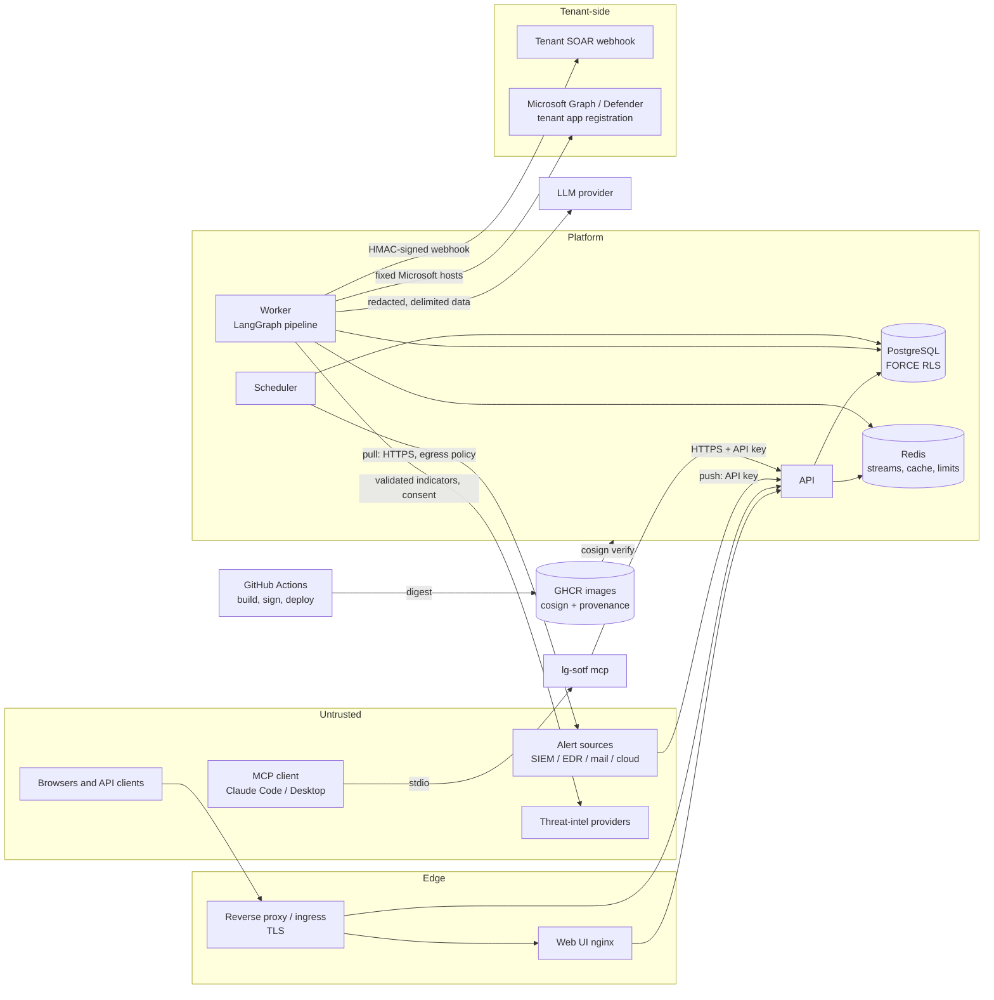

# Threat model (v2)

| | |
|---|---|
| Version | 2.0, 2026-11-07 (SEC3.1) |
| Replaces | the threat-model section of [security.md](security.md#1-threat-model), which stays as the short summary |
| Scope | LG-SOTF API, worker, scheduler, PostgreSQL, Redis, connectors, evidence tools, MCP server, MSSP delegation, web UI and reverse proxy, CI/CD and release |
| Method | STRIDE per component; OWASP Top 10 for Agentic Applications (2026); MITRE ATLAS |
| Audience | Security reviewers at MSSPs and their customers, pen testers, LG-SOTF engineers |
| Review | Every epic adds or updates its rows before it closes (section 7); the whole document is reviewed every quarter |

This document lists what can go wrong, which control handles it, and where
that control is in the code. Each control is one of the following:

* **In place**: it ships in this release. A `path:line` reference points
  to the code or configuration that enforces it. A test checks that every
  reference names a file that exists (`tests/deploy/test_security_docs.py`).
* **Partial**: part of it ships; the gap is stated.
* **Planned (STORY-ID)**: it does not exist yet. The story ID is in the
  backlog. Do not count planned controls as mitigations when you assess the
  current release.

How to use it: the security model and the controls themselves are described
in [security.md](security.md). Deployment hardening is in
[hardening.md](hardening.md). The safety invariants that cut across these
rows, each with the tests that prove it, are in [invariants.md](invariants.md).
The AI system card, [ai-system-card.md](ai-system-card.md), describes the
models, the agents and their tools, the human oversight design and the
evaluation evidence that the AI rows here rely on.
The MCP design is in
[design/mcp-architecture.md](design/mcp-architecture.md), and its threat
table (section 8.1) is the detailed source for the planned remote MCP
endpoint.

## 1. System and trust boundaries

Trust boundaries, in the order an attacker meets them:

1. **Alert content → pipeline.** Everything inside an alert is written, or
   can be shaped, by the attacker whose activity produced it.
2. **Network clients → API.** Credentials: JWT session, OIDC token or API
   key.
3. **Tenant → tenant.** Every tenant-owned row is under PostgreSQL row-level
   security.
4. **Platform → outside services** (LLM, threat intelligence, SOAR,
   Microsoft). Outbound calls go through the egress policy.
5. **MCP client → API.** The MCP server is a client of the API and holds
   nothing but an API key.
6. **MSSP operator → customer tenant.** Today this is a platform admin with
   `X-Tenant-ID`. The organisation model with grants (ARCH-E4.1) replaces
   it.
7. **Source code → running image.** CI builds, signs and attests the image,
   and the deploy verifies it.

### Actors added in v2

security.md lists the original actors: the external attacker, a stolen API
key, a malicious tenant user, a hostile source URL, a manipulated model and
an infrastructure operator. v2 adds the following:

| Actor | Capability | Main controls |
|---|---|---|
| MSSP analyst acting for a customer | Works across many customer tenants | Today: platform admin plus `X-Tenant-ID`, audited, no decisions under a switch. Planned: scoped, expiring grants (ARCH-E4.1a–d, SEC6.2) |
| MCP client agent (an LLM with tools) | Reads alert text that may carry instructions; may also hold shell or web tools | Read-only and note tools only; API keys cannot decide; untrusted-data wrapping; client hardening profile |
| Adversary controlling evidence-tool output | Plants text in threat-intel results, mailbox contents or SIEM fields that a later query returns | Today: lookups only for extracted indicators; results are `<tool_data>`. Planned: quarantined reader and typed facts (AI-E3.2) |
| Compromised dependency or build step | Code runs in CI or in the image | Pinned dependencies and actions, scanners, isolated signing job, verification before deploy |
| AI coding agent with repository write access | Proposes code changes | CI gates, CODEOWNERS on guard files, no release credentials. Policy document planned (SEC3.2) |

## 2. STRIDE per component

STRIDE: **S**poofing, **T**ampering, **R**epudiation, **I**nformation
disclosure, **D**enial of service, **E**levation of privilege.

### 2.1 API (`lg-sotf api`)

| ID | STRIDE | Threat | Controls | Status |
|---|---|---|---|---|
| TM-API-1 | S | Stolen or forged session | HS256 access tokens of 15 minutes (`src/lg_sotf/settings.py:166`); refresh rotation with reuse detection; JWT secret of at least 32 bytes enforced at start-up (`src/lg_sotf/settings.py:503-505`) | In place. Asymmetric JWT with `kid` rotation is planned (SEC5.2) |
| TM-API-2 | S | API key used beyond its purpose | Keys are scoped (`ingest`, `read`, `write`) and refused on admin, decision and approval routes (`src/lg_sotf/api/auth/deps.py:43-62`) | In place |
| TM-API-3 | E | A user reaches another tenant | Tenant comes from the credential; `X-Tenant-ID` is honoured only for platform admins and audited (`src/lg_sotf/api/auth/authenticate.py:394-410`); RLS below (TM-DB-1) | In place |
| TM-API-4 | E | Role escalation through the request body | Approver role always comes from the principal; role checks are in `Access.check` (`src/lg_sotf/api/auth/deps.py:53-58`) | In place |
| TM-API-5 | D | Large bodies, floods, login brute force | Streaming body limit (`src/lg_sotf/api/middleware.py:189-235`); Redis rate limits per principal and per tenant (`src/lg_sotf/api/auth/deps.py:70-79`); account lockout | Partial: rate limits fail open when Redis is down (`src/lg_sotf/api/ratelimit.py:67-70`); lockout still applies |
| TM-API-6 | I | Stack traces, secrets or bodies in errors and logs | Uniform error envelope; logs carry error type and frames only (ADR-0005); redaction of every log record | In place |
| TM-API-7 | I | Clickjacking, MIME sniffing, referrer leaks | Security headers and CSP (`src/lg_sotf/api/middleware.py:29-33`, `src/lg_sotf/api/middleware.py:148-179`) | In place |
| TM-API-8 | I | Prometheus metrics readable by anyone who can reach the API | Bearer token checked when `api.metrics_token` is set (`src/lg_sotf/api/routers/health.py:66-79`) | Partial: open when the token is unset; see HG-APP-5 in [hardening.md](hardening.md) |
| TM-API-9 | R | A user denies an action | Hash-chained, append-only audit log (TM-DB-3) | In place |
| TM-API-10 | S | Spoofed client address defeats per-address limits and the audit trail | `X-Forwarded-For` is trusted only from `api.forwarded_allow_ips` (`src/lg_sotf/settings.py:222`) | In place, if set correctly (HG-PX-4) |

### 2.2 Worker and LLM pipeline (`lg-sotf worker`)

| ID | STRIDE | Threat | Controls | Status |
|---|---|---|---|---|
| TM-WRK-1 | T | Prompt injection in alert fields changes the verdict | Untrusted-data blocks with escaped `<` and `>` (`src/lg_sotf/llm/prompting.py:365-400`); injection detection voids false-positive signals (`src/lg_sotf/agents/triage/base.py:125-131`); the injection signal blocks corroboration (`src/lg_sotf/agents/analysis/base.py:15-28`) | In place |
| TM-WRK-2 | T | A fooled model closes a dangerous alert, or the attacker names objects so the rules corroborate a benign close (title camouflage) | High and critical alerts are never auto-closed; low and medium need rule corroboration; refusals escalate (`src/lg_sotf/domain/routing.py:1-21`). Rule false-positive evidence comes only from the detection rule name with attacker-named values masked, EICAR hashes, the tenant's `triage.known_scanners` and the source id, never from titles, entity names, command lines, user agents or email subjects (`src/lg_sotf/domain/benign_evidence.py`, AI-E6.3). Rule-name words that name the detected activity (`scheduled`, `update`, `backup`, `scan`, `monitoring`) count only with a trusted qualifier: an intent word in the same rule name, a test-environment source id or, for `scan`, a known scanner (AI-E6.4) | In place; measured by `high_severity_auto_closed_benign` = 0 and the gated `title-camouflage` and `activity-camouflage` families of the adversarial corpus v2 in CI |
| TM-WRK-3 | E | A fooled model triggers containment | Containment on model-only evidence always waits for approval (`src/lg_sotf/services/response/planner.py:328-329`); tenant autonomy, with unknown values read as `disabled` (`src/lg_sotf/services/response/policy.py:215-226`) | In place |
| TM-WRK-4 | I | Alert data or secrets sent to the model provider | Secrets redacted before storage and before the model; personal data is **not** redacted | Partial: per-tenant pseudonymisation before the LLM call is planned (SEC7.5b) |
| TM-WRK-5 | I | Model endpoint pointed at an internal or metadata address | `llm.base_url` egress check (`src/lg_sotf/llm/endpoint.py:80-100`), enforced at start-up (`src/lg_sotf/settings.py:519-524`) | In place |
| TM-WRK-6 | D | Cost exhaustion (alert floods, long prompts) | Per-tenant daily token budget, seeded from PostgreSQL after a Redis loss (`src/lg_sotf/llm/budget.py:1-12`); rules gate LLM calls | In place. Per-investigation budgets are planned (AI-E3.3) |
| TM-WRK-7 | T | A malformed or truncated model answer is used | Schema-validated structured output; refusal, truncation and invalid output are distinct errors (`src/lg_sotf/llm/structured.py:1-12`) | In place |
| TM-WRK-8 | R | Nobody can say which prompt produced a decision | Prompt registry with a content hash per template (`src/lg_sotf/llm/registry.py:1-12`); model and provider per step in the alert summary | Partial: a full LLM and tool-call trace store is planned (AI-E1.3) |
| TM-WRK-9 | T | LLM normaliser invents fields for an unknown event | Off by default; its output is grounded against the event and never auto-closed (`src/lg_sotf/ingestion/llm_fallback.py:1-5`) | In place |
| TM-WRK-10 | T | A poisoned guidance note (insider, compromised analyst account or an AI draft) makes attacks close | Only the note's structured predicate yields facts, never its text; no bare wildcard scope; never for high, critical or never-close classes; a fact replay rejects a note that would close a labelled attack; second-person approval; mandatory expiry; audited ([ADR-0014](adr/0014-investigation-skills.md) section 4.2) | Planned (AI-E3.9) |
| TM-WRK-11 | T | Skill drift: a skill, prompt or model change widens what closes | Contract hash per skill; `skill-diff` change classes with a CI version check; a widening change caps autonomy at `auto_full_audit`; per-skill corpus gate per PR and nightly; recall canaries; blind-audit miss estimate per skill (ADR-0014 sections 1.6, 8.2) | Planned (AI-E3.8a, AI-E3.8b, AI-E3.11) |
| TM-WRK-12 | E | Autonomy gained without being earned: miscounted evidence, rubber-stamped labels, a self-approved promotion | Only skill-blind and AI-blind labels count; four-eyes promotion (PRD-8.3); demotion on any miss in the label's transaction; recall canaries (ADR-0014 section 6.3) | Planned (AI-E3.10) |
| TM-WRK-13 | T | An attacker trains the AI with benign-looking repeats so memory vouches for the real attack | Only analyst decisions feed pattern memory and case memory; skill closures never do; the pattern key includes the command template; memory never proves a benign hypothesis alone (ADR-0014 sections 4.3, 8.3) | Planned (AI-E4.3, founder plan step 3) |

### 2.3 Scheduler (`lg-sotf scheduler`)

| ID | STRIDE | Threat | Controls | Status |
|---|---|---|---|---|
| TM-SCH-1 | E | Cross-tenant code path misused from the runtime role | `system_tx()` bypasses RLS only for members of the schema-owner role and checks this (`src/lg_sotf/db/pool.py:243-256`) | In place |
| TM-SCH-2 | T | Retention deletes audit rows early | Retention drops whole partitions older than `retention.audit_days`; the trigger blocks row deletes (TM-DB-3) | In place |
| TM-SCH-3 | D | Two schedulers run maintenance at once | Leader election on a PostgreSQL advisory lock (`scheduler.leader_lease_s`) | In place |

### 2.4 PostgreSQL

| ID | STRIDE | Threat | Controls | Status |
|---|---|---|---|---|
| TM-DB-1 | I/T | Tenant data read or written across tenants | `FORCE ROW LEVEL SECURITY` on tenant tables (`src/lg_sotf/db/migrations/versions/0001_initial.py:516`); `tenant_tx` sets `app.tenant_id` per transaction (`src/lg_sotf/db/pool.py:233-240`) | In place; tested in `tests/integration/db/test_rls.py` |
| TM-DB-2 | E | Runtime role can bypass RLS | `lg-sotf migrate` refuses a runtime role that is a superuser, has `BYPASSRLS` or belongs to the owner role (`src/lg_sotf/db/migrate.py:227-249`); compose roles created `NOBYPASSRLS NOINHERIT` (`docker/postgres/init-roles.sh:21-30`) | In place |
| TM-DB-3 | T/R | Audit entries altered or deleted | Per-tenant SHA-256 hash chain (`src/lg_sotf/db/repos/audit.py:1-15`); triggers block `UPDATE`, `DELETE` and `TRUNCATE` (`src/lg_sotf/db/migrations/versions/0001_initial.py:448-467`); `GET /api/v1/audit/verify` | In place. A DBA with the owner role can still rewrite the chain; WORM export is planned (ARCH-E8) |
| TM-DB-4 | I | Credentials readable from a dump | Source credentials and tenant secrets encrypted with Fernet, bound to tenant and purpose (`src/lg_sotf/security/crypto.py:35-81`) | Partial: install-wide keys; per-tenant KEKs and crypto-shredding are planned (ARCH-E4.4, SEC5.1) |
| TM-DB-5 | I | Traffic to the database read on the network | `database.ssl_mode` up to `verify-full` (`src/lg_sotf/db/pool.py:90-111`) | In place, off unless configured (HG-PG-4) |

### 2.5 Redis

| ID | STRIDE | Threat | Controls | Status |
|---|---|---|---|---|
| TM-RD-1 | I | Events of one tenant delivered to another | Keys, streams and channels carry the tenant id; WebSockets subscribe only to the principal's channel and re-check every 15 s (`src/lg_sotf/api/routers/ws.py:184-186`) | In place |
| TM-RD-2 | T | Anyone on the network writes queue entries or cache values | Redis is not published by the compose files; `rediss://` and passwords are supported through the URL (`src/lg_sotf/queue/redis.py:18-24`) | Partial: no authentication by default; see HG-RD-1 and HG-RD-2 |
| TM-RD-3 | D | Redis loss drops work or resets budgets | Scheduler orphan sweep re-enqueues runs; token budget re-seeded from PostgreSQL | In place |

### 2.6 Ingestion and pull connectors

| ID | STRIDE | Threat | Controls | Status |
|---|---|---|---|---|
| TM-ING-1 | S | Forged pushed alerts | Ingest needs an `ingest`-scoped API key (`src/lg_sotf/api/auth/deps.py:94`) | In place |
| TM-ING-2 | I | Tenant admin aims a pull source at internal services (SSRF) | Egress policy: HTTPS in production, resolved addresses checked, loopback, link-local and metadata always refused, connection pinned to the checked address (`src/lg_sotf/net/egress.py:65-124`, `src/lg_sotf/net/egress.py:157`) | In place |
| TM-ING-3 | I | Secrets in raw events stored or sent to the model | Redaction before storage (security.md section 7) | In place |
| TM-ING-4 | D | Oversized events | `ingestion.max_raw_bytes`, request body limits, ingest rate bucket | In place |

### 2.7 Response connectors

| ID | STRIDE | Threat | Controls | Status |
|---|---|---|---|---|
| TM-RSP-1 | S/T | Forged or replayed webhook to the SOAR | HMAC-SHA256 over timestamp and body, idempotency key (`src/lg_sotf/services/connectors/webhook.py:18`, `src/lg_sotf/services/connectors/webhook.py:280`) | In place; receivers must verify |
| TM-RSP-2 | E | Action on a protected asset or critical process | Guardrails before planning and before execution (`src/lg_sotf/services/response/guardrails.py:67`) | In place |
| TM-RSP-3 | I | Microsoft credentials sent to an attacker-chosen host | Hosts are module constants, never tenant configuration (`src/lg_sotf/integrations/microsoft/clouds.py:1-6`) | In place |
| TM-RSP-4 | D | Mass containment | Hourly cap per tenant and blast-radius limits; dry run by default (`src/lg_sotf/settings.py:304-306`) | In place |
| TM-RSP-5 | R | Who approved an action is unclear | Action ledger with status history and approver; every transition audited | In place |

### 2.8 Evidence tools (read-only investigation queries)

Today the evidence tools are threat-intelligence lookups (VirusTotal and
AbuseIPDB) and the tenant's own alert history. AI-E2 adds a tool registry
and templated, read-only queries against Microsoft and SIEM sources. AI-E3
adds a planner that never sees raw tool output. [ADR-0014](adr/0014-investigation-skills.md)
(proposed) adds investigation skills, templated Wazuh indexer queries and
tenant reference material; rows TM-EVT-8 to TM-EVT-13 are its threats.

| ID | STRIDE | Threat | Controls | Status |
|---|---|---|---|---|
| TM-EVT-1 | I | Injected text makes the agent send arbitrary values to a third party | Lookup targets restricted to candidate ids built from extracted indicators (`src/lg_sotf/agents/analysis/react.py:24-27`); indicators validated and reduced, private addresses and internal domains never sent (`src/lg_sotf/tools/enrichment/providers.py:1-20`) | In place |
| TM-EVT-2 | T | Tool output carries instructions (indirect injection through evidence) | Results go in a separate `<tool_data>` block marked as untrusted (`src/lg_sotf/llm/prompting.py:421-427`); the model's reading of a result is never rule evidence | Partial. Quarantined reader producing typed facts planned (AI-E3.2); tool-output injection measured by the adversarial corpus v2 (AI-E6.1) |
| TM-EVT-3 | E | A tool performs a write or an unbounded query | Current tools are read-only HTTP lookups | Planned: tool registry with risk class, schemas, per-tenant enablement, egress and row caps (AI-E2.1); free-form query guard (AI-E6.4) |
| TM-EVT-4 | I | One tenant's evidence returned to another | Enrichment caches keyed per tenant; history queries under `tenant_tx` | In place. Per-tenant tool credentials planned (AI-E2.1) |
| TM-EVT-5 | D | Query cost or throttling exhausts a customer's API quota | ReAct step and wall-clock budgets (`src/lg_sotf/agents/analysis/react.py:8-19`) | Partial: per-investigation money budgets planned (AI-E3.3) |
| TM-EVT-6 | R | An investigation cannot be replayed | Evidence pack with signed digest (`src/lg_sotf/compliance/evidence.py:22`) | Partial: evidence ledger and record/replay cassettes planned (AI-E1.3, AI-E1.4) |
| TM-EVT-7 | E | Claim from tool output treated as corroboration | Only rule-derived indicators corroborate (`src/lg_sotf/agents/analysis/base.py:15-28`) | In place. Weights for tool-observed facts planned (AI-E3.5) with the critic's citation check (AI-E3.4) |
| TM-EVT-8 | T | Instructions in Wazuh fields (service name, command line, user or workstation name) steer the planner to a benign hypothesis | Facts rendered as untrusted data; closed action space (optional query ids and hypothesis ids only); a close rests on the deterministic proof and the checker, never on the model's words; a gated `wazuh-field-injection` adversarial family | Planned (INT3.4, AI-E3.4, AI-E3.8b) |
| TM-EVT-9 | I | An evidence query reads another customer's events on a shared Wazuh cluster | Per-tenant indexer user and DLS role (INT3.2); a mandatory tenant scope filter in every template; a shared source without a scope is refused; negative DLS test per tenant | Planned (INT3.2, INT3.4) |
| TM-EVT-10 | E | A parameter widens a Wazuh query, or a tool writes | Typed parameters; values only in `term`, `terms` and `range` filters; a DSL allow-list test over every template; `POST _search` only; read-only indexer role; row, time and window caps | Planned (AI-E2.1, INT3.4) |
| TM-EVT-11 | D | Investigations overload the customer's indexer | Per-tenant concurrency, a per-investigation query budget, `timeout` and `terminate_after` on every query, a circuit breaker | Planned (AI-E3.3, INT3.4) |
| TM-EVT-12 | T | A truncated, failed or premature query reads as "nothing happened" | `complete` computed per fact (timeouts, failed shards, row caps, cut aggregations, open windows); three-valued predicates fail closed; the settle delay; incomplete required evidence escalates | Planned (INT9.3, AI-E3.4) |
| TM-EVT-13 | I | Case memory or guidance notes leak across tenants | Forced RLS (INV-01), reads under `tenant_tx`, no cross-tenant retrieval or embeddings; cross-tenant learning only through aggregated skill releases | Planned (AI-E4.3, AI-E3.9) |

### 2.9 MCP server

Phases 0 and 0.5 ship: `lg-sotf mcp` over stdio, a client of the REST API.
The remote endpoint with OAuth (Phases 1b–3) is designed but not built.

| ID | STRIDE | Threat | Controls | Status |
|---|---|---|---|---|
| TM-MCP-1 | E | Injected alert text steers the client to approve, decide or contain | No MCP tool approves or decides; the REST routes refuse API keys (`src/lg_sotf/api/auth/deps.py:43-50`); the server holds only an API key | In place |
| TM-MCP-2 | T | Tool results carry instructions or hidden characters | Results wrapped as untrusted data, `<` and `>` escaped, invisible characters removed or escaped (`src/lg_sotf/mcp/shaping.py:55`, `src/lg_sotf/mcp/shaping.py:107-125`, `src/lg_sotf/mcp/shaping.py:227`) | In place (a mitigation, not a guarantee) |
| TM-MCP-3 | I | API key leaks through the shell or command line | Key file refused unless owner-only and a regular file (`src/lg_sotf/mcp/command.py:58-62`); never a command-line argument | In place |
| TM-MCP-4 | I | Key forwarded to another host | HTTPS required except loopback (`src/lg_sotf/mcp/client.py:80-97`); no redirects, proxy settings ignored (`src/lg_sotf/mcp/client.py:150-156`) | In place |
| TM-MCP-5 | I | Exfiltration through the client's own tools (the lethal trifecta) | Client hardening profile in [mcp.md](mcp.md#security); the server cannot remove that leg | Partial by design |
| TM-MCP-6 | T | Test alerts trigger real actions | Install-level dry run; tester keys `ingest`+`read` only | Partial: server-side QA tenants and rehearsal routing planned (MCP design Phase 1a) |
| TM-MCP-7 | T | A committed `.mcp.json` sends keys to an attacker program | CODEOWNERS on MCP config and `src/lg_sotf/mcp/` (`.github/CODEOWNERS:18-27`) | In place, effective with "Require review from Code Owners" |
| TM-MCP-8 | D | Tool-call floods | At most 4 running and 32 queued calls; response size caps (`src/lg_sotf/mcp/server.py:50-51`, `src/lg_sotf/settings.py:343-344`) | In place |
| TM-MCP-9 | S/E | Remote MCP token theft, consent phishing, cross-tenant pivot | Design section 8.1, threats 5–10 and 14 | Planned (INT5.4a–c, MCP design Phases 1b–3) |
| TM-MCP-10 | T | Poisoned external MCP servers used as evidence (MCP-in) | Allow-listed tools, outputs quarantined | Planned (AI-E7.1, AI-E3.2) |

### 2.10 MSSP delegation

Today an MSSP operator is a platform admin. With `X-Tenant-ID` the operator
can read and configure a customer tenant, and each request is audited in
that tenant (`src/lg_sotf/api/auth/authenticate.py:394-410`). Claims,
decisions and approvals are refused under a switch (`home_tenant_only`,
`src/lg_sotf/api/auth/deps.py:61-62`). ARCH-E4.1 replaces this with
organisations and grants.

| ID | STRIDE | Threat | Controls | Status |
|---|---|---|---|---|
| TM-MSP-1 | E | Platform admin has unbounded access to every tenant | Audit per access; no decisions under a switch | Partial. Organisation model with scoped grants and RLS on grants planned (ARCH-E4.1a) |
| TM-MSP-2 | I | A read path ignores grants and leaks another customer's data | RLS per tenant | Planned: read paths under grants on every router (ARCH-E4.1b); cross-tenant leak suite over every route (ARCH-E4.1d) |
| TM-MSP-3 | E | MSSP analyst decides for a customer without authority | Refused today (`src/lg_sotf/api/auth/deps.py:61-62`) | Planned: write paths and decisions under grants with dual audit (ARCH-E4.1c) |
| TM-MSP-4 | E | WebSocket, MCP or API key outlives a revoked grant | WebSocket re-check every 15 s (TM-RD-1) | Planned: WS, MCP and API keys under grants (ARCH-E4.1d) |
| TM-MSP-5 | R | Customer cannot see or revoke MSSP access | Audit entries `platform_admin.tenant_access` in the customer's chain | Planned: customer grant register and revoke, expiry, JIT reason, co-approval (SEC6.2) |
| TM-MSP-6 | S | Customer identities mixed under one install-wide IdP | One OIDC issuer per install (`src/lg_sotf/settings.py:173`) | Planned: one IdP per tenant bound to its issuer (SEC6.1) |
| TM-MSP-7 | E | Break-glass access is silent | `lg-sotf reset-mfa` exists | Planned: break-glass procedure, alert on use, drill (SEC6.5) |
| TM-MSP-8 | I | Erased customer data recoverable from backups | Erasure deletes rows and Redis keys and keeps the audit log (`src/lg_sotf/compliance/tenant_data.py:433`) | Partial: crypto-shredding with per-tenant KEKs planned (ARCH-E4.4, SEC5.1) |

### 2.11 Web UI and reverse proxy

| ID | STRIDE | Threat | Controls | Status |
|---|---|---|---|---|
| TM-WEB-1 | T | XSS through alert content | CSP `default-src 'none'; script-src 'self'` and other headers from the frontend entrypoint (`src/lg_front/docker/entrypoint.sh:123-134`) | In place |
| TM-WEB-2 | I | Tokens in logs (OIDC codes, WebSocket query tokens) | nginx logs `$uri` without the query string (`src/lg_front/docker/nginx.conf:29-33`); the VM Caddy edge disables access logs (`deploy/vm/caddy/Caddyfile.tmpl:6-14`) | In place for shipped proxies; your own proxy: HG-PX-5 |
| TM-WEB-3 | S | Forged `X-Forwarded-For` | nginx honours it only from `LG_SOTF_TRUSTED_PROXIES` (`src/lg_front/docker/entrypoint.sh:161-163`) | In place |
| TM-WEB-4 | I | Plain HTTP | Secure cookies required in production (`src/lg_sotf/settings.py:527-528`); HSTS when configured | In place; TLS is the operator's (HG-PX-1) |

### 2.12 CI/CD and supply chain

| ID | STRIDE | Threat | Controls | Status |
|---|---|---|---|---|
| TM-CI-1 | T | A tampered image is deployed | Keyless cosign signatures and SLSA provenance, made in a job that runs no repository code (`.github/workflows/release-images.yml:154-204`); the deploy verifies signer identity and issuer (`.github/workflows/deploy.yml:229-232`) | In place (SEC1.1) |
| TM-CI-2 | T | Vulnerable or malicious dependency | Pinned requirements, pip-audit, Bandit, gitleaks per change and over full history (`.github/workflows/ci.yml:296-337`); Dependabot; an admission checklist for new dependencies and patch SLAs (docs/dependency-policy.md) | Partial: image CVE gate and digest-pinned base images planned (SEC1.3); SBOM and VEX as release assets planned (SEC1.2) |
| TM-CI-3 | E | A change switches off a guard (baselines, ratchets, workflows) | CODEOWNERS on workflows, CI scripts and pinned dependencies (`.github/CODEOWNERS:6-16`) | In place, with branch protection |
| TM-CI-4 | E | Container escape or privilege inside the image | Non-root uid 10001, no setuid binaries, no pip (`docker/Dockerfile:104-118`) | In place |
| TM-CI-5 | T | Air-gapped bundle altered in transit | `SHA256SUMS` plus its hash sent out of band | Partial: signed bundle and signed Helm OCI artifact planned (SEC1.4) |
| TM-CI-6 | E | AI coding agent introduces a backdoor | CI gates, CODEOWNERS, protected `main` | Partial: AI-coding-agent policy and SSDF attestation planned (SEC3.2); CodeQL and Scorecard planned (SEC1.5) |
| TM-CI-7 | T | A release or channel tag points at an untested or unsigned image | The release train tags only commits whose CI passed, including the N-1 upgrade and install rehearsals (`.github/workflows/release-train.yml:50-53`), and verifies both digests exactly like the deploy before anything moves (`.github/workflows/release-train.yml:137-157`); the job that moves tags runs no repository code and holds no OIDC token (`.github/workflows/release-train.yml:159-172`); `v*` tags never move | In place (ARCH-E1.5); tag rulesets and the `release` environment are repository settings (docs/releases.md) |

### 2.13 Secrets, keys and backups

| ID | STRIDE | Threat | Controls | Status |
|---|---|---|---|---|
| TM-KEY-1 | I | Published placeholder secrets used in production | Start-up refuses placeholders and weak secrets (`src/lg_sotf/security/insecure.py:92-107`, `src/lg_sotf/settings.py:538-542`) | In place |
| TM-KEY-2 | I | Secrets in Helm values or ConfigMaps | Values schema rejects secret-bearing keys (`deploy/helm/lg-sotf/values.schema.json:8-9`) | In place |
| TM-KEY-3 | I | Backup gives keys and data together | Keys documented as stored apart from dumps | Partial: operator procedure (HG-PG-8) |

## 3. OWASP Top 10 for Agentic Applications (2026)

| ID | Risk | Where it applies | Controls | Status |
|---|---|---|---|---|
| ASI01 | Agent Goal Hijack | Alert text and tool output steering triage, analysis or the MCP client | TM-WRK-1, TM-WRK-2, TM-EVT-2, TM-MCP-1, TM-MCP-2. The model cannot close high-severity alerts or contain on its own | In place; measured by the adversarial corpus v2 in CI (AI-E6.1, [evaluation.md](evaluation.md#adversarial-corpus-v2)) |
| ASI02 | Tool Misuse & Exploitation | Threat-intel lookups, future evidence tools, MCP tools | Candidate-only lookups (TM-EVT-1); read-only MCP catalogue; no write tool for decisions | Partial: tool registry with risk classes (AI-E2.1). Tool-output and response-steering families of the adversarial corpus v2 (AI-E6.1) |
| ASI03 | Identity & Privilege Abuse | API keys held by agents, MSSP operators, platform admins | Scoped keys refused on decisions (TM-API-2); `home_tenant_only` (TM-MSP-3) | Partial: grants (ARCH-E4.1), per-tenant IdP (SEC6.1), WebAuthn for platform admins (SEC6.4) |
| ASI04 | Agentic Supply Chain Vulnerabilities | LangChain and LangGraph, MCP SDK, model providers, external MCP servers | Pinned dependencies and scanners (TM-CI-2); signed images (TM-CI-1); MCP-in not built | Partial: SBOM/VEX (SEC1.2), Trivy (SEC1.3), dependency admission policy (SEC2.3) |
| ASI05 | Unexpected Code Execution (RCE) | Model output, normaliser output | The model selects no code path: structured output only (TM-WRK-7); no tool runs code or shell; read-only root filesystem | In place |
| ASI06 | Memory & Context Poisoning | Verdict cache, suppression suggestions, future tenant memory | Verdict cache only from analyst decisions, bounded to the decided severity, cleared on a true positive (security.md section 5) | In place for the cache. Injected history answers are in the adversarial corpus v2 (AI-E6.1). Tenant memory admits analyst-confirmed cases only, planned (AI-E4.1, AI-E4.3) |
| ASI07 | Insecure Inter-Agent Communication | Agents pass state through the LangGraph state, not messages; MCP client to server | State is typed and checkpointed under RLS; MCP over stdio to the REST API with an API key | In place. A2A is out of scope (not built) |
| ASI08 | Cascading Failures | Model outage, provider throttling, Redis loss | Refusals and failures escalate to an analyst; rules-only fallback when the budget is exhausted; orphan sweep (TM-RD-3) | In place |
| ASI09 | Human-Agent Trust Exploitation | Analysts over-trusting a plausible narrative | Reasoning shown as untrusted text; model-only containment needs approval; rule evidence shown separately | Partial: critic with citation check (AI-E3.4), AI system card (AI-E6.2) |
| ASI10 | Rogue Agents | A model or MCP client acting outside policy | Policy is deterministic code, not prompts; dry run by default; per-tenant autonomy | Partial: per-tenant kill switches (SEC9.3), invariant registry and `verify-invariants` (SEC9.1) |

## 4. MITRE ATLAS

| Technique | Where | Controls |
|---|---|---|
| AML.T0051.001 LLM Prompt Injection: Indirect | Alert fields, tool output, MCP results | TM-WRK-1, TM-EVT-2, TM-MCP-2 |
| AML.T0051.000 LLM Prompt Injection: Direct | Analyst chat-style input is not offered; MCP client prompts | Out of the server's control; server-side policy (TM-MCP-1) |
| AML.T0054 LLM Jailbreak | Same channels as injection | Structured output and deterministic routing make a jailbroken answer one input among rule evidence (TM-WRK-2, TM-WRK-3) |
| AML.T0053 AI Agent Tool Invocation | ReAct lookups, MCP tools | TM-EVT-1, TM-EVT-3, TM-MCP-1 |
| AML.T0086 Exfiltration via AI Agent Tool Invocation | Lookups to third parties; MCP client tools | TM-EVT-1 (no free-form values leave); TM-MCP-5 (client profile) |
| AML.T0057 LLM Data Leakage | Model provider receives alert data | TM-WRK-4; provider choice and `llm.enabled=false` (rules only) |
| AML.T0056 Extract LLM System Prompt | Prompts are public in the repository | Not a secret; no credential is placed in a prompt |
| AML.T0080 AI Agent Context Poisoning | Verdict cache, future tenant memory | ASI06 row |
| AML.T0070 RAG Poisoning | Not applicable today (no retrieval); similar-case retrieval planned | Analyst-confirmed cases only (AI-E4.3) |
| AML.T0034 Cost Harvesting | Alert floods, long investigations | TM-WRK-6, TM-EVT-5 |
| AML.T0029 Denial of AI Service | Provider outage or throttling | ASI08 row; failures escalate |
| AML.T0015 Evade AI Model | Attacker shapes activity to look benign | Rules decide what text cannot; high severity never auto-closes; measured by the adversarial eval split. Benign words from attacker-named objects in a title are not evidence (TM-WRK-2; title-camouflage family, gated since AI-E6.3) |
| AML.T0010 AI Supply Chain Compromise | Model provider, SDKs, images | TM-CI-1, TM-CI-2; model provenance recorded per step |

ATLAS IDs follow the public ATLAS matrix as of 2026-11; check
[atlas.mitre.org](https://atlas.mitre.org/) when you map new rows.

## 5. Residual risks accepted for this release

* Personal data reaches the configured model provider (TM-WRK-4).
* Rate limits fail open when Redis is unavailable (TM-API-5).
* Platform admins are all-powerful across tenants until ARCH-E4.1 ships
  (TM-MSP-1). Keep their number small, require MFA (on by default in
  production) and review `platform_admin.tenant_access` audit entries.
* The MCP client can exfiltrate what it reads with its own tools
  (TM-MCP-5).
* No third-party penetration test yet. One is planned after the
  organisation model ships (SEC3.4a).
* Microsoft connectors are not yet validated in a real tenant (AI-E2.6,
  INT1). Treat them as experimental.

## 6. Out of scope

These are the same as in security.md: a compromised host, container runtime,
database server or Kubernetes control plane; the SOAR platform that
receives webhooks; and the model provider's own handling of prompts.
Self-hosted installs keep the vendor out of the data path, so the vendor is
not a processor (see [compliance.md](compliance.md)).

## 7. Gate per epic

An epic that changes an attack surface cannot close until this document
covers it. The gate has three steps:

1. **Before the epic's first T3 story merges**, its threats get rows in
   section 2, with status *Planned (story ID)*. A new component gets a new
   STRIDE table.
2. **When each story merges**, its rows move to *In place* or *Partial* with
   `path:line` references. The docs test checks that every referenced file
   exists.
3. **Before the epic closes**, the OWASP Agentic and ATLAS rows it touches
   are updated, and the reviewer of the last story signs off in the PR.

| Epic | Surface | Rows it owns | Gate status |
|---|---|---|---|
| ARCH-E1 Upgrade, recovery and release safety | Graph versions, upgrades | TM-SCH-*, TM-CI-* | Rows present |
| ARCH-E4 MSSP and enterprise identity | Organisations, grants, SAML, SCIM, KMS | TM-MSP-1 to TM-MSP-8, TM-DB-4 | Rows present (planned) |
| ARCH-E8 Durable events and storage tiers | Object store, WORM audit export | TM-DB-3; add TM-OBJ-* | Add rows before the first story |
| ARCH-E9 Control plane and cells | Cell registry, cross-cell auth | Add a new STRIDE table | Add rows before the first story |
| AI-E1 Evaluation and trace foundation | Trace store, prompt registry, shadow mode | TM-WRK-8, TM-EVT-6 | Rows present |
| AI-E2 Tool registry and Microsoft read tools | Evidence tools | TM-EVT-1 to TM-EVT-7 | Rows present (planned) |
| AI-E3 Investigation subgraph | Planner, quarantined reader, critic | TM-EVT-2, TM-EVT-5, TM-EVT-7, ASI01, ASI09 | Rows present (planned) |
| AI-E4 Tenant memory and feedback | Memory, retrieval, calibration | ASI06, AML.T0070, AML.T0080 | Add TM-MEM-* before the first story |
| AI-E5 Economics and sovereignty | Per-tenant model routing, BYO keys | TM-WRK-4, TM-WRK-5 | Add rows before the first story |
| AI-E6 Safety hardening and compliance | Adversarial corpus, system card, query guard | ASI01, ASI09, TM-EVT-3 | Rows present |
| AI-E7 Ecosystem (MCP-in) | External MCP servers | TM-MCP-10, ASI04 | Rows present (planned) |
| INT5 MCP ecosystem | Remote MCP-out | TM-MCP-9 | Rows present (planned) |
| SEC1 Supply chain and release integrity | CI, images, bundles | TM-CI-1 to TM-CI-6 | Rows present |
| SEC5 Keys and tokens | KEKs, JWT signing | TM-API-1, TM-DB-4, TM-KEY-* | Rows present (planned) |
| SEC6 MSSP identity hardening | IdP per tenant, grants UX, break-glass | TM-MSP-5 to TM-MSP-7 | Rows present (planned) |
| SEC9 AI safety evidence | Invariants ([invariants.md](invariants.md)), kill switches | ASI10 | Rows present; invariant registry in place (SEC9.1) |
| INT1–INT4 connectors | New sources and response targets | TM-ING-*, TM-RSP-* | Add a row per new connector that holds credentials |

Stories of tier T3 (authorisation, RLS, migrations, signing, response
execution, the LLM tool boundary) cite the rows they change in their
threat note.
